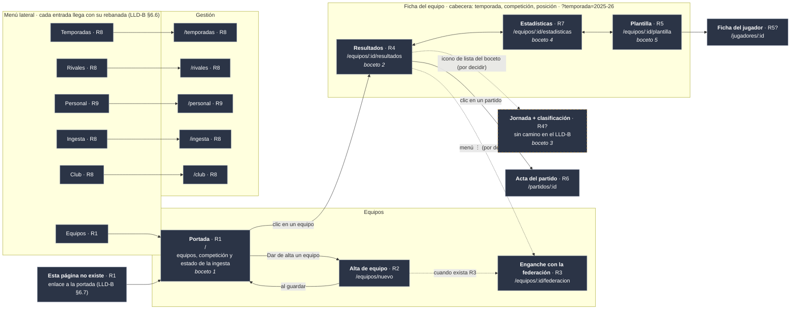

# Plan backoffice-001 · La web del club, rebanada a rebanada

> ⚠️ **BORRADOR DE TRABAJO, NO ES EL PLAN.** Copia del primer plan (2026-10-14), guardada el 2026-10-15 como
> material de partida. El plan de verdad, [Plan backoffice-001](./Plan%20backoffice-001.md), se rehace desde
> cero revisando pantalla por pantalla con el desarrollador. No ejecutar nada desde este fichero.

> Abierto el **2026-10-14**, con el [ADR](../docs/ADR-Backoffice-001.md) cerrado el 2026-10-12, el
> [LLD](../docs/Backoffice%20LLD-001.md) cerrado el 2026-10-14 (§1–§11), la ingesta corriendo sola en el Mac
> ([Plan launchd-001](../backend/Plan%20launchd-001.md)) y **604 tests** en el backend.
>
> **Convención de remisiones.** `LLD-B §x` es el [LLD del backoffice](../docs/Backoffice%20LLD-001.md);
> `LLD §x`, el [LLD del backend](../docs/API_y_BBDD%20LLD-001.md); `ADR-B`, el
> [ADR del backoffice](../docs/ADR-Backoffice-001.md); `D-nn`, la
> [bitácora de decisiones](../docs/API_y_BBDD%20LLD-Anexo-Decisiones-Disenho-001.md); `H-nn`, la
> [auditoría 002](../backend/Plan%20de%20auditor%C3%ADa-002.md); y «el borrador», el
> [borrador inicial](../docs/backoffice_initial_draft.md). Los pasos de **este** fichero van como `W-n`, `E-n`,
> `R1.n`, `R2.n`…, y las decisiones pendientes como `DBO-n`.
>
> **Este fichero es plan y registro a la vez.** Un paso sin renglón en §6 no está hecho.

---

## 0. Qué entrega este plan

**La web del backoffice**, construida **una pantalla cada vez, con las peticiones al servidor que esa
pantalla necesita** (el borrador, §2). Contesta a la pregunta que el borrador dejaba abierta (§4): el
backoffice **tiene plan propio**, y sus unidades son **rebanadas**, no fases.

El plan tiene dos alturas, a propósito:

| Qué | Cuánto detalle | Por qué |
|---|---|---|
| **El mapa de rebanadas** (§4) | Todas, con su orden y las operaciones del catálogo que activa cada una | Para ver el camino entero y que nadie active una operación fuera de su sitio |
| **Las fichas y los pasos** (§5) | Solo los de lo que se va a hacer ya: el andamiaje (W y E) y las rebanadas **1 y 2** | Lo pide el LLD-B §E.1: la ficha de cada pantalla **se escribe cuando toca hacerla**, porque cada rebanada enseña algo que cambia la siguiente |

**Al cerrar cada rebanada se escribe aquí la ficha de la siguiente**, antes de empezarla.

**Lo que se tiene al terminar las rebanadas 1 y 2:** la web arranca en `celtic-castilla.localhost:5173`,
enseña los equipos del club con su competición y el estado de la ingesta, y permite dar de alta un equipo
nuevo. Todo con sus escenarios BDD en verde contra un servidor de pruebas real, la accesibilidad comprobada
en los dos modos, y lo que el servidor necesitaba, hecho con el método del backend.

---

## 1. Lo que ya está decidido y NO se vuelve a discutir

Está escrito en otros sitios; aquí va solo la lista, para que una sesión nueva no lo reabra.

| Qué | Dónde |
|---|---|
| Una pantalla con sus peticiones cada vez, no «todo el servidor y luego toda la web» | El borrador, §2 |
| **El inicio de sesión, al final.** Mientras tanto, web y servidor en local, con el club sacado de la dirección | El borrador, §3 · LLD-B §12 |
| Vue + TypeScript, PrimeVue, descripciones de los datos generadas del catálogo, dos máquinas en Fly.io | ADR-B, decisiones 1–5 |
| Pruebas de piezas con Vitest y escenarios BDD (Playwright + Cucumber) contra el servidor real, **sin simulacros**, con axe en cada escenario | ADR-B, decisión 6 · LLD-B §11 |
| Carpetas, prefijo `/api/v1`, qué se recuerda y dónde, los cuatro estados de toda pantalla, errores, formularios, mapa de pantallas, tema, accesibilidad | LLD-B §1–§10 |
| **El catálogo (`openapi.yaml`) es la fuente de verdad**, y el `filter` del generador es el alcance entregado del servidor | `D-65`, `D-69` |
| Lo que trae la federación se corrige, pero no se crea ni se borra | `D-21`, LLD §5.1, LLD-B §7 |

---

## 2. Lo que decide el desarrollador, y con qué evidencia delante

Cada decisión lleva **el comando para verlo uno mismo** antes de elegir. Ninguna bloquea el andamiaje (W y E):
`DBO-1` y `DBO-2` se deciden **antes de `R1.3`**; `DBO-3` y `DBO-4`, **antes de abrir la rebanada 2**; `DBO-5`,
**antes de `E-6`**.

### `DBO-1` · ¿Cómo sabe la portada en qué competición juega cada equipo?

**Lo que pasa.** La bitácora dice que la portada es **una sola petición**: `GET /teams?seasonId=` devolviendo
cada equipo **con sus competiciones** (`D-89`, «Consecuencia buena»; LLD §9.12). **Pero el catálogo no lo
dice.** `TeamResponse` no tiene ningún campo de competición, así que hoy esa lista sale **sin** la columna
principal de la portada. El dato sí existe en la base, en la inscripción (`team_registrations`, `D-68`); lo
que falta es el camino para leerlo.

**Cómo verlo:**

```sh
# 1. En el catálogo: ningún campo de competición dentro de TeamResponse (no imprime nada)
awk '/^    TeamResponse:/,/^    RegisterTeamRequest:/' backend/Sources/APIContract/openapi.yaml | grep -i competition

# 2. En la base de trabajo: el dato está (también se ve en TablePlus)
docker exec backend-db-1 psql -U tfm -d tfm -c 'select s.label, t.category, t.letter, c.division_label, c.group_label
  from "club_celtic-castilla".team_registrations r
  join "club_celtic-castilla".teams t on t.id = r.team_id
  join "club_celtic-castilla".seasons s on s.id = r.season_id
  left join "club_celtic-castilla".competitions c on c.id = r.competition_id'
# → 2026/27 · alevin A · PRIMERA ALEVIN · Grupo 8   y   2026/27 · cadete B · PRIMERA CADETE · Grupo 4
```

| Opción | Cómo queda | A favor | En contra |
|---|---|---|---|
| **a.** `TeamResponse` gana `competitionIds` (lista), que **solo se rellena** cuando se pide con `?seasonId=`. La web pide además `GET /competitions?seasonId=` y los junta | **Dos peticiones**, siempre dos, sea cual sea el número de equipos | Cambio pequeño en el catálogo. Cada competición viaja **una vez** aunque la jueguen el A y el B. El estado de la ingesta sigue viviendo en la competición, como dijo `D-89` | Un campo que vale distinto según cómo se pidió. Juntar dos listas en la web (poca cosa: es buscar por `id`) |
| **b.** `TeamResponse` gana `competitions` con la competición **entera dentro**, solo con `?seasonId=` | **Una** petición, lo que dijo `D-89` | Lo más cómodo para la web y para las apps del móvil | La misma competición repetida dentro de cada equipo que la juega. Un equipo de la respuesta lleva dentro otra entidad entera, con su estado de ingesta: más superficie que mantener en el catálogo |
| **c.** Una operación nueva, solo para la portada (p. ej. `GET /team-registrations?seasonId=`) | **Una** petición, con una forma hecha a medida | No toca `TeamResponse` | Una operación más en un catálogo que se declaró completo, y hecha para **una** pantalla |

**Propuesta: (a).** Es la que menos cambia el catálogo y la única en la que el estado de la ingesta de cada
competición se lee en un solo sitio. Dos peticiones fijas no son el problema que `D-89` evitaba: aquello era
**una por equipo**. Sea cual sea la elección, **se escribe como entrada nueva de la bitácora** (o como
enmienda de `D-89`) y se corrige la frase de `D-89` que daba esto por hecho.

### `DBO-2` · ¿Cómo se lee el estado de la ingesta de una competición? — H-58

**Lo que pasa.** La portada enseña, por cada competición, si la ingesta va bien (`ingestionHealth`: `ok`,
`failing`, `stale`, `never`). La regla está escrita (`D-89`) pero **nunca se ha programado**, porque
`/competitions` aún no se sirve. Y desde que hay **tres clases de pasada** —calendario, clasificación y
goleadores— y una fila que **transita** (`accepted`, `D-96`), «la última pasada» ya no es una sola cosa. La
auditoría dejó cinco preguntas para esta rebanada (H-58), que se contestan **con la pantalla delante**:

1. Qué se enseña de una pasada `accepted` vieja (pedida y que no cerró).
2. De qué clase es «la última pasada»: ¿la peor de las tres, la de calendario…?
3. Por qué fecha se ordena: cuándo empezó o cuándo terminó.
4. Dónde cae la fila adoptada, que conserva la hora en que se pidió.
5. A partir de cuántos minutos una `accepted` es sospechosa (medido: con la federación sana cierra en 1–5 s).

**Cómo verlo, y es un caso real de esta semana:**

```sh
docker exec backend-db-1 psql -U tfm -d tfm -c 'select c.age_category, r.kind, r.outcome, r.started_at, r.finished_at
  from "club_celtic-castilla".ingestion_runs r
  join "club_celtic-castilla".competitions c on c.id = r.competition_id
  order by r.started_at desc limit 8'
```

Lo que sale hoy (2026-10-14): el **domingo 11** a las 21:30 las tres clases fueron bien en las dos
competiciones; el **lunes 12** por la mañana, el **calendario falló** en las dos (es el despertar sin red de
`L-L.6`) y la clasificación y los goleadores no llegaron a intentarse. Si «la última» fuera «la última de
cualquier clase», la portada diría **`failing`**; si fuera «la peor de las tres», también; si mirara solo la
clasificación, diría **`ok`**. Es la pregunta 2 con datos de verdad.

**Propuesta para la pregunta 2, la que más pesa:** `failing` si **la última pasada de cualquiera de las tres
clases** falló —lo que F7 ya apuntaba como «probablemente»—. Las otras cuatro se contestan en `R1.2` con la
misma consulta delante. Lo que se decida **se escribe en `D-89`** (enmienda) y **cierra H-58**.

### `DBO-3` · ¿De dónde sale la temporada en un club que aún no tiene ninguna? — antes de la rebanada 2

**Lo que pasa, encontrado al escribir este plan.** El alta de equipo **exige** una temporada (`seasonId`
obligatorio en `CreateTeamRequest`, para que el equipo no quede invisible: `D-68`). Pero hoy una temporada solo
nace de dos maneras: **enganchando un equipo** a la federación (que crea la temporada en cascada, `D-67`) o con
`POST /seasons`, que pide el **código de temporada de la federación** (`federationSeasonId`, el `21` de
`temporada=21` en la URL de la RFFM), algo que el personal de un club no tiene por qué conocer. Así que **un
club recién creado no puede dar de alta su primer equipo desde la web**: para engancharlo necesita el equipo, y
para el equipo necesita la temporada.

**Cómo verlo:**

```sh
# El alta exige seasonId…
awk '/^    CreateTeamRequest:/,/^    FederationLinkPreviewRequest:/' backend/Sources/APIContract/openapi.yaml | grep -n 'required'
# …y crear una temporada exige el código de la federación
awk '/^    CreateSeasonRequest:/,/^    UpdateSeasonRequest:/' backend/Sources/APIContract/openapi.yaml | grep -n 'required'
```

No se propone salida todavía: hay que mirarla con calma, y quizá sea del servidor. Lo que sí está claro es
**cuándo deja de poder esperar**: antes de abrir la rebanada 2. En el club de trabajo no se nota, porque ya
tiene 2025/26 y 2026/27.

### `DBO-4` · ¿La rebanada 2 incluye inscribir en otra temporada?

El borrador dice «alta de equipo: `POST /v1/teams` **+ inscripciones**». Pero el alta **ya inscribe** al equipo
en su temporada al crearlo, y el enganche inscribe en su competición. La inscripción aparte
(`PUT /teams/{id}/registrations/{seasonId}`) sirve para **otra** temporada —el paso de cada verano— y para
corregir.

**Propuesta: dejarla fuera de la rebanada 2** y llevarla a la de temporadas (§4, rebanada 8), que es donde se
hace el paso de verano. Dos razones: la rebanada 2 queda con **una** escritura nueva, y la guarda de identidad
del equipo frente a la competición (`Team.requireIdentityMatches`, el agujero de `C-A.3`) solo entra en juego
cuando la inscripción lleva competición, que el alta no lleva.

### `DBO-5` · ¿Cómo se prueba el estado «cargando» sin simulacros?

El LLD-B §3.1 pide un escenario por cada uno de los cuatro estados, y el «cargando» dura milisegundos contra
un servidor rápido. El ADR-B prohíbe simular el servidor.

**Propuesta:** en ese escenario, Playwright **retiene** la respuesta real del servidor (`page.route` con
`route.fetch()` y una espera antes de `route.fulfill()`) **sin cambiar ni un byte**. El servidor contesta de
verdad; solo se le pone una pausa en el camino. Es terreno del desarrollador —es una decisión de pruebas— y
afecta a todas las pantallas, así que se decide una vez, antes de `E-6`, y si se acepta sube al LLD-B §11.

---

## 3. El método

### 3.1 El bucle, de fuera hacia dentro

Cada rebanada empieza **por el escenario**, que es lo que el usuario verá, y acaba **por el escenario**:

1. **Los escenarios de la ficha, escritos y en rojo.** Rojo **porque falta la pantalla**, no porque el arnés
   no arranque: un escenario que falla al levantar el servidor no ha probado nada (H-07).
2. **Lo que le falta al servidor**, con el método del backend de siempre (Plan de desarrollo §5.1): prueba →
   esqueleto que devuelve **mal a propósito** → rojo de aserción → implementación → mutación con
   `Tools/Mutate`. `REQUIRE_DB=1 swift test`, nunca `swift test` a secas.
3. **Las piezas de la web, con Vitest**, con el mismo bucle: prueba → **esqueleto que pinta mal a
   propósito** (la pieza existe y se monta, pero enseña otro texto) → rojo de aserción → implementación.
   Un `Cannot find module` no es un rojo: demuestra que el fichero no estaba, no que la prueba cace nada.
4. **La pantalla**, que junta las piezas y pide los datos.
5. **Los escenarios en verde, con axe en los dos modos** (LLD-B §9.4).
6. **La revisión a mano** del LLD-B §10.7 *b*, con la lista en el PR.

### 3.2 Los avisos

1. **`REQUIRE_DB=1 swift test`** para todo lo del servidor (H-07).
2. **No parar el Postgres del desarrollador.** Los escenarios usan **su propio** servidor (puerto 8081) y su
   base (`tfm_test`); el «servidor caído» se prueba parando **ese**, nunca el del 8080 ni el contenedor.
3. **Un escenario que no pudo arrancar falla; nunca se salta** (ADR-B, decisión 6).
4. **Lo que se descubre y no venía en la ficha va en su propio commit**, y cada commit deja el árbol en verde
   por sí mismo.
5. **Si un cambio del servidor toca más de un *target* o cambia el catálogo, es mini-fase**, con su renglón
   en el [Plan de desarrollo](../docs/Plan%20de%20desarrollo-001.md) (regla 2 de la auditoría). Las de las
   rebanadas 1 y 2 ya están listadas en sus fichas.
6. **Si sale una regla que vale para todas las pantallas, sube al LLD-B**, en su apartado y en commit aparte
   (LLD-B §E.1).

### 3.3 La plantilla del prompt de entrada

```
Ejecuta el bloque <X> del plan del backoffice en `backoffice/Plan backoffice-001.md`.

Lee §0 a §3 y §6 de ese fichero, y el «Leer antes» de tu bloque.

Cinco límites:
  1. De fuera hacia dentro (§3.1): escenario en rojo, servidor con su ciclo TDD,
     piezas con su ciclo TDD, pantalla, escenario en verde.
  2. No amplíes el alcance: lo que descubras que falta va a §8.
  3. Lo decidido en §1 no se rediscute; lo de §2 lo decide el desarrollador.
  4. `REQUIRE_DB=1 swift test` en el servidor; no pares el Postgres del desarrollador.
  5. Explica en lenguaje llano: quien revisa es ingeniero de pruebas, no desarrollador web.

Al terminar: pon tus pasos al día en §6.
```

---

## 4. El mapa de rebanadas

**Hoy el servidor tiene activas 6 de las 83 operaciones del catálogo.** Cada rebanada activa las suyas, y una
operación **solo entra en el `filter` con la rebanada que la usa**. El orden de 3 en adelante es un
**borrador**: se confirma al cerrar la anterior.

**El mapa de pantallas, con la rebanada que construye cada una.** Es el del LLD-B §6.1 en versión de
escritorio: un menú lateral fijo en vez de la flecha «atrás» de los bocetos del móvil. **Al cerrar cada
rebanada, sus pantallas pasan a la clase `hecha`**; la que esté en marcha, a `enCurso`.



Colores: **verde** = hecha · **ámbar** = en curso · **gris** = pendiente · **borde discontinuo** = sale en un
boceto pero el LLD-B no le da camino. **Flecha discontinua** = navegación aún sin decidir. Un `?` tras la
rebanada = asignación probable, se confirma al escribir su ficha.

| # | Pantalla (LLD-B §6.1) | Operaciones que activa | Estado |
|---|---|---|---|
| **W + E** | **Andamiaje**: la web vacía que arranca, y el arnés de los escenarios | — (usa `getClub`, ya activa) · la dirección de la federación, configurable | Detallado en §5 |
| **1** | **Portada** `/` — los equipos del club con su competición y el estado de la ingesta | `listSeasons`, `listTeams`, `listCompetitions` (según `DBO-1`) | Detallado en §5 |
| **2** | **Alta de equipo** `/equipos/nuevo` | `createTeam` (+ lo que diga `DBO-3`) | Detallado en §5 |
| 3 | **Enganche** `/equipos/:id/federacion` — pegar la URL del calendario | Ninguna nueva: `previewFederationLink` y `linkTeamToFederation` ya están activas (F10) · `getTeam` | Borrador |
| 4 | **Ficha del equipo, Resultados** `/equipos/:id/resultados` | `listRounds`, `listMatches`, `getStanding` | Borrador |
| 5 | **Plantilla** `/equipos/:id/plantilla` | `listPlayers`, `createPlayer`, `updatePlayer`, `deletePlayer`, `getPlayer` (y las fotos, aparte) | Borrador |
| 6 | **Acta del partido** `/partidos/:id` | `getMatch`, `listAppearances`/`create…`/`update…`/`delete…`, igual para `Goal` y `Card` | Borrador |
| 7 | **Estadísticas** `/equipos/:id/estadisticas` | `listLeagueScorers` y lecturas ya activas | Borrador |
| 8 | **Gestión**: temporadas, rivales, ingesta, club | `Season` (resto), `registerTeamInSeason` (`DBO-4`), `OpponentClub`, `updateCompetition`, `updateClub`, `listIngestionRuns`, `triggerIngestion` (ya activas) | Borrador; puede partirse |
| 9 | **Personal** `/personal` | `StaffMember`, `StaffPosition`, `StaffAssignment`, `listVerbs` | Borrador |
| 10 | **Inicio de sesión + despliegue**: Supabase Auth, Fly.io, el CI y la ingesta programada de verdad | `getMe`, `inviteStaffMember` | Borrador · llega todo junto (el borrador, §3) |

**Por qué el enganche va tercero y no más tarde:** sin él, un equipo dado de alta en la rebanada 2 se queda
**sin competición** en la portada, y no hay nada más que hacer con él. Y es barato: el servidor ya lo tiene.

**Lo que aún no tiene sitio**, a propósito: ausencias (`Absence`), tramos de sanción
(`CompetitionSanctionBracket`), equipos que se reclaman o se liberan (`claimTeam`, `releaseTeam`), borrar y
archivar temporadas. Se colocan cuando una ficha los pida.

---

## 5. Los bloques

El orden es **W → E → 1 → 2**. W y E se pueden solapar, pero E necesita que la web arranque.

### Bloque W · La web vacía que arranca

**Leer antes:** LLD-B §1 (carpetas, las tres partes, el prefijo), §2.3 (qué se guarda) y §9 (tema).

**No son ciclos TDD**, salvo `W-6`: son pasos con su comprobación escrita.

| Paso | Qué | Comprobación |
|---|---|---|
| `W-1` | Crear el proyecto en `backoffice/` con Vite, Vue y TypeScript, con las carpetas del LLD-B §1.1. Fijar la versión de Node (`.nvmrc`). Quitar `.gitkeep` | `npm run dev` arranca y `http://celtic-castilla.localhost:5173` enseña una página |
| `W-2` | **Las descripciones generadas**: `openapi-typescript` fabrica `src/api/schema.d.ts` del catálogo al arrancar y al fabricar. Fuera del repositorio (`.gitignore`) | El fichero aparece tras `npm run dev`; con un camino que no existe en el catálogo (`client.GET('/equiposs')`), `npm run typecheck` **falla** |
| `W-3` | **La conexión**: `src/api/client.ts` con `openapi-fetch`, comienzo fijo `/api/v1`, límite de **30 s** (LLD-B §3.4) y cancelación al salir de la pantalla (§3.2). El recepcionista de Vite según LLD-B §1.3 | Con `Run serve` en el 8080: `curl -s http://celtic-castilla.localhost:5173/api/v1/club` devuelve el club. `curl -s http://celtic-castilla.localhost:8080/api/v1/club` da «no encontrado» (§1.3) |
| `W-4` | **El revisor de código** (ESLint) con dos reglas que importan: `components/` no puede usar `api/` (LLD-B §1.2) y las reglas de accesibilidad de Vue (ADR-B, decisión 6) | Un fichero de prueba que las incumple da **error**; se borra después |
| `W-5` | **PrimeVue** con el tema Aura, los textos en español, la semana desde el lunes, `lang="es"`, y el modo claro/oscuro aplicado **antes de pintar** (LLD-B §9.1–§9.5). Los colores, todavía los de Aura: se miden de los bocetos en `R1.8` | Abrir con el sistema en oscuro: no hay destello blanco. Un calendario de PrimeVue sale en español y empieza en lunes |
| `W-6` | **Vitest** con Testing Library, y su primera prueba de verdad: `src/theme/format.ts` con la fecha sin hora (LLD-B §9.7), ejecutada **con el navegador en otra zona horaria** (`TZ=America/New_York`) | **Ciclo TDD**: rojo de aserción con un formateo que pasa por `new Date()`, verde con el que lee el texto |
| `W-7` | **Las órdenes del día a día**, en `package.json` y en el README de `backoffice/`: arrancar, probar, revisar, fabricar | Cada orden del README se ejecuta tal cual y hace lo que dice |
| `W-8` | **Las reglas del catálogo al alcance de Ajv** (LLD-B §5.1): que la web pueda leer `openapi.yaml` al fabricar, con el Ajv de la versión de reglas que usa OpenAPI 3.1 (`ajv/dist/2020`) | Una prueba de Vitest valida `{}` contra `CreateTeamRequest` y recibe los tres campos obligatorios que faltan, cada uno con su nombre |

### Bloque E · El arnés de los escenarios

**Leer antes:** LLD-B §11 entera; ADR-B, decisión 6; `backend/README.md` §2 (variables del servidor).

| Paso | Qué | Comprobación |
|---|---|---|
| `E-1` | **Servidor:** la dirección de la federación, configurable con una variable de entorno; sin ella, `https://www.rffm.es` (LLD-B §E.2). Hoy está fija en `backend/Sources/Federation/RFFMEndpoints.swift:13`. **Es código del servidor**: ciclo TDD y mutación. Es un solo *target* (`Federation`) más la raíz de composición, así que va con renglón propio en el Plan de desarrollo | Rojo de aserción → verde; `REQUIRE_DB=1 swift test` en verde; sin la variable, una ingesta contra la RFFM real sigue funcionando |
| `E-2` | **Comprobar lo que el LLD-B §11.1 dejó pendiente:** que el servidor arranca contra la base de pruebas en otro puerto (`DB_NAME=tfm_test API_PORT=8081`) | `curl` al 8081 contesta; el del 8080 sigue como estaba |
| `E-3` | **La federación falsa** (LLD-B §11.3): un servidor pequeño que devuelve las respuestas grabadas de `backend/Tests/*/Fixtures/` según la dirección que se le pida | Con el servidor de pruebas apuntando a ella, `ingest` sobre un club de pruebas trae los partidos grabados |
| `E-4` | **Cucumber + Playwright** con el arranque del LLD-B §11.1: servidor en 8081, web en 5174 apuntando al 8081, **fallo inmediato** y con nombre si alguno no arranca, barrido de restos `bo_` al empezar, `KEEP_TEST_DATA=1` | Con el 8081 ocupado, la pasada falla en segundos diciendo cuál. Sin nada ocupado, un escenario de humo («la web arranca») en verde |
| `E-5` | **Un club por escenario** con el prefijo `bo_` (LLD-B §11.2), creado con `provision-tenant` usando el **binario ya compilado**, no `swift run` (que comprueba la compilación cada vez). **Medir** cuánto tarda | Dos escenarios seguidos no se ven los datos; la cifra, apuntada en §6. Si pasa de unos segundos por escenario, se para y se decide con el número |
| `E-6` | **axe en los dos modos** al final de cada escenario (LLD-B §9.4), y lo que decida `DBO-5` para el estado «cargando» | Un escenario de prueba con una imagen sin texto alternativo **falla**; se borra después |

### Rebanada 1 · La portada

**Leer antes:** LLD-B §3 (los cuatro estados), §4 (errores), §6 (mapa), §8 (el club) y §10; `D-68` (con su
enmienda) y `D-89`; H-58; las decisiones `DBO-1` y `DBO-2`, **ya tomadas**.

#### La ficha

| | |
|---|---|
| **Camino** | `/`, con la temporada detrás de `?` (`/?temporada=2025-26`). Sin ella, la que el servidor marca con `isCurrent` (LLD-B §6.5) |
| **Qué enseña** | El **marco**: nombre corto y escudo del club en la cabecera, el título de la pestaña («Equipos · CD Ejemplo»), «Saltar al contenido» y el menú con una sola entrada, «Equipos» (LLD-B §6.6). Y la **tabla de equipos propios** inscritos en esa temporada, con una fila por equipo y competición: **equipo**, **competición**, **estado de la ingesta** y **última sincronización** |
| **El estado de la ingesta** | Con **palabra y símbolo**, nunca solo color (LLD-B §9.4): «Al día», «Falla», «Sin actualizar desde hace más de una semana», «Aún no sincronizada». Con la fecha del último intento cuando no coincide con la del último éxito (`D-89`) |
| **Equipo sin enganchar** | La fila sale igual, con la competición «Sin enganchar a la federación». Es el estado normal de un equipo recién dado de alta |
| **Selector de temporada** | Las temporadas del club; al cambiar, cambia la dirección (LLD-B §2.2) |
| **Acciones** | Ninguna en esta rebanada: es solo lectura. El botón «Dar de alta un equipo» llega con la rebanada 2 (LLD-B §6.6) |
| **Cargando** | «Cargando equipos…», anunciado al lector de pantalla sin mover el foco (LLD-B §10.3) |
| **Vacío** | «Este club aún no tiene equipos en la temporada 2026/27». Sin enlace todavía: el alta no existe |
| **Error** | En el hueco de la tabla, con *Reintentar* solo si el fallo puede ser pasajero (LLD-B §4.4) |
| **Sin club** | Las cuatro páginas enteras del LLD-B §8.3 |
| **Temporada que no existe** | `?temporada=1999-00` → el estado de error de la pantalla, con un enlace a la temporada en curso |
| **Peticiones** | `getClub` (ya activa), `listSeasons`, `listTeams?isOwn=true&seasonId=…` y, según `DBO-1`, `listCompetitions?seasonId=…` |

#### Lo que le falta al servidor

| Qué | Por qué | Es mini-fase |
|---|---|---|
| La lista cerrada de códigos de error en el catálogo (`enum` de `code`, paso 1 del LLD-B §4.5 *b*) | Que a la web le falte un mensaje **no compile** | No: solo catálogo |
| El formato `<campo>: <motivo>` de `detail`, escrito en el catálogo (LLD-B §4.5 *a*) | La web lo lee; tiene que depender de algo escrito | No: solo catálogo |
| El cambio de `DBO-1` en el catálogo | La columna «competición» | Sí, junto con lo siguiente |
| `listSeasons`, `listTeams` (con la unión de `D-68`) y `listCompetitions` con `lastIngestionAt` e `ingestionHealth` calculados según `DBO-2` | Las tres lecturas de la portada | **Sí**: catálogo, Aplicación, Persistencia y HTTP |

#### Los pasos

| Paso | Qué | Comprobación |
|---|---|---|
| `R1.1` | **Los escenarios**, en `e2e/features/portada.feature` (ver la lista abajo), en rojo | Rojos **por la pantalla que falta**, con el arnés de E arrancando bien |
| `R1.2` | **`DBO-2`, las cinco preguntas de H-58**, contestadas con la consulta de §2 delante y escritas como enmienda de `D-89` | La enmienda en la bitácora; H-58 a «decidido» en la auditoría |
| `R1.3` | **El catálogo**: `enum` de `code`, formato de `detail`, cambio de `DBO-1`. Renglón de la mini-fase en el Plan de desarrollo | `npx @redocly/cli lint backend/Sources/APIContract/openapi.yaml` limpio; el servidor compila (las pruebas que leen un `code` fuera de la lista fallan: es lo buscado) |
| `R1.4` | **El `filter`** con las tres lecturas y sus **esqueletos que devuelven mal a propósito**, como en F10 (`C-0.1`) | `swift build` en verde y las tres rutas contestan con la forma del catálogo y datos equivocados |
| `R1.5` | **Los ciclos del servidor**: `listSeasons` (con `isCurrent`), `listCompetitions` (con el estado según `DBO-2`), `listTeams` (la unión de `D-68`, el filtro `isOwn` y lo de `DBO-1`). Cada `@Test` cita su `D-nn` | Rojo de aserción → verde en cada uno; catálogo de mutación; `REQUIRE_DB=1 swift test` en verde |
| `R1.6` | **Contra la base de trabajo, no solo en las pruebas** (lección de F6 y F8) | `curl -s 'http://celtic-castilla.localhost:8080/v1/teams?isOwn=true&seasonId=<2026/27>'` enseña el alevín A y el cadete B con su competición, y el estado sale como dice `DBO-2` sobre las pasadas reales del lunes 12 |
| `R1.7` | **La conexión de la web**: `errors.ts` con un mensaje por cada código de la lista (si falta uno, no compila) y la lectura del `detail` (LLD-B §4.1–§4.5) | Prueba de Vitest por familia de error; quitar un código de la tabla rompe `typecheck` |
| `R1.8` | **Los colores, medidos de los bocetos** (`docs/design-assets/mobile/1-Teams_Dashboard.png`) y escritos en `src/theme/` con nombre de significado y valor por modo (LLD-B §9.1–§9.2) | Los valores en el fichero, con de qué parte del boceto salió cada uno. El contraste AA lo comprueba axe en `R1.10` |
| `R1.9` | **El marco y la portada**: las piezas con Vitest (la fila de equipo, la etiqueta de estado, el selector de temporada) y las pantallas (`App.vue` con la carga del club, `screens/home/`) | Cada pieza con su ciclo: esqueleto que pinta mal → rojo de aserción → verde |
| `R1.10` | **Los escenarios en verde**, con axe en los dos modos | Toda la `portada.feature` en verde |
| `R1.11` | **La revisión a mano** (LLD-B §10.7 *b*): teclado, VoiceOver, zoom al 200 %, los dos modos | La lista marcada en el PR, con lo que se encontró |
| `R1.12` | **Cierre**: §6 de este fichero; H-58 cerrado; la regla general que haya salido, al LLD-B (commit aparte); `AGENTS.md`; y **la ficha de la rebanada 2 revisada** con lo aprendido | Los pasos de cierre de `AGENTS.md` («Al cerrar una fase»), del primero al quinto |

**Los escenarios de `portada.feature`**, como punto de partida (pasos en español, LLD-B §11.4):

```gherkin
Feature: Portada del club

  Scenario: Ver los equipos de la temporada en curso con su competición
  Scenario: Un equipo sin enganchar sale con «Sin enganchar a la federación»
  Scenario: Una competición cuya última pasada falló sale como «Falla»
  Scenario: Elegir otra temporada cambia la dirección y la tabla
  Scenario: Un club sin equipos en la temporada enseña el mensaje de vacío
  Scenario: Mientras llegan los datos se ve «Cargando equipos…»          # según DBO-5
  Scenario: Con el servidor de pruebas parado, el error ofrece Reintentar
  Scenario: Un club que no existe enseña la página entera «Este club no existe»
  Scenario: Una dirección sin club enseña cómo abrirla
  Scenario: Un camino que no existe enseña «Esta página no existe» con enlace a la portada
  Scenario: Al llegar a la portada, el título de la pestaña y el foco dicen dónde se está
```

Los `Given` de partidos y competiciones se preparan **enganchando y ejecutando la ingesta contra la federación
falsa** (LLD-B §11.3); los equipos y temporadas, por el servidor. Hasta que exista el alta (rebanada 2), el
equipo de los `Given` se crea con `seed-team`, como en F10: **herramienta, no contrato**.

### Rebanada 2 · El alta de equipo

**Leer antes:** LLD-B §5 (formularios), §4.3 (dónde sale cada error), §10.3 y §10.7 *a*; `D-66`; la
descripción de `createTeam` y de `CreateTeamRequest` en el catálogo; la nota de A-12 sobre lo que hereda la
rebanada 2 (auditoría 002); las decisiones `DBO-3` y `DBO-4`, **ya tomadas**.

**Esta ficha es provisional**: se revisa en `R1.12` con lo que enseñe la portada.

#### La ficha

| | |
|---|---|
| **Camino** | `/equipos/nuevo`. Se llega desde el botón «Dar de alta un equipo» de la portada y desde su mensaje de vacío |
| **Campos** | **Categoría**, **género**, **modalidad** (selectores, LLD-B §5.2), **letra** (opcional) y **temporada** (selector, con la vigente elegida). Los obligatorios con asterisco y la palabra (LLD-B §10.4) |
| **Un aviso a la vista** | Género y modalidad **no se pueden cambiar después** (`D-58`, `D-66`): se dice junto a esos campos, antes de guardar |
| **Antes de enviar** | Las reglas de `CreateTeamRequest` con Ajv, todas a la vez (LLD-B §5.1) |
| **Al guardar** | El botón se bloquea (LLD-B §3.3). Bien: aviso «Guardado» y **vuelta a la portada** en la temporada del equipo, donde aparece con «Sin enganchar». Cuando exista la rebanada 3, el destino natural será su enganche |
| **Errores del servidor** | `409` (ya hay un equipo igual) → aviso arriba, que no se va solo. `404` (la temporada ya no existe) → aviso arriba. `422` → junto a su campo (LLD-B §4.5 *a*). El formulario **no se vacía** |
| **Salir sin guardar** | Pregunta antes (LLD-B §5.5) |
| **Sin temporadas** | Lo que diga `DBO-3` |
| **Peticiones** | `listSeasons` (ya activa en la 1), `createTeam` y lo que diga `DBO-3` |

#### Lo que le falta al servidor

`createTeam`: el *handler* y su caso de uso, con la unicidad de la clave del equipo (`409`, LLD §3.5) y la
inscripción al nacer (`D-68`). **Lo que hereda de la auditoría y se comprueba al empezar:** que las escrituras
con rol elevado llevan su ancla `TODO(§7)` (H-66) y que la guarda de identidad está en el Dominio y no hay que
reescribirla (A-12). Es mini-fase: catálogo (`filter`), Aplicación, Persistencia y HTTP.

#### Los pasos (provisionales)

| Paso | Qué |
|---|---|
| `R2.1` | Los escenarios de `alta-equipo.feature`, en rojo |
| `R2.2` | Lo que diga `DBO-3`, si es del servidor |
| `R2.3` | `createTeam` en el `filter` con su esqueleto, y sus ciclos TDD |
| `R2.4` | Contra la base de trabajo: un alta por `curl`, y verla en la portada |
| `R2.5` | Las piezas del formulario (comprobación con Ajv, la lista de errores arriba con enlaces a cada campo, el aviso de salir sin guardar), con Vitest |
| `R2.6` | La pantalla, el botón de la portada y el enlace del vacío |
| `R2.7` | Los escenarios en verde, con axe en los dos modos |
| `R2.8` | La revisión a mano |
| `R2.9` | Cierre, como `R1.12`, y la ficha de la rebanada 3 escrita aquí |

```gherkin
Feature: Alta de equipo

  Scenario: Dar de alta un equipo y verlo en la portada sin enganchar
  Scenario: Dar de alta un equipo solo con el teclado                       # LLD-B §10.7 a
  Scenario: Al enviar sin categoría ni temporada, el foco va a la lista de errores y nombra las dos
  Scenario: Un equipo que ya existe da un aviso arriba y el formulario sigue relleno
  Scenario: Salir con cambios sin guardar pregunta antes
  Scenario: Mientras se guarda, el botón no se puede pulsar dos veces
```

---

## 6. Estado

| Bloque | Estado | Pasos | Fecha |
|---|---|---|---|
| **W** · La web vacía | ⏳ por empezar | 0/8 | — |
| **E** · El arnés | ⏳ por empezar | 0/6 | — |
| **1** · Portada | ⏳ por empezar | 0/12 | — |
| **2** · Alta de equipo | ⏳ ficha provisional | 0/9 | — |

| Decisión | Estado |
|---|---|
| `DBO-1` · La competición de cada equipo en la portada | ⏳ propuesta (a) — antes de `R1.3` |
| `DBO-2` · Cómo se lee el estado de la ingesta (H-58) | ⏳ propuesta para la pregunta 2 — antes de `R1.3` |
| `DBO-3` · La temporada de un club sin ninguna | ⏳ sin propuesta — antes de la rebanada 2 |
| `DBO-4` · La rebanada 2 sin inscribir en otra temporada | ⏳ propuesta: fuera — antes de la rebanada 2 |
| `DBO-5` · Cómo se prueba el «cargando» | ⏳ propuesta: retener la respuesta real — antes de `E-6` |

**Punto de partida: 604 tests en el backend, 0 en la web.**

---

## 7. Lo que este plan NO hace, para que nadie lo confunda con un olvido

- **Las fichas de las rebanadas 3 en adelante.** Se escriben al cerrar la anterior (§0).
- **El inicio de sesión, Fly.io y el CI.** Rebanada 10, todo junto (el borrador, §3). Mientras tanto **la API
  no tiene control de acceso** y solo se usa en local.
- **La mutación de las pruebas de la web** (StrykerJS). El ADR-B la dejó para más adelante.
- **Los dos pendientes del servidor «sin prisa»** del LLD-B §E.2: que `ProblemMiddleware` use la lista
  generada y devolver todos los errores de valor a la vez. Tienen sitio en el Plan de desarrollo cuando se
  hagan, no aquí.
- **Los dos datos de la federación que se pierden en la ingesta** (el borrador, §5): la jornada en curso es
  de la rebanada 4 si su ficha la pide; el código del campo, de las apps.
- **Comparar capturas de pantalla.** El ADR-B lo dejó fuera por ahora.

---

## 8. Lo que el plan descubra y no sea suyo

Va aquí, con una línea y a quién pertenece.

**De la redacción del plan (2026-10-14) · la frase de `D-89` sobre la portada da por hecho un campo que el
catálogo no tiene.** «Con §9.12(a) —`GET /teams?seasonId=` devolviendo cada equipo con sus competiciones—»:
ese «(a)» no existe en el §9.12 del LLD, y `TeamResponse` no lleva competiciones. **A quién pertenece**: a
`DBO-1`, que lo resuelve y corrige la frase.

**De la redacción del plan (2026-10-14) · un club nuevo no puede crear su primer equipo desde la web.** Es
`DBO-3`. **A quién pertenece**: a la rebanada 2, y puede que al diseño del servidor (LLD §5).
