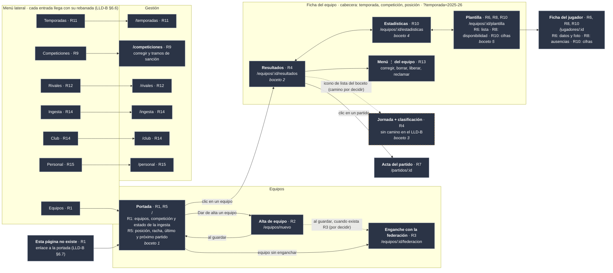

# Plan backoffice-001 · La web del club, rebanada a rebanada

> Rehecho desde cero el **2026-10-15**, revisando pantalla por pantalla con el desarrollador. El primer
> intento se borró el 2026-10-16; queda en la historia de git (commit `d6a16e6`).
>
> Parte de: el [ADR](../docs/ADR-Backoffice-001.md), cerrado el 2026-10-12; el
> [LLD](../docs/Backoffice%20LLD-001.md), cerrado el 2026-10-14 (§1–§11), con su
> [anexo de decisiones](../docs/Backoffice%20LLD-Anexo-Decisiones-Disenho-001.md); la ingesta corriendo sola en
> el Mac ([Plan launchd-001](../backend/Plan%20launchd-001.md)); y **604 tests** en el backend.
>
> **Convención de remisiones.** `LLD-B §x` es el [LLD del backoffice](../docs/Backoffice%20LLD-001.md) y
> `DW-nn`, su [anexo de decisiones](../docs/Backoffice%20LLD-Anexo-Decisiones-Disenho-001.md); `LLD §x`, el
> [LLD del backend](../docs/API_y_BBDD%20LLD-001.md) y `D-nn`, su
> [bitácora de decisiones](../docs/API_y_BBDD%20LLD-Anexo-Decisiones-Disenho-001.md); `ADR-B`, el
> [ADR del backoffice](../docs/ADR-Backoffice-001.md); `H-nn`, la
> [auditoría 002](../backend/Plan%20de%20auditor%C3%ADa-002.md); y «el borrador», el
> [borrador inicial](../docs/backoffice_initial_draft.md).
>
> **Este fichero es plan y registro a la vez.** Un paso sin su renglón de estado no está hecho.

---

## 1. Objetivos

**Construir la web del backoffice una pantalla cada vez, junto con las peticiones al servidor que esa pantalla
necesita** (el borrador, §2). No se hace «todo el servidor y luego toda la web»: cada unidad de trabajo es una
**rebanada**, que entrega una pantalla funcionando de punta a punta.

Hoy el servidor sirve **6 de las 83 operaciones** del catálogo. Cada rebanada activa las suyas, y una operación
**solo se activa con la rebanada que la usa**.

**Cada rebanada se da por terminada cuando:**

- la pantalla hace lo que dice su ficha, en sus cuatro estados (cargando, error, vacío y con datos; LLD-B §3.1);
- sus escenarios BDD están en verde contra un servidor de pruebas real, **sin simulacros**;
- la accesibilidad está comprobada, automáticamente en los dos modos (claro y oscuro) y a mano (LLD-B §10.7);
- lo que el servidor necesitaba está hecho con el método del backend, con sus pruebas y su mutación.

**Lo que queda fuera hasta el final:** el inicio de sesión, la publicación en Fly.io y el CI. Mientras tanto,
web y servidor funcionan en local, con el club sacado de la dirección (el borrador, §3; LLD-B §12).

---

## 2. Cómo se trabaja

### 2.1 Qué va en este plan y qué no

| Qué | Dónde |
|---|---|
| **Qué se hace, en qué orden y cómo se comprueba**: el mapa, la ficha de cada pantalla, los pasos y su estado | Aquí |
| Una regla que vale para **todas** las pantallas | LLD-B, en su apartado y en un commit aparte (LLD-B §E.1) |
| El **porqué** de una decisión que solo afecta a la web | Anexo de decisiones del backoffice (`DW-nn`) |
| El **porqué** de una decisión que cambia **lo que responde el servidor**, aunque la pida una pantalla | Bitácora del backend (`D-nn`), porque las apps del móvil usarán las mismas respuestas |

Cuando una pantalla obliga a decidir algo, el plan dice **qué paso bloquea** y enlaza la entrada donde se
discute; la discusión no se copia aquí.

### 2.2 La ficha de cada pantalla se escribe cuando toca hacerla

Antes de empezar una rebanada se escribe su ficha: qué enseña, qué peticiones usa, qué acciones permite, cómo
se ve en cada uno de sus cuatro estados, adónde lleva después de guardar y qué le falta al servidor (LLD-B
§E.1). **Se revisa con el desarrollador antes de construir nada.** Cada rebanada enseña algo que puede cambiar
la siguiente, así que la ficha de la siguiente se repasa al cerrar la anterior.

### 2.3 El bucle, de fuera hacia dentro

Cada rebanada empieza **por el escenario**, que es lo que el usuario verá, y acaba **por el escenario**:

1. **Los escenarios de la ficha, escritos y en rojo.** Rojo **porque falta la pantalla**, no porque el arnés
   no arranque: un escenario que falla al levantar el servidor no ha probado nada (H-07).
2. **Lo que le falta al servidor**, con el método del backend de siempre (Plan de desarrollo §5.1): prueba →
   esqueleto que devuelve **mal a propósito** → rojo de aserción → implementación → mutación con
   `Tools/Mutate`. `REQUIRE_DB=1 swift test`, nunca `swift test` a secas.
3. **Las piezas de la web, con Vitest**, con el mismo bucle: prueba → **esqueleto que pinta mal a
   propósito** (la pieza existe y se monta, pero enseña otro texto) → rojo de aserción → implementación.
   Un `Cannot find module` no es un rojo: demuestra que el fichero no estaba, no que la prueba cace nada.
4. **La pantalla**, que junta las piezas y pide los datos.
5. **Los escenarios en verde, con axe en los dos modos** (LLD-B §9.4).
6. **La revisión a mano** del LLD-B §10.7 *b*, con la lista en el PR.

### 2.4 Los avisos

1. **`REQUIRE_DB=1 swift test`** para todo lo del servidor (H-07).
2. **No parar el Postgres del desarrollador.** Los escenarios usan **su propio** servidor (puerto 8081) y su
   base (`tfm_test`); el «servidor caído» se prueba parando **ese**, nunca el del 8080 ni el contenedor.
3. **Un escenario que no pudo arrancar falla; nunca se salta** (ADR-B, decisión 6).
4. **Lo que se descubre y no venía en la ficha va en su propio commit**, y cada commit deja el árbol en verde
   por sí mismo.
5. **Si un cambio del servidor toca más de un *target* o cambia el catálogo, es mini-fase**, con su renglón
   en el [Plan de desarrollo](../docs/Plan%20de%20desarrollo-001.md) (regla 2 de la auditoría).
6. **Explicar en lenguaje llano**: quien revisa es ingeniero de pruebas, no desarrollador web.

---

## 3. El mapa de pantallas

Es el del LLD-B §6.1 en versión de escritorio, con un menú lateral fijo en vez de la flecha «atrás» de los
bocetos del móvil (`docs/design-assets/mobile/`), **revisado contra el catálogo el 2026-10-16**: cada operación
del catálogo tiene su pantalla, y de ahí salieron la pantalla de Competiciones y el menú ⋮ del equipo. Cada
pantalla lleva la rebanada (§4) que la construye; **una pantalla puede llegar en varias rebanadas**, como la
portada, que empieza sencilla y se completa cuando el servidor sirve partidos y clasificación. El detalle de
cada pantalla se revisa al escribir su ficha (§2.2).

**Al cerrar cada rebanada, lo que construye pasa a la clase `hecha`**; lo que esté en marcha, a `enCurso`.

Colores: **verde** = hecha · **ámbar** = en curso · **gris** = pendiente · **borde discontinuo** = sale en un
boceto pero el LLD-B no le da camino. **Flecha discontinua** = navegación aún sin decidir.

---

## 4. Las rebanadas

**Leyenda de los endpoints:**

| Marca | Qué significa |
|---|---|
| *(sin marca)* | Está descrito en el catálogo, pero **no programado**: hay que hacerlo en las cuatro capas del servidor (catálogo activado, Aplicación, Persistencia y HTTP) |
| ● | Ya programado y activo en el servidor |
| ⚠️ | Hay que **cambiar su descripción en el catálogo** antes de programarlo; la celda dice qué le falta |
| 🆕 | **No existe en el catálogo**: hay que diseñarlo desde cero |

| Rebanada | Pantalla afectada | Endpoints afectados |
|---|---|---|
| **0** · Andamiaje | Ninguna: la web arranca con una página en blanco, y el arnés de los escenarios (§5) | Ninguno nuevo · en el servidor, la dirección de la RFFM pasa a ser configurable (`R0.8`) |
| **1** · Portada base | Marco (cabecera, menú, «página no existe») · Portada: equipos, competición y estado de la ingesta | `getClub` ● · `listSeasons` · `listTeams` ⚠️ — su respuesta no dice en qué competición juega cada equipo · `listCompetitions` |
| **2** · Alta de equipo | Alta de equipo · Portada: botón «Dar de alta» y enlace desde el vacío | `createTeam` · ⚠️ falta decidir cómo nace la primera temporada de un club: `createSeason` (rebanada 11) pide el código de temporada de la federación, que el club no tiene por qué conocer |
| **3** · Enganche | Enganche · Portada: el equipo pasa a tener competición | `getTeam` · `previewFederationLink` ● · `linkTeamToFederation` ● |
| **4** · Resultados | Ficha del equipo: cabecera y pestaña Resultados · Jornada + clasificación | `listRounds` · `getRound` · `listMatches` · `getStanding` |
| **5** · Portada del boceto | Portada: posición, racha, último resultado y próximo partido | Los de la 4, pedidos equipo por equipo · o 🆕 una petición que lo junte (por decidir) |
| **6** · Plantilla | Plantilla: lista y gestión, sin cifras · Ficha del jugador: datos y foto | `listPlayers` · `getPlayer` · `createPlayer` · `updatePlayer` · `deletePlayer` · `uploadPlayerPhoto` · `deletePlayerPhoto` |
| **7** · Acta del partido | Acta · Resultados: enlace de cada partido a su acta | `getMatch` · `listAppearances` · `getAppearance` · `createAppearance` · `updateAppearance` · `deleteAppearance` · `listGoals` · `getGoal` · `createGoal` · `updateGoal` · `deleteGoal` · `listCards` · `getCard` · `createCard` · `updateCard` · `deleteCard` |
| **8** · Ausencias | Ficha del jugador: lesiones y sanciones · Plantilla: disponible / no disponible | `listAbsences` · `getAbsence` · `createAbsence` · `updateAbsence` · `deleteAbsence` |
| **9** · Competiciones | Gestión: Competiciones — corregir la competición y fijar sus tramos de sanción | `getCompetition` · `updateCompetition` · `deleteCompetition` · `getSanctionBrackets` · `replaceSanctionBrackets` |
| **10** · Estadísticas | Pestaña Estadísticas · Plantilla: cifras de cada jugador · Ficha del jugador: sus cifras | `listLeagueScorers` · 🆕 rendimiento del equipo total/local/visitante · 🆕 desglose de goles marcados y recibidos · 🆕 estadísticas de jugador · 🆕 amarillas pendientes de sanción |
| **11** · Temporadas | Gestión: Temporadas | `getSeason` · `createSeason` · `updateSeason` · `deleteSeason` · `previewSeasonPurge` · `archiveSeason` · `restoreSeason` · `registerTeamInSeason` · `unregisterTeamFromSeason` |
| **12** · Rivales | Gestión: Rivales | `listOpponentClubs` · `getOpponentClub` · `updateOpponentClub` |
| **13** · Acciones sobre el equipo | Ficha del equipo: menú ⋮ | `updateTeam` · `deleteTeam` · `claimTeam` · `releaseTeam` |
| **14** · Ingesta y club | Gestión: Ingesta · Gestión: Club | `listIngestionRuns` ● · `triggerIngestion` ● · `updateClub` ● — solo web |
| **15** · Personal | Gestión: Personal | `listStaffMembers` · `getStaffMember` · `createStaffMember` · `updateStaffMember` · `deleteStaffMember` · `listStaffPositions` · `createStaffPosition` · `updateStaffPosition` · `deleteStaffPosition` · `setPositionPermissions` · `listVerbs` · `listStaffAssignments` · `createStaffAssignment` · `deleteStaffAssignment` |
| **16** · Inicio de sesión y despliegue | Todas: acceso con usuario · Personal: invitar | `getMe` · `inviteStaffMember` |
| — · Sin pantalla, a propósito | — | `createCompetition` · `previewCompetition`: solo para semillas, *scripts* y pruebas (`D-67`) |

Están las **83 operaciones** del catálogo: 81 repartidas y 2 sin pantalla a propósito. Una operación **solo se
activa con la rebanada que la usa**.

**Por qué este orden:**

- **Cada rebanada usa datos que ya existen.** El acta (7) va antes que las estadísticas (10), porque las
  estadísticas se calculan con lo que se apunta en el acta; y las competiciones (9) también, porque las
  amarillas pendientes dependen de sus tramos de sanción.
- **La 10 es la única con diseño grande en el servidor**: el LLD del backend diseña las estadísticas por dentro
  (§3.4, §4.5) pero **nunca llegaron al catálogo**.
- **Lo que se pide por partes**: la portada del boceto (5) y las posiciones de cada partido en Resultados (4)
  salen de pedir la clasificación por jornada y los partidos por equipo. Se decide al escribir sus fichas si
  se acepta o si se diseña una petición que lo junte.

**Pendiente de confirmar:** si la salida a la primera temporada (rebanada 2) es crearla desde la web, una parte
de la rebanada 11 se adelanta a la 2. Se decide al revisar la ficha del alta.

---

## 5. Las rebanadas, en detalle

Cada rebanada se detalla aquí **cuando se ha revisado con el desarrollador** (§2.2). Los pasos se numeran
`R<rebanada>.<paso>`.

### Rebanada 0 · El andamiaje

Dos partes: **la web vacía que arranca** (`R0.1`–`R0.7`) y **el arnés de los escenarios** (`R0.8`–`R0.13`).
La segunda necesita que la web arranque, pero `R0.8`, que es del servidor, puede hacerse en cualquier momento.

#### Primera parte · La web vacía que arranca

**Leer antes:** LLD-B §1 (carpetas, las tres partes y el prefijo `/api/v1`), §2.3 (qué se guarda en el
navegador), §3.2 y §3.4 (cancelar y esperar 30 s) y §9 (tema e idioma); `DW-01`, `DW-02`, `DW-04` y `DW-12`.

**Qué se tiene al terminar:** la web arranca en `celtic-castilla.localhost:5173` y enseña una página en blanco,
en el modo claro u oscuro del sistema. Por detrás ya están listos los tipos de datos sacados del catálogo, la
conexión con el servidor, el revisor de código, PrimeVue y las pruebas de piezas. Todavía **no hay ninguna
pantalla**: la primera llega con la rebanada 1.

**Solo `R0.4` es un ciclo TDD.** Los demás son pasos de montaje, cada uno con su comprobación escrita.

| Paso | Qué | Comprobación |
|---|---|---|
| `R0.1` | **El proyecto.** La web vacía en `backoffice/`, con Vite, Vue, TypeScript y el mapa de pantallas (`router.ts`) con una sola página en blanco. Las carpetas del LLD-B §1.1: `api/`, `screens/`, `components/` y `theme/`. La versión de Node fijada en `.nvmrc` (22). En el `.gitignore`: el comentario de `backoffice/` pasa de «React» a «Vue», y se ignora lo que se fabrica (`node_modules/`, `dist/`, `src/api/schema.d.ts`). Se quita el `.gitkeep` | `npm run dev` arranca, y `http://celtic-castilla.localhost:5173` enseña la página en blanco. Se comprueba también en Safari: si no abre las direcciones `*.localhost`, se apunta en el README |
| `R0.2` | **Las pruebas de piezas**: Vitest con Testing Library | `npm test` se ejecuta. Una prueba que compara mal a propósito **falla** con un mensaje que se entiende, y se borra después |
| `R0.3` | **Los tipos sacados del catálogo**: `openapi-typescript` lee `backend/Sources/APIContract/openapi.yaml` y fabrica `src/api/schema.d.ts` cada vez que se arranca o se fabrica la web | El fichero aparece tras `npm run dev`. Una petición a una dirección que no existe en el catálogo (`client.GET('/equiposs')`) hace **fallar** `npm run typecheck` |
| `R0.4` | **La conexión con el servidor** (`src/api/client.ts`), con `openapi-fetch`: toda petición empieza por `/api/v1`, la web deja de esperar a los **30 s** y una petición se puede cancelar (LLD-B §3.2, §3.4). Y el **recepcionista de Vite**, que pasa lo que empieza por `/api` al servidor del 8080 quitándole el `/api` (LLD-B §1.3) | **Ciclo TDD con Vitest**, una regla cada vez: (1) pedir el club sale a `/api/v1/club`; (2) sin respuesta en 30 s, llega el error «el servidor no responde», probado con un reloj de mentira y sin esperar de verdad; (3) una petición cancelada no entrega nada. Cada una: esqueleto que hace mal → rojo de aserción → verde. **Y a mano**, con `Run serve` en el 8080: `curl -s http://celtic-castilla.localhost:5173/api/v1/club` devuelve el club, y `curl -s http://celtic-castilla.localhost:8080/api/v1/club` da «no encontrado» |
| `R0.5` | **El revisor de código** (ESLint), con dos reglas que importan: un fichero de `components/` no puede usar `api/` (`DW-01`), y las reglas de accesibilidad de Vue (ADR-B, decisión 6) | Un fichero de prueba que incumple cada regla da **error**. Se borra después |
| `R0.6` | **PrimeVue** con el tema Aura, los textos de sus piezas en español, la semana desde el lunes y `lang="es"` en la página (LLD-B §9.5, §10.6). El **modo claro u oscuro se aplica antes de pintar**, siguiendo al sistema, o la elección guardada si existe (`tema`, la única excepción del LLD-B §2.3). Los colores, todavía los de Aura: se miden de los bocetos en la rebanada 1 | Con el Mac en modo oscuro, al abrir la web **no hay destello blanco**. Una prueba de Vitest monta un calendario de PrimeVue con esta configuración y comprueba que los meses salen en español y la semana empieza en lunes |
| `R0.7` | **Las órdenes del día a día**, en `package.json` y en `backoffice/README.md`: arrancar (`dev`), probar (`test`), comprobar tipos (`typecheck`), revisar (`lint`) y fabricar (`build`) | Cada orden del README se ejecuta tal cual y hace lo que dice |

#### Segunda parte · El arnés de los escenarios

**Leer antes:** LLD-B §11 entera; ADR-B, decisión 6; `DW-13` y `DW-14`; `backend/README.md` §2 (variables del
servidor); `backend/Tests/FederationTests/Fixtures/README.md` (qué respuestas de la federación hay grabadas).

**Qué se tiene al terminar:** con una sola orden se arrancan un servidor y una web **solo para las pruebas**
(puertos 8081 y 5174, base `tfm_test`), detrás una federación falsa, y un escenario de humo pasa en verde con
axe en los dos modos. Cada escenario tiene su propio club. **El servidor del 8080 y la base `tfm` del
desarrollador no se tocan.**

**Tres cosas comprobadas al revisar esta parte (2026-10-16):** la base `tfm_test` **no existe** hasta que la
crean las pruebas del backend (`backend/Sources/TestSupport/TestEnvironment.swift:88`); las respuestas grabadas
son siete —tres calendarios y la clasificación y los goleadores de **un solo grupo**, el Cadete G1 2025-26—; y
los escudos que trae el calendario apuntan a la RFFM de verdad (`appweb.rffm.es`), porque esa dirección la
publica la propia respuesta.

**`R0.8` es código del servidor**: ciclo TDD y mutación, como en el backend. Los demás son pasos de montaje con
su comprobación.

| Paso | Qué | Comprobación |
|---|---|---|
| `R0.8` | **Servidor: la dirección de la RFFM, configurable.** Hoy está fija en `backend/Sources/Federation/RFFMEndpoints.swift:13`. Pasa a leerse de la variable de entorno **`RFFM_BASE_URL`**; sin ella, sigue siendo `https://www.rffm.es`. Lleva el nombre de la RFFM y no uno genérico porque cada adaptador es dueño de sus direcciones (`D-97`). Toca dos partes del servidor (`Federation` y la raíz de composición), así que **es mini-fase**, con su renglón en el Plan de desarrollo. **Nota: al hacerlo, se añade la variable a la documentación del backend** (`backend/README.md` §2, la lista de variables) | Rojo de aserción → verde; mutación; `REQUIRE_DB=1 swift test` en verde. **Y sin la variable, todo sigue como antes**: una `ingest` a mano sobre `celtic-castilla` trae datos de la RFFM real |
| `R0.9` | **El servidor de pruebas en marcha**: el binario ya compilado, no `swift run` (que comprueba la compilación cada vez), con `DB_NAME=tfm_test API_PORT=8081`. Si `tfm_test` no existe, se crea, igual que hacen las pruebas del backend. Es la comprobación que el LLD-B §11.1 dejó pendiente | `curl -s http://bo-humo.localhost:8081/v1/club` contesta (aunque sea «este club no existe»). El `curl` al 8080 sigue como estaba, y `docker ps` sigue enseñando el Postgres en marcha |
| `R0.10` | **La federación falsa** (`DW-14`): un servidor pequeño en **Node**, en `backoffice/e2e/support/`, que devuelve las respuestas grabadas según la dirección que le pidan. Si un escenario necesita un caso que no está grabado, se graba uno nuevo | Con el servidor de pruebas apuntando a ella (`RFFM_BASE_URL`), en un club de pruebas con equipo y competición sembrados (`seed-team`, `seed-competition`), `ingest` trae los 240 partidos del calendario jugado |
| `R0.11` | **Cucumber + Playwright** con el arranque del LLD-B §11.1: servidor de pruebas, web en el 5174 con su recepcionista apuntando al 8081, y federación falsa. **Si alguno no arranca, la pasada falla enseguida diciendo cuál.** Al empezar se barren los restos `bo_` de una pasada cortada; con `KEEP_TEST_DATA=1` se dejan para mirarlos en TablePlus. Navegador de los escenarios: **Chromium**; Safari y Firefox, en la revisión a mano de cada rebanada | Con el 8081 ocupado, la pasada falla en segundos diciendo cuál. Sin nada ocupado, un escenario de humo («la web arranca») en verde |
| `R0.12` | **Un club por escenario**, con el prefijo `bo_` (`DW-13`), creado con `provision-tenant` del binario compilado. El barrido borra el *schema* y su fila en `public.tenants`. **Se mide cuánto tarda** | Dos escenarios seguidos no ven los datos del otro. La cifra, apuntada en §6. Si pasa de unos segundos por escenario, se para y se decide con el número delante |
| `R0.13` | **axe en los dos modos** al final de cada escenario (LLD-B §9.4) | Un escenario de prueba con una imagen sin texto alternativo **falla**, en los dos modos. Se borra después |

#### Lo que no está en la rebanada 0, y dónde va

| Qué | Va a | Por qué |
|---|---|---|
| El interruptor para cambiar de modo claro a oscuro | Rebanada 1 | Es parte del marco (cabecera y menú), que se construye con la portada |
| Los mensajes de cada código de error (`errors.ts`) | Rebanada 1 | Necesita antes la lista cerrada de códigos en el catálogo, que es un paso del servidor de esa rebanada |
| Cómo se prueba el estado «cargando» sin simulacros | Rebanada 1, antes de su primer escenario | Es la primera pantalla con un «cargando». Se decide con ella y se escribe como `DW-17` |
| Ajv, las reglas de los formularios leídas del catálogo | Rebanada 2 | Es para formularios, y el primero es el alta de equipo |
| La fecha sin hora y su prueba en otra zona horaria (`format.ts`) | Rebanada 4 | Es para las fechas de los partidos, y la portada base no enseña ninguna |
| Que los escudos de los escenarios no se bajen de internet | Rebanada 4 | Es la primera pantalla que enseña escudos de rivales |

---

## 6. Estado

| Rebanada | Estado | Pasos | Fecha |
|---|---|---|---|
| **0** · El andamiaje | 🔨 en curso | 6/13 | desde 2026-10-16 |

**Punto de partida: 604 tests en el backend, 0 en la web.**

**Rebanada 0, paso a paso:**

| Paso | Hecho | Lo que se comprobó |
|---|---|---|
| `R0.1` | 2026-10-16 | `npm run build` sin errores; `celtic-castilla.localhost:5173` contesta (`curl`) y enseña la página en blanco, con Vue montado, en Chrome y en **Safari**, que abre las direcciones `*.localhost` sin ajustes (no hace falta nota en el README). Versiones: Vite 8, Vue 3.5 y `vue-router` 5 |
| `R0.2` | 2026-10-16 | `npm test` (Vitest 5, Testing Library para Vue 8.1, jsdom). Una prueba que espera «Adiós, Celtic» donde la pieza dice «Hola, Celtic» **falla** enseñando lo esperado, lo recibido y la línea; con el texto bueno, pasa; borrada después. `passWithNoTests` mientras no haya pruebas, **hasta `R0.4`** |
| `R0.3` | 2026-10-16 | `npm run dev` (y `build` y `typecheck`) fabrica antes `src/api/schema.d.ts` del `openapi.yaml`, con `openapi-typescript` 7.13; git no lo guarda. `client.GET('/equiposs', {})` hace **fallar** `npm run typecheck`: *`'/equiposs'` is not assignable to `PathsWithMethod<paths, "get">`*; `/club`, en la línea de al lado, pasa. Sin el segundo argumento también falla, pero con un mensaje confuso (*Expected 2 arguments*). `openapi-fetch` se instala ya, para esta comprobación; `client.ts` llega en `R0.4` |
| `R0.4` | 2026-10-16 | **Ciclo TDD**, 3 pruebas en `src/api/client.test.ts`, cada una con su rojo de aserción: (1) esqueleto sin `/api` → *expected `['/v1/club']` to deeply equal `['/api/v1/club']`*; (2) esqueleto sin reloj → a los 30 s, *expected 'waiting' to be 'failed'* (y a los 29,999 s sigue esperando); (3) esqueleto que se olvida de la cancelación de quien pide → *expected 'answered' to be 'failed'*. Antes del primer rojo bueno salieron dos que no lo eran: Node no acepta direcciones a medias (`/v1/club`), y `openapi-fetch` se quedaba con el `fetch` de verdad al cargar; por eso la dirección se completa con la de la página y el `fetch` se busca en cada petición. **A mano**, con `Run serve` en el 8080: `5173/api/v1/club` devuelve el club y `8080/api/v1/club` da 404. Quitado `passWithNoTests` |
| `R0.5` | 2026-10-16 | `npm run lint` (ESLint 10, `eslint-plugin-vue`, `typescript-eslint` y `eslint-plugin-vuejs-accessibility`). Una pieza de mentira en `components/` da **error** al usar `../api/client` (*Una pieza de components/ no puede usar api/…*), con una imagen sin `alt` y con un campo sin etiqueta; borrada después. **El botón sin nombre, no**: el paquete no tiene esa regla (sí la de enlaces y encabezados vacíos), aunque el ADR lo ponía de ejemplo. Lo cazará axe en los escenarios (`button-name`), y conviene que el escenario de prueba de `R0.13` lo incluya |
| `R0.6` | 2026-10-16 | **PrimeVue 4.5.5 y `@primeuix/themes` 2.0.3, fijas**: la 5 cambió de licencia (nota en el ADR, decisión 4); todo lo que entra con ellas es MIT. Textos en español con `primelocale`, y `lang="es"`. La prueba del calendario (`src/theme/primevue.test.ts`) dio su rojo sin el idioma: *`['Su','Mo','Tu',…]` to deeply equal `['L','M','X','J','V','S','D']`*; con él, verde. Para montarlo hizo falta un `matchMedia` mínimo en `test-setup.ts` (jsdom no lo trae). El modo se elige en `index.html` antes de pintar: `tema` guardado, o el del sistema. **A mano**: sin destello blanco en modo oscuro, y `tema = claro` manda sobre el sistema (visto bueno del desarrollador) |

**Hallazgos de la rebanada 0** (no venían en el plan; cada uno en su commit):

- **Testing Library para Vue trae una versión vieja de su parte común** (`R0.2`, 2026-10-16): no reconocía
  algunos papeles de accesibilidad. Se le obliga a usar la 10.4 → [DW-15](../docs/Backoffice%20LLD-Anexo-Decisiones-Disenho-001.md).
- **`openapi-typescript` no acepta TypeScript 6** (`R0.3`, 2026-10-16): la plantilla de Vite lo trajo, y la
  herramienta que fabrica los tipos del catálogo solo acepta TypeScript 5. Se baja a la 5.9.3 →
  [DW-16](../docs/Backoffice%20LLD-Anexo-Decisiones-Disenho-001.md).
