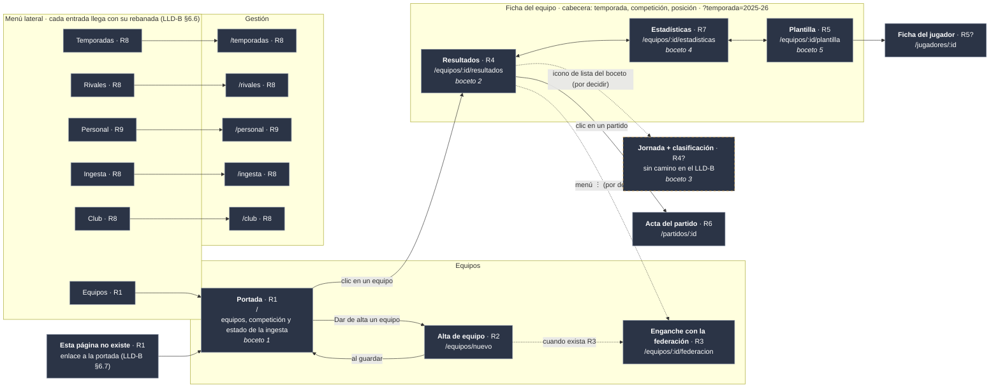

# Plan backoffice-001 · La web del club, rebanada a rebanada

> Rehecho desde cero el **2026-10-15**, revisando pantalla por pantalla con el desarrollador. El primer
> intento queda como material de partida en [Plan backoffice-001-borrador](./Plan%20backoffice-001-borrador.md).
>
> Parte de: el [ADR](../docs/ADR-Backoffice-001.md), cerrado el 2026-10-12; el
> [LLD](../docs/Backoffice%20LLD-001.md), cerrado el 2026-10-14 (§1–§11), con su
> [anexo de decisiones](../docs/Backoffice%20LLD-Anexo-Decisiones-Disenho-001.md); la ingesta corriendo sola en
> el Mac ([Plan launchd-001](../backend/Plan%20launchd-001.md)); y **604 tests** en el backend.
>
> **Convención de remisiones.** `LLD-B §x` es el [LLD del backoffice](../docs/Backoffice%20LLD-001.md) y
> `DW-nn`, su [anexo de decisiones](../docs/Backoffice%20LLD-Anexo-Decisiones-Disenho-001.md); `LLD §x`, el
> [LLD del backend](../docs/API_y_BBDD%20LLD-001.md) y `D-nn`, su
> [bitácora de decisiones](../docs/API_y_BBDD%20LLD-Anexo-Decisiones-Disenho-001.md); `ADR-B`, el
> [ADR del backoffice](../docs/ADR-Backoffice-001.md); `H-nn`, la
> [auditoría 002](../backend/Plan%20de%20auditor%C3%ADa-002.md); y «el borrador», el
> [borrador inicial](../docs/backoffice_initial_draft.md).
>
> **Este fichero es plan y registro a la vez.** Un paso sin su renglón de estado no está hecho.

---

## 1. Objetivos

**Construir la web del backoffice una pantalla cada vez, junto con las peticiones al servidor que esa pantalla
necesita** (el borrador, §2). No se hace «todo el servidor y luego toda la web»: cada unidad de trabajo es una
**rebanada**, que entrega una pantalla funcionando de punta a punta.

Hoy el servidor sirve **6 de las 83 operaciones** del catálogo. Cada rebanada activa las suyas, y una operación
**solo se activa con la rebanada que la usa**.

**Cada rebanada se da por terminada cuando:**

- la pantalla hace lo que dice su ficha, en sus cuatro estados (cargando, error, vacío y con datos; LLD-B §3.1);
- sus escenarios BDD están en verde contra un servidor de pruebas real, **sin simulacros**;
- la accesibilidad está comprobada, automáticamente en los dos modos (claro y oscuro) y a mano (LLD-B §10.7);
- lo que el servidor necesitaba está hecho con el método del backend, con sus pruebas y su mutación.

**Lo que queda fuera hasta el final:** el inicio de sesión, la publicación en Fly.io y el CI. Mientras tanto,
web y servidor funcionan en local, con el club sacado de la dirección (el borrador, §3; LLD-B §12).

---

## 2. Cómo se trabaja

### 2.1 Qué va en este plan y qué no

| Qué | Dónde |
|---|---|
| **Qué se hace, en qué orden y cómo se comprueba**: el mapa, la ficha de cada pantalla, los pasos y su estado | Aquí |
| Una regla que vale para **todas** las pantallas | LLD-B, en su apartado y en un commit aparte (LLD-B §E.1) |
| El **porqué** de una decisión que solo afecta a la web | Anexo de decisiones del backoffice (`DW-nn`) |
| El **porqué** de una decisión que cambia **lo que responde el servidor**, aunque la pida una pantalla | Bitácora del backend (`D-nn`), porque las apps del móvil usarán las mismas respuestas |

Cuando una pantalla obliga a decidir algo, el plan dice **qué paso bloquea** y enlaza la entrada donde se
discute; la discusión no se copia aquí.

### 2.2 La ficha de cada pantalla se escribe cuando toca hacerla

Antes de empezar una rebanada se escribe su ficha: qué enseña, qué peticiones usa, qué acciones permite, cómo
se ve en cada uno de sus cuatro estados, adónde lleva después de guardar y qué le falta al servidor (LLD-B
§E.1). **Se revisa con el desarrollador antes de construir nada.** Cada rebanada enseña algo que puede cambiar
la siguiente, así que la ficha de la siguiente se repasa al cerrar la anterior.

### 2.3 El bucle, de fuera hacia dentro

Cada rebanada empieza **por el escenario**, que es lo que el usuario verá, y acaba **por el escenario**:

1. **Los escenarios de la ficha, escritos y en rojo.** Rojo **porque falta la pantalla**, no porque el arnés
   no arranque: un escenario que falla al levantar el servidor no ha probado nada (H-07).
2. **Lo que le falta al servidor**, con el método del backend de siempre (Plan de desarrollo §5.1): prueba →
   esqueleto que devuelve **mal a propósito** → rojo de aserción → implementación → mutación con
   `Tools/Mutate`. `REQUIRE_DB=1 swift test`, nunca `swift test` a secas.
3. **Las piezas de la web, con Vitest**, con el mismo bucle: prueba → **esqueleto que pinta mal a
   propósito** (la pieza existe y se monta, pero enseña otro texto) → rojo de aserción → implementación.
   Un `Cannot find module` no es un rojo: demuestra que el fichero no estaba, no que la prueba cace nada.
4. **La pantalla**, que junta las piezas y pide los datos.
5. **Los escenarios en verde, con axe en los dos modos** (LLD-B §9.4).
6. **La revisión a mano** del LLD-B §10.7 *b*, con la lista en el PR.

### 2.4 Los avisos

1. **`REQUIRE_DB=1 swift test`** para todo lo del servidor (H-07).
2. **No parar el Postgres del desarrollador.** Los escenarios usan **su propio** servidor (puerto 8081) y su
   base (`tfm_test`); el «servidor caído» se prueba parando **ese**, nunca el del 8080 ni el contenedor.
3. **Un escenario que no pudo arrancar falla; nunca se salta** (ADR-B, decisión 6).
4. **Lo que se descubre y no venía en la ficha va en su propio commit**, y cada commit deja el árbol en verde
   por sí mismo.
5. **Si un cambio del servidor toca más de un *target* o cambia el catálogo, es mini-fase**, con su renglón
   en el [Plan de desarrollo](../docs/Plan%20de%20desarrollo-001.md) (regla 2 de la auditoría).
6. **Explicar en lenguaje llano**: quien revisa es ingeniero de pruebas, no desarrollador web.

---

## 3. El mapa de pantallas

> ⏳ **Por revisar, pantalla por pantalla.** Es el punto de partida: el del LLD-B §6.1 en versión de escritorio,
> con un menú lateral fijo en vez de la flecha «atrás» de los bocetos del móvil (`docs/design-assets/mobile/`).
> La rebanada de cada pantalla es **provisional** hasta que se revise.

**Al cerrar cada rebanada, sus pantallas pasan a la clase `hecha`**; la que esté en marcha, a `enCurso`.

Colores: **verde** = hecha · **ámbar** = en curso · **gris** = pendiente · **borde discontinuo** = sale en un
boceto pero el LLD-B no le da camino. **Flecha discontinua** = navegación aún sin decidir. Un `?` tras la
rebanada = asignación probable.
