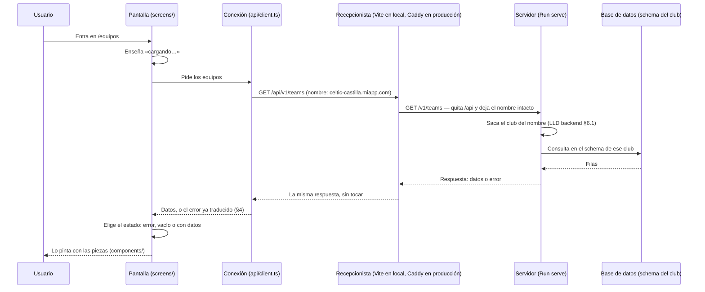

# Backoffice LLD-001 · Cómo está hecha la web del backoffice por dentro

- **Estado:** Borrador. Redactado: §1 (carpetas, las tres partes y el prefijo `/api/v1`) y §2 (qué recuerda la web: la dirección, nada en el navegador y los datos pedidos cada vez) y §3 (el recorrido de una petición: cuatro estados por pantalla, cancelar al salir, botón bloqueado al guardar, 30 s de espera). El resto, pendiente.
- **Fecha de apertura:** 2026-10-12
- **Decisores:** desarrollador único (+ Claude Code)
- **Relacionado:** [ADR-Backoffice-001](./ADR-Backoffice-001.md) · [Borrador inicial del backoffice](./backoffice_initial_draft.md) ·
  [LLD de API y BD](./API_y_BBDD%20LLD-001.md) · [CORS explicado sencillo](./lessonsToLearn/CORS%20explicado%20sencillo%20-%20la%20web%20y%20la%20API%20en%20la%20misma%20direcci%C3%B3n.md)

> **Cómo leer este LLD.** El [ADR](./ADR-Backoffice-001.md) decidió **con qué** se hace la web: Vue con
> TypeScript, PrimeVue, las descripciones de los datos generadas del catálogo, Fly.io y las pruebas. Este
> documento dice **cómo se organiza y cómo se comporta** lo que se construye con eso. Se escribe en lenguaje
> llano: cada término técnico se explica la primera vez que aparece.
>
> **Lo que no va aquí:**
> - **Las herramientas**: están en el ADR.
> - **El detalle campo a campo de los datos**: está en el catálogo `backend/Sources/APIContract/openapi.yaml`.
>   Copiarlo aquí sería tener dos verdades (`D-25`).
> - **El orden de trabajo y los pasos**: van en el plan de rebanadas.

---

## A. Cómo está hecha por dentro

### 1. Organización del código

#### 1.1 Las carpetas

```
backoffice/
├── package.json         lista de herramientas y órdenes (npm run dev, npm test…)
├── vite.config.ts       arranque en local, con el recepcionista que manda /api al servidor (§1.3)
├── index.html
├── src/
│   ├── main.ts          enciende la web: Vue, PrimeVue y el mapa de pantallas
│   ├── App.vue          el marco: menú y hueco donde aparece cada pantalla
│   ├── router.ts        el mapa de pantallas (§6)
│   ├── api/             ← la ÚNICA carpeta que habla con el servidor
│   │   ├── schema.d.ts  generado del openapi.yaml; no se toca a mano ni se guarda en el repositorio
│   │   ├── client.ts    la pieza que hace las peticiones
│   │   └── errors.ts    traduce los errores del servidor (§4)
│   ├── screens/         una carpeta por pantalla: pide los datos y se los pasa a las piezas
│   │   └── home/        la portada (E.1)
│   ├── components/      piezas que solo pintan: reciben datos y avisan de los clics
│   └── theme/           colores e idioma de PrimeVue (§9)
└── e2e/
    ├── features/        los escenarios .feature (palabras clave en inglés, pasos en español)
    ├── steps/           qué hace cada paso
    └── support/         arranque del servidor y del club de pruebas (§11)
```

**Los nombres de carpetas y ficheros, en inglés**, como el código del servidor y como los encontrará quien
lea cualquier documentación de Vue. Lo que ve el usuario en pantalla y los pasos de los escenarios, en
español.

**Las pruebas de piezas viven al lado de lo que prueban**: `TeamCard.vue` y `TeamCard.test.ts`, juntas. Las
de punta a punta, en `e2e/`.

**`schema.d.ts` se genera, no se guarda.** Se fabrica del catálogo al arrancar la web en local y al
prepararla para publicar, igual que el servidor genera sus descripciones al compilar (el *plugin* de
`APIContract`). Así no puede quedarse atrás una copia vieja.

#### 1.2 Tres partes, y cada una solo usa la de debajo

| Parte | Carpeta | Qué hace | Qué **no** puede hacer |
|---|---|---|---|
| **Pantallas** | `screens/` | Pide los datos a `api/`, decide qué enseñar (cargando, vacío, error, datos) y se los pasa a las piezas | — |
| **Piezas** | `components/` | Pinta lo que recibe y avisa cuando el usuario hace algo («han pulsado *Dar de baja* sobre este jugador») | Hablar con el servidor: no puede usar `api/` |
| **Conexión** | `api/` | Hace las peticiones y traduce las respuestas y los errores | Saber nada de pantallas ni de piezas |

Es la misma idea que las capas del servidor (LLD del backend, §2.2): **las dependencias van en un solo
sentido**. Y, como allí, **la regla la comprueba una herramienta, no la buena voluntad**: el revisor de código
(ESLint) da error si un fichero de `components/` usa algo de `api/`, antes de ejecutar nada.

**Por qué este reparto, visto desde las pruebas** (ADR, decisión 6): las **piezas** se prueban con Vitest
pasándoles datos, como a una función; las **pantallas**, en los escenarios BDD contra el servidor real. No
queda nada a medio camino que obligue a simular el servidor.

#### 1.3 El prefijo: `/api/v1`

**Desde el navegador, los datos se piden siempre en `/api/v1/…`**. El recepcionista quita el `/api` al
pasarle la petición al servidor, que sigue contestando en `/v1/…` como hasta ahora: el servidor no cambia.

**Por qué:** al leer una dirección se tiene que saber a la primera si es de datos o de la web.
`https://celtic-castilla.miapp.com/api/v1/teams` se lee como datos sin conocer el proyecto; `/v1/teams`, no.

**El precio, y la regla que lo controla:** la misma petición tiene dos formas de escribirse, según por
dónde entre.

| Quién pide | Por dónde entra | Cómo escribe la dirección |
|---|---|---|
| La web, las apps del móvil, la prueba de humo tras publicar | Por el recepcionista | **`/api/v1/…`** |
| Las pruebas del servidor y un `curl` directo a `Run serve` en local (puerto 8080) | Directo al servidor | **`/v1/…`** |

Si una dirección con `/api` llega al servidor sin pasar por el recepcionista, el servidor no la conoce y
contesta «no encontrado». Es la pista de que alguien se saltó el recepcionista.

**Cómo se configura en cada sitio:**

- **En la web** (`src/api/client.ts`): la pieza de peticiones lleva `/api` como comienzo fijo, y cada
  petición se escribe con el camino del catálogo, que empieza por `/v1`. Así el editor sigue comprobando
  cada camino contra el catálogo.

  ```ts
  const client = createClient<paths>({ baseUrl: '/api' })
  client.GET('/v1/teams')   // el navegador pide /api/v1/teams
  ```

- **En local** (`vite.config.ts`):

  ```ts
  server: {
    proxy: {
      // Lo que empiece por /api, al servidor, quitándole el /api.
      // changeOrigin: false → el nombre de la dirección (el club) pasa intacto.
      '/api': {
        target: 'http://localhost:8080',
        changeOrigin: false,
        rewrite: (path) => path.replace(/^\/api/, ''),
      },
    },
  },
  ```

- **En producción** (`Caddyfile` de la máquina «web»): `handle_path /api/*` reenvía a la máquina «api» y
  quita el `/api` por sí solo. Todo lo demás son ficheros de la web, con la regla de devolver `index.html`
  cuando el camino no es un fichero (nota de CORS, sección 6). Esa regla vale para **todo menos `/api`**:
  una petición de datos mal escrita tiene que dar el error del servidor, no la página de la web.

**Lo que cambia en la prueba de humo** (nota de CORS, sección 5): los `curl` contra producción van a
`/api/v1/club`.

### 2. Qué recuerda la web y dónde

**Lo que hay que saber antes:** la web, mientras está abierta, recuerda las cosas **en memoria**, y la memoria
se borra al recargar la página o cerrar la pestaña. Que algo dure más exige **escribirlo en el navegador** a
propósito. Con eso, cuatro reglas.

#### 2.1 El club no se guarda: se lee de la dirección

La web **no necesita saber qué club es** para pedir sus datos: el servidor lo deduce del nombre de la
dirección (`celtic-castilla.miapp.com`), como hace hoy (LLD del backend, §6.1). Al arrancar, la web pide
**una vez** `/api/v1/club` para tener el nombre y el escudo, y lo mantiene en memoria mientras la pestaña
está abierta. Es la única excepción a la regla 2.4. Qué enseña si el club no existe: §8.

#### 2.2 Lo que debe sobrevivir a una recarga va en la dirección

La web saca todo lo que necesita para pintar una pantalla de **tres partes de la dirección**:

| Parte | Ejemplo | Qué dice |
|---|---|---|
| El nombre | `celtic-castilla.miapp.com` | El club |
| El camino | `/equipos/123/plantilla` | Qué estás viendo (§6) |
| Lo que va detrás de `?` | `?temporada=2025-26` | Lo que has elegido: temporada, filtros, orden |

Así, **recargar o abrir un enlace guardado deja en la misma pantalla**, y un enlace que se manda a un
compañero le enseña lo mismo. **Lo que no esté en la dirección se pierde al recargar, y es a propósito**:
si una elección debe sobrevivir, su sitio es la dirección, no el navegador.

#### 2.3 En el navegador no se guarda ningún dato del club

Ni jugadores, ni partidos, ni nombres: **nada** en las zonas de almacenamiento del navegador
(`localStorage`, `sessionStorage`, IndexedDB, *cookies* propias). Es lo que pide el ADR para los datos de
menores (requisito 7, RGPD). **Única excepción, reservada:** la sesión de Supabase Auth, cuando se monte el
inicio de sesión (§12).

#### 2.4 Los datos se piden cada vez que se entra en una pantalla

**Decisión: cada pantalla pide sus datos al entrar**, también al volver a una que ya se había visto, y no se
guarda nada en memoria entre pantallas. Tras guardar un cambio, la pantalla vuelve a pedir lo que enseña.

**La alternativa descartada:** una herramienta que guarda en memoria lo ya descargado (Pinia Colada,
TanStack Query) y, al volver a una pantalla, enseña al momento lo que tenía mientras lo actualiza por
detrás.

**Razones:**

- **Siempre se ve lo que hay en el servidor**, también lo que acaba de cambiar un compañero. Lo grave en
  esta web no es esperar un momento, sino corregir un acta mirando datos viejos.
- **No hay que acordarse de nada después de guardar.** Con datos guardados, cada cambio obliga a decir qué
  otros datos ya no valen; si se olvida, la pantalla enseña algo que ya no es verdad.
- **Las pruebas ven lo que respondió el servidor**, sin una pantalla que cambia sola después de aparecer y
  pasos que tienen que esperar a que se asiente.
- **El coste es pequeño:** pocos usuarios, un servidor que responde rápido y pantallas que piden poco. El
  precio es un «cargando…» corto al entrar en cada pantalla (§3).

**Cuándo se revisa:** si una pantalla **se mide** lenta. Entonces se añade la memoria solo donde haga falta.
Es barato porque todas las peticiones salen de `api/` (§1.2).

### 3. El recorrido de una petición

El equivalente, en la web, al §2.3 del LLD del backend: qué pasa desde que el usuario entra en una pantalla
hasta que ve sus datos.



**Lo que hace cada uno:** la **pantalla** decide qué enseñar; la **conexión** hace la petición y traduce la
respuesta; el **recepcionista** solo reparte (nota de CORS, sección 5); y el **servidor** es quien sabe el
club, valida y responde. Ninguna regla del negocio se decide en la web (ADR, requisito 1).

#### 3.1 Toda pantalla tiene cuatro estados

| Estado | Cuándo | Ejemplo |
|---|---|---|
| **Cargando** | Desde que se pide hasta que llega la respuesta | «Cargando equipos…» |
| **Error** | El servidor respondió con un error, o no respondió (§3.4) | «No se ha podido conectar con el servidor» |
| **Vacío** | La respuesta llegó bien, pero no trae nada | «Este equipo aún no tiene jugadores» |
| **Con datos** | La respuesta trae algo que enseñar | La lista de jugadores |

**Los cuatro se diseñan siempre**, y la ficha de cada pantalla (parte E) dice cómo se ve cada uno. **Vacío
no es error**: un equipo sin jugadores es una situación normal y se dice con un mensaje que explica qué
hacer, no con un aviso de fallo. Para las pruebas, son **cuatro escenarios por pantalla**.

#### 3.2 Si se sale de una pantalla antes de la respuesta, la petición se cancela

Si el usuario se va a otra pantalla mientras la primera aún espera, su petición se cancela. Así una
respuesta que llega tarde **no puede pintarse en la pantalla equivocada**.

#### 3.3 Mientras se guarda, el botón se bloquea

Al pulsar *Guardar* (o *Dar de alta*, *Dar de baja*…), el botón queda bloqueado hasta que llega la
respuesta: **un doble clic no puede mandar dos veces lo mismo**. Al terminar bien, la pantalla vuelve a pedir
sus datos (§2.4); si termina mal, el error se enseña como dice el §4 y el botón se desbloquea.

#### 3.4 La web espera un máximo de 30 segundos

Pasados **30 segundos** sin respuesta, la web deja de esperar y avisa de que el servidor no responde. **Un
solo límite para todas las peticiones.**

**Por qué 30 y no menos:** la vista previa del enganche con la federación
(`POST /v1/teams/{id}/federation-link/preview`) pregunta **en directo** a la federación, y el servidor espera
hasta **20 segundos** antes de dar su propio error (`backend/Sources/Federation/HTTPFederationTransport.swift`,
LLD del backend §2.3-c). Ese error dice más («la federación no responde») que el de la web («el servidor no
responde»). Si la web se rindiera antes de los 20 s, ese mensaje no llegaría nunca. **Si alguna vez se sube
el límite del servidor, hay que subir este por encima.**

#### 3.5 El «cargando…» se enseña desde el primer momento

Se enseña **en cuanto se pide**, sin esperar unos milisegundos a ver si la respuesta llega antes. Puede
parpadear un instante con un servidor rápido, a cambio de que **la pantalla se comporte siempre igual** y
de que el escenario que comprueba el estado *cargando* no dependa de la velocidad del servidor.

**Lo que no va aquí:** qué mensaje sale con cada error y dónde se enseña (§4), y cómo se anuncia el
«cargando…» a un lector de pantalla (§10).

---

## B. Cómo se comporta con el usuario

### 4. Los errores

*Cómo se convierte cada error del servidor (no encontrado, conflicto, servidor caído…) en un mensaje en
español, y dónde se enseña: junto al campo en un formulario, como aviso en una pantalla.*

> Pendiente.

### 5. Los formularios

*Qué comprueba la web solo por comodidad y qué deja al servidor, que es quien manda. Y qué pasa si sales de
un formulario con cambios sin guardar.*

> Pendiente.

### 6. El mapa de pantallas

*Qué caminos existen (`/equipos/123/plantilla`), cómo se navega entre ellos y el menú.*

> Pendiente.

---

## C. Las reglas del negocio que se ven en la pantalla

### 7. Quién es dueño de cada dato

*Lo que trae la federación (partidos, rivales, clasificación) solo se corrige; lo que mete el club
(jugadores, goles, tarjetas) se gestiona entero. Y el equipo propio, la excepción: se crea y se borra
mientras no esté enganchado (`D-66`). Cómo se refleja en botones y formularios.*

> Pendiente.

---

## D. Lo transversal

### 8. El club en la web

*Cómo lo saca de la dirección y qué enseña si el club no existe.*

> Pendiente.

### 9. El tema y el idioma

*Colores, fechas y números a la española, y si hay modo claro.*

> Pendiente.

### 10. La accesibilidad en concreto

*Qué reglas se cumplen siempre, además de lo que comprueban solas las herramientas del ADR.*

> Pendiente.

### 11. Las pruebas por dentro

*Cómo arrancan las pruebas su propio servidor y su club, y cómo se escriben los pasos.*

> Pendiente.

### 12. El inicio de sesión

*Hueco reservado: se monta al final (borrador, §3).*

> Pendiente.

---

## E. Fichas de pantalla

*Una ficha por pantalla, que crece con cada rebanada: qué enseña, qué peticiones usa, qué acciones permite,
cómo se ve vacía, cargando o con error, y qué le falta al servidor. Lo que falte se diseña en el catálogo y
en el LLD del backend.*

### E.1 La portada

> Pendiente.
