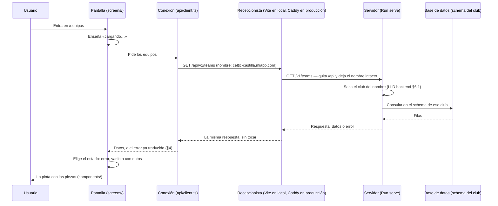

# Backoffice LLD-001 · Cómo está hecha la web del backoffice por dentro

- **Estado:** **Cerrado el 2026-10-14** para §1–§11. §12, el inicio de sesión, queda reservado para el
  final. Lo que se descubra en una rebanada y valga para todas las pantallas se añade aquí (parte E).
- **Fecha de apertura:** 2026-10-12
- **Decisores:** desarrollador único (+ Claude Code)
- **Relacionado:** [Anexo de decisiones](./Backoffice%20LLD-Anexo-Decisiones-Disenho-001.md) · [ADR-Backoffice-001](./ADR-Backoffice-001.md) · [Borrador inicial del backoffice](./backoffice_initial_draft.md) ·
  [LLD de API y BD](./API_y_BBDD%20LLD-001.md) · [CORS explicado sencillo](./lessonsToLearn/CORS%20explicado%20sencillo%20-%20la%20web%20y%20la%20API%20en%20la%20misma%20direcci%C3%B3n.md)

> **Cómo leer este LLD.** El [ADR](./ADR-Backoffice-001.md) decidió **con qué** se hace la web: Vue con
> TypeScript, PrimeVue, las descripciones de los datos generadas del catálogo, Fly.io y las pruebas. Este
> documento dice **cómo se organiza y cómo se comporta** lo que se construye con eso. Se escribe en lenguaje
> llano: cada término técnico se explica la primera vez que aparece.
>
> **Lo que no va aquí:**
> - **Las herramientas**: están en el ADR.
> - **El detalle campo a campo de los datos**: está en el catálogo `backend/Sources/APIContract/openapi.yaml`.
>   Copiarlo aquí sería tener dos verdades (`D-25`).
> - **El orden de trabajo, los pasos y la ficha de cada pantalla**: van en el plan de desarrollo (parte E).
> - **El porqué de cada regla** —qué alternativa se descartó y qué se asume a cambio—: está en el
>   [anexo de decisiones](./Backoffice%20LLD-Anexo-Decisiones-Disenho-001.md), con enlaces `[DW-nn]` desde aquí.

---

## A. Cómo está hecha por dentro

### 1. Organización del código

#### 1.1 Las carpetas

```
backoffice/
├── package.json         lista de herramientas y órdenes (npm run dev, npm test…)
├── vite.config.ts       arranque en local, con el recepcionista que manda /api al servidor (§1.3)
├── index.html
├── src/
│   ├── main.ts          enciende la web: Vue, PrimeVue y el mapa de pantallas
│   ├── App.vue          el marco: menú y hueco donde aparece cada pantalla
│   ├── router.ts        el mapa de pantallas (§6)
│   ├── api/             ← la ÚNICA carpeta que habla con el servidor
│   │   ├── schema.d.ts  generado del openapi.yaml; no se toca a mano ni se guarda en el repositorio
│   │   ├── schemas.json las reglas y los nombres del catálogo, generados igual (§5.1, §9.6)
│   │   ├── client.ts    la pieza que hace las peticiones
│   │   ├── errors.ts    traduce los errores del servidor (§4)
│   │   └── rules.ts     comprueba un formulario con las reglas del catálogo (§5.1)
│   ├── sorting.ts       cómo se ordena una tabla (§3.6)
│   ├── notice.ts        el aviso breve del marco, como «Guardado» (§5.4)
│   ├── screens/         una carpeta por pantalla: pide los datos y se los pasa a las piezas
│   │   ├── home/        la portada
│   │   └── new-team/    el alta de equipo
│   ├── components/      piezas que solo pintan: reciben datos y avisan de los clics
│   └── theme/           colores e idioma de PrimeVue (§9)
└── e2e/
    ├── features/        los escenarios .feature (palabras clave en inglés, pasos en español)
    ├── steps/           qué hace cada paso
    └── support/         arranque del servidor y del club de pruebas (§11)
```

**Los nombres de carpetas y ficheros, en inglés**, como el código del servidor y como los encontrará quien
lea cualquier documentación de Vue. Lo que ve el usuario en pantalla y los pasos de los escenarios, en
español.

**Las pruebas de piezas viven al lado de lo que prueban**: `TeamCard.vue` y `TeamCard.test.ts`, juntas. Las
de punta a punta, en `e2e/`.

**`schema.d.ts` se genera, no se guarda.** Se fabrica del catálogo al arrancar la web en local y al
prepararla para publicar, igual que el servidor genera sus descripciones al compilar (el *plugin* de
`APIContract`). Así no puede quedarse atrás una copia vieja.

#### 1.2 Tres partes, y cada una solo usa la de debajo

| Parte | Carpeta | Qué hace | Qué **no** puede hacer |
|---|---|---|---|
| **Pantallas** | `screens/` | Pide los datos a `api/`, decide qué enseñar (cargando, vacío, error, datos) y se los pasa a las piezas | — |
| **Piezas** | `components/` | Pinta lo que recibe y avisa cuando el usuario hace algo («han pulsado *Dar de baja* sobre este jugador») | Hablar con el servidor: no puede usar `api/` |
| **Conexión** | `api/` | Hace las peticiones y traduce las respuestas y los errores | Saber nada de pantallas ni de piezas |

**Las dependencias van en un solo sentido, y la regla la comprueba el revisor de código** (ESLint): da error
si un fichero de `components/` usa algo de `api/`, antes de ejecutar nada. Por qué este reparto: [DW-01].

#### 1.3 El prefijo: `/api/v1`

**Desde el navegador, los datos se piden siempre en `/api/v1/…`**. El recepcionista quita el `/api` al
pasarle la petición al servidor, que sigue contestando en `/v1/…` como hasta ahora: el servidor no cambia.

Por qué, y lo que se asume a cambio: [DW-02]. **La misma petición se escribe de dos formas, según por dónde
entre:**

| Quién pide | Por dónde entra | Cómo escribe la dirección |
|---|---|---|
| La web, las apps del móvil, la prueba de humo tras publicar | Por el recepcionista | **`/api/v1/…`** |
| Las pruebas del servidor y un `curl` directo a `Run serve` en local (puerto 8080) | Directo al servidor | **`/v1/…`** |

Si una dirección con `/api` llega al servidor sin pasar por el recepcionista, el servidor no la conoce y
contesta «no encontrado». Es la pista de que alguien se saltó el recepcionista.

**Cómo se configura en cada sitio:**

- **En la web** (`src/api/client.ts`): la pieza de peticiones lleva `/api/v1` como comienzo fijo, y cada
  petición se escribe con el camino tal como está en el catálogo, que **no** lleva el `/v1`: el catálogo lo
  pone en su dirección base (`servers`, `https://{tenant}.{host}/v1`) y sus caminos son `/teams`, `/club`…
  Así el editor sigue comprobando cada camino contra el catálogo.

  ```ts
  const api = createClient<paths>({ baseUrl: `${location.origin}/api/v1`, fetch: send })
  api.GET('/teams')   // el navegador pide /api/v1/teams
  ```

  Dos detalles que piden las pruebas de piezas, sin cambiar nada en el navegador: la dirección se completa
  con la de la página (`location.origin`), porque en las pruebas corre Node, que no acepta direcciones a
  medias; y cada petición pasa por una función propia (`send`, la del límite de 30 s, §3.4) que busca el
  `fetch` en ese momento, para que las pruebas puedan poner uno de mentira.

- **En local** (`vite.config.ts`):

  ```ts
  server: {
    proxy: {
      // Lo que empiece por /api, al servidor, quitándole el /api.
      // changeOrigin: false → el nombre de la dirección (el club) pasa intacto.
      '/api': {
        target: 'http://localhost:8080',
        changeOrigin: false,
        rewrite: (path) => path.replace(/^\/api/, ''),
      },
    },
  },
  ```

- **En producción** (`Caddyfile` de la máquina «web»): `handle_path /api/*` reenvía a la máquina «api» y
  quita el `/api` por sí solo. Todo lo demás son ficheros de la web, con la regla de devolver `index.html`
  cuando el camino no es un fichero (nota de CORS, sección 6). Esa regla vale para **todo menos `/api`**:
  una petición de datos mal escrita tiene que dar el error del servidor, no la página de la web.

**Lo que cambia en la prueba de humo** (nota de CORS, sección 5): los `curl` contra producción van a
`/api/v1/club`.

### 2. Qué recuerda la web y dónde

**Lo que hay que saber antes:** la web, mientras está abierta, recuerda las cosas **en memoria**, y la memoria
se borra al recargar la página o cerrar la pestaña. Que algo dure más exige **escribirlo en el navegador** a
propósito. Con eso, cuatro reglas.

#### 2.1 El club no se guarda: se lee de la dirección

La web **no necesita saber qué club es** para pedir sus datos: el servidor lo deduce del nombre de la
dirección (`celtic-castilla.miapp.com`), como hace hoy (LLD del backend, §6.1). Al arrancar, la web pide
**una vez** `/api/v1/club` para tener el nombre y el escudo, y lo mantiene en memoria mientras la pestaña
está abierta. Es la única excepción a la regla 2.4. Qué enseña si el club no existe: §8.

#### 2.2 Lo que debe sobrevivir a una recarga va en la dirección

La web saca todo lo que necesita para pintar una pantalla de **tres partes de la dirección**:

| Parte | Ejemplo | Qué dice |
|---|---|---|
| El nombre | `celtic-castilla.miapp.com` | El club |
| El camino | `/equipos/123/plantilla` | Qué estás viendo (§6) |
| Lo que va detrás de `?` | `?temporada=2025-26` | Lo que has elegido: temporada, filtros, orden |

Así, **recargar o abrir un enlace guardado deja en la misma pantalla**, y un enlace que se manda a un
compañero le enseña lo mismo. **Lo que no esté en la dirección se pierde al recargar, y es a propósito**
*(salvo el «estado de la navegación» de Vue Router, que el navegador guarda con su entrada del historial y
conserva al recargar, pero no al abrir un enlace: así viaja la temporada de la portada al alta de equipo; plan R2,
decisión 5)*:
si una elección debe sobrevivir, su sitio es la dirección, no el navegador.

#### 2.3 En el navegador no se guarda ningún dato del club

Ni jugadores, ni partidos, ni nombres: **nada** en las zonas de almacenamiento del navegador
(`localStorage`, `sessionStorage`, IndexedDB, *cookies* propias). Es lo que pide el ADR para los datos de
menores (requisito 7, RGPD).

**Las excepciones son una lista cerrada, con nombre.** Lo que no esté aquí no se guarda:

| Qué se guarda | Dónde | Por qué no es un dato del club |
|---|---|---|
| `tema` = `claro` u `oscuro` | `localStorage` | Es una preferencia de la pantalla, no de nadie del club (§9.3) |
| La sesión de Supabase Auth — **reservada** | La decide Supabase | Llega con el inicio de sesión (§12) |

#### 2.4 Los datos se piden cada vez que se entra en una pantalla

**Cada pantalla pide sus datos al entrar**, también al volver a una que ya se había visto, y no se guarda
nada en memoria entre pantallas. Tras guardar un cambio, la pantalla vuelve a pedir lo que enseña. Por qué, lo
que cuesta y cuándo se revisa: [DW-03].

**Y mientras algo esté «en marcha», se vuelven a pedir solos** *(añadido el 2026-10-25, con la portada de la
[rebanada 3](./Plan%20de%20desarrollo%20R3%20Enganche-001.md))*. Si una pantalla enseña algo que el servidor
está haciendo todavía —una ingesta, el estado `pending`—, pide otra vez sus datos **cada 10 s**, solo con la
pestaña a la vista y **como mucho 5 minutos** seguidos; para cuando ya no queda nada en marcha. El refresco **no
enseña «Cargando…»**, conserva el orden y el foco, y si falla se deja lo que había y se prueba en el siguiente:
un refresco no pinta errores. No se anuncia al lector de pantalla. Por qué: [DW-20].

### 3. El recorrido de una petición

El equivalente, en la web, al §2.3 del LLD del backend: qué pasa desde que el usuario entra en una pantalla
hasta que ve sus datos.



**Lo que hace cada uno:** la **pantalla** decide qué enseñar; la **conexión** hace la petición y traduce la
respuesta; el **recepcionista** solo reparte (nota de CORS, sección 5); y el **servidor** es quien sabe el
club, valida y responde. Ninguna regla del negocio se decide en la web (ADR, requisito 1).

#### 3.1 Toda pantalla tiene cuatro estados

| Estado | Cuándo | Ejemplo |
|---|---|---|
| **Cargando** | Desde que se pide hasta que llega la respuesta | «Cargando equipos…» |
| **Error** | El servidor respondió con un error, o no respondió (§3.4) | «No se ha podido conectar con el servidor» |
| **Vacío** | La respuesta llegó bien, pero no trae nada | «Este equipo aún no tiene jugadores» |
| **Con datos** | La respuesta trae algo que enseñar | La lista de jugadores |

**Los cuatro se diseñan siempre**, y la ficha de cada pantalla (en el plan de desarrollo) dice cómo se ve cada uno. **Vacío
no es error**: un equipo sin jugadores es una situación normal y se dice con un mensaje que explica qué
hacer, no con un aviso de fallo. Para las pruebas, son **cuatro escenarios por pantalla**.

#### 3.2 Si se sale de una pantalla antes de la respuesta, la petición se cancela

Si el usuario se va a otra pantalla mientras la primera aún espera, su petición se cancela. Así una
respuesta que llega tarde **no puede pintarse en la pantalla equivocada**.

#### 3.3 Mientras se guarda, el botón se bloquea

Al pulsar *Guardar* (o *Dar de alta*, *Dar de baja*…), el botón queda bloqueado hasta que llega la
respuesta: **un doble clic no puede mandar dos veces lo mismo**. Al terminar bien, la pantalla vuelve a pedir
sus datos (§2.4); si termina mal, el error se enseña como dice el §4 y el botón se desbloquea.

#### 3.4 La web espera un máximo de 30 segundos

Pasados **30 segundos** sin respuesta, la web deja de esperar y avisa de que el servidor no responde. **Un
solo límite para todas las peticiones.**

Está por encima de los **20 segundos** que el servidor espera a la federación, para que su error («la
federación no responde») llegue siempre antes que el de la web. **Si alguna vez se sube el límite del
servidor, hay que subir este por encima.** Por qué: [DW-04].

#### 3.5 El «cargando…» se enseña desde el primer momento

Se enseña **en cuanto se pide**, sin esperar unos milisegundos a ver si la respuesta llega antes. Por qué, y
el parpadeo que se acepta: [DW-05].

#### 3.6 Las tablas se ordenan pinchando su cabecera

*(Añadido el 2026-10-24, con la tabla de la portada: bloque T del
[plan de la rebanada 2](./Plan%20de%20desarrollo%20R2%20Alta%20de%20equipo-001.md).)*

- **Cada cabecera es un botón**, con una flecha al lado (↕ sin ordenar, ▲ o ▼ ordenada). **El primer clic ordena
  por esa columna en su orden; el segundo, al revés; el tercero vuelve al orden de siempre**, el que manda el
  servidor. Los empates conservan ese orden.
- **El orden de cada columna lo decide su regla**, sobre los datos de verdad y no sobre el texto que se ve: una
  fecha por fecha y no por «23/10/2026 20:24»; una categoría por edad y no por el alfabeto. **Las filas que no
  tienen nada en esa columna** (un equipo sin competición) **van siempre al final**, en los dos sentidos.
- **El orden va en la dirección** (§2.2, §6.5): `?orden=ingesta`, y al revés, `?orden=ingesta-inverso`. Un valor
  que no se entiende se ignora, sin error. Ordenar no vuelve a pedir nada al servidor.
- **Con el teclado y con el lector** (§10.1): el botón se alcanza con el tabulador y se pulsa con Intro o
  Espacio, y el foco se queda en él; la columna ordenada lleva `aria-sort`, y el lector dice «orden ascendente»
  o «descendente». La flecha no se lee. Es el modelo de tabla ordenable del W3C.

**Cómo se hace**, para la tabla que venga: `src/sorting.ts` pone lo que es igual en todas (ordenar, los tres clics
y el orden en la dirección); `components/SortableHeader.vue`, la cabecera; y cada pantalla, sus reglas (las de la
portada, en `screens/home/order.ts`) y las **claves de orden** de cada fila. Una columna nueva es una regla más y
una cabecera más. La tabla de PrimeVue no se usa: ordena mal las filas agrupadas, como un equipo con varias
competiciones.

#### 3.7 Las acciones de una fila son iconos, con su texto por ratón y por teclado

*(Añadido el 2026-10-25, con la portada de la [rebanada 3](./Plan%20de%20desarrollo%20R3%20Enganche-001.md).)*

- **Lo que se hace desde una fila** sin entrar en su ficha va como **un icono por acción**, sin menú.
- **Cada icono va donde está lo que afecta**: las acciones de la fila entera, en una **columna «Acciones»** al
  final, una vez aunque la fila ocupe varias líneas; las de una parte de la fila, **en su celda** (relanzar la
  ingesta de una competición, en la celda de su ingesta).
- **El texto de la acción no se ve hasta pasar el ratón o llegar con el teclado**, y los dos caminos funcionan;
  *Escape* lo cierra (WCAG 1.4.13). El `Tooltip` de PrimeVue hace uno u otro, no los dos: la web tiene su propia
  pieza.
- **El lector de pantalla lee siempre el nombre, con la fila detrás**: «Sincronizar otra competición, Cadete A».
  Diez botones iguales no se distinguen en la lista de botones de VoiceOver. El texto visible está dentro del
  nombre (WCAG 2.5.3).
- **40 × 40 px** cada icono (WCAG 2.5.8 pide 24). La columna «Acciones» no se ordena; su cabecera no se ve, pero el
  lector la lee.
- **Lo que se permite a veces** sigue la regla de §7.4: desactivado, y con el motivo **escrito a la vista**, no
  solo en el texto del icono.
- **El caso que más lo pide puede llevar además un enlace con texto**, en su celda: «Sincronizar con la
  Federación» debajo de «Sin competición».

Por qué iconos, y no un menú ⋮ ni botones con texto: [DW-19].

**Lo que no va aquí:** qué mensaje sale con cada error y dónde se enseña (§4), y cómo se anuncia el
«cargando…» a un lector de pantalla (§10).

---

## B. Cómo se comporta con el usuario

### 4. Los errores

**Lo que manda el servidor cuando algo falla** (LLD del backend §5.4,
`backend/Sources/HTTPAdapter/ProblemMiddleware.swift`): siempre el mismo formato, con cinco campos.

```json
{ "status": 422, "code": "INVALID_VALUE", "title": "Valor no válido",
  "detail": "name: no puede estar vacío", "type": "https://…/invalid-value" }
```

A 2026-10-12, el servidor emite **32 códigos distintos** (`TEAM_NOT_FOUND`, `ALREADY_LINKED_TO_FEDERATION`,
`FEDERATION_UNREACHABLE`, `DATABASE_UNAVAILABLE`, `UNKNOWN_TENANT`…). La lista crece con cada operación nueva.

**Cómo verlo** (con `Run serve` arrancado; cambiar `celtic-castilla` por un club que exista en local):

```sh
# Un club que no existe → 404 UNKNOWN_TENANT
curl -s http://noexiste.localhost:8080/v1/club
# Un valor que no vale → 422 INVALID_VALUE, con el nombre del campo metido en "detail"
curl -s -X PATCH -H 'Content-Type: application/json' -d '{"name":""}' \
     http://celtic-castilla.localhost:8080/v1/club
```

#### 4.1 La web decide por el `code`, nunca por el texto

En `src/api/errors.ts` hay **una tabla: a cada código, su mensaje en español**. La web nunca mira `title`
ni `detail` para decidir qué hacer, **con una sola excepción**: el campo al que pertenece un error de valor
(§4.5 *a*). El número (`status`) solo se usa como red cuando llega un código que la
tabla no tiene, para elegir un mensaje genérico de su familia: «no se ha encontrado» (404), «no se ha podido
guardar» (409, 422), «error del servidor» (5xx). **Salvo un 502, 503 o 504 sin código**, que es el
recepcionista diciendo que el servidor no está: ése es «No se ha podido conectar con el servidor» ([DW-18]).

#### 4.2 Los mensajes los escribe la web

Los textos del servidor están pensados para quien desarrolla, no para quien usa la web. Por eso:

- **`detail` no se enseña nunca**, salvo el motivo de un error de valor (§4.5 *a*). Es una explicación técnica (`"name: no puede estar vacío"`,
  `"host=… claim=…"`). En desarrollo, en un 500 lleva además el diagnóstico interno; en producción el
  servidor ya lo omite (`exposesInternalDetail`), pero la regla de la web no depende de eso.
- **Sí se enseña el `code`, en pequeño, al final del mensaje** («Código: TEAM_NOT_FOUND»), para que quien
  lo vea pueda contar exactamente qué pasó.

#### 4.3 Dónde se enseña un error

Depende de cuándo ocurre:

| Cuándo | Dónde | Ejemplo |
|---|---|---|
| Al **cargar** una pantalla | **En el hueco de la pantalla**, en lugar de los datos: el estado *error* del §3.1 | «No se ha podido conectar con el servidor» |
| Al **guardar**, por un dato concreto | **Junto al campo** del formulario | «El nombre no puede estar vacío» |
| Al **guardar**, por algo que no es de un campo | **Un aviso arriba del formulario**, que no desaparece solo | «Este equipo ya está enganchado a la federación» |
| **El club no existe** | **La página entera** (§8) | «Este club no existe» |

Un error al guardar **no borra lo que el usuario escribió**: el formulario sigue relleno para que corrija y
vuelva a intentarlo.

#### 4.4 *Reintentar* solo cuando tiene sentido

El botón *Reintentar* aparece **solo cuando el fallo puede ser pasajero**:

| Situación | Cómo se reconoce | ¿Reintentar? |
|---|---|---|
| El servidor no responde en 30 s, o no se puede conectar | Sin respuesta (§3.4) | ✅ Sí |
| El servidor está caído detrás del recepcionista | 502, 503 o 504 **sin código** ([DW-18]) | ✅ Sí |
| La base de datos está caída | `DATABASE_UNAVAILABLE` (503) | ✅ Sí |
| La federación no responde | `FEDERATION_UNREACHABLE` (504) | ✅ Sí |
| Todo lo demás: «ya existe», «no encontrado», «valor no válido»… | El resto de códigos | ❌ No: daría lo mismo |

#### 4.5 Lo que le falta al servidor

**a. A qué campo pertenece el error: se lee del texto, con un formato fijo.** En los dos errores de valor
—`INVALID_VALUE` (422) y `NOT_EDITABLE_AFTER_SYNC` (409)— el servidor escribe `detail` siempre igual:

```
<campo>: <motivo>          p. ej.  name: no puede estar vacío
```

**Decisión: la web lee ese formato tal cual**, sin esperar a un campo `field` en el error. Separa por el
primer `": "`: lo de delante es el campo y lo de detrás el motivo, que **sí** se enseña junto a ese campo
porque el servidor lo escribe en español y para el usuario. Si el texto no sigue el formato, o el campo no
está en el formulario, el error sale en el aviso de arriba (§4.3).

- **Pendiente con la portada:** escribir en el catálogo el formato `<campo>: <motivo>`, para que la web
  dependa de algo escrito.
- **Lo vigila una prueba**: un escenario BDD que provoca un error de valor y comprueba que sale junto a su
  campo. Si el servidor cambia el formato, ese escenario falla.
- Por qué así y no con un campo `field`: [DW-06].

**c. Todos los errores a la vez.** Hoy el servidor avisa del primer campo mal y se para. En la web, las
reglas que están escritas en el catálogo ya salen todas a la vez (§5.1); las que solo conoce el Dominio
(por ejemplo, un nombre que solo tiene espacios), de una en una. **Pendiente del backend**: devolver la
lista entera de errores de valor. Ese cambio es el momento de revisar la *a*.

**b. La lista de códigos, escrita.** Hoy `code` es un texto libre en el catálogo (`openapi.yaml`, esquema
`Problem`), así que **nada comprueba que la web tenga un mensaje para cada código**. Se resuelve en dos pasos:

| Paso | Qué se toca | Qué se gana | Cuándo |
|---|---|---|---|
| **1. La lista en el catálogo** | `openapi.yaml`: `code` pasa a tener la lista cerrada de códigos (`enum`). **Y un poco de Swift**: la función `problem(...)` de los *handlers* construye el error con el tipo generado y recibía el código como texto, así que pasa a recibirlo de la lista, con sus 8 llamadas. *(Esta casilla decía «ni una línea de Swift»; se vio que no al revisar la portada.)* | **En la web, la garantía completa**: la tabla de `errors.ts` se declara como «un mensaje para cada código de la lista», y si falta uno **no compila**. En el servidor, a medias: los 8 códigos de los *handlers* se comprueban al compilar, y **el censo** (`backend/Tools/Census`) comprueba que cada código que emite el servidor está en la lista | Con la rebanada de la portada |
| **2. El servidor usa la lista** | `ProblemMiddleware.swift`: su `Problem`, escrito a mano con `code: String`, pasa a usar la lista generada. Unas 30 líneas, en ese fichero | La garantía completa también en el servidor: un código que no está en la lista no compila | **Pendiente del backend**, sin prisa y en su propio commit |

Los tres, *a*, *b* y *c*, se diseñan en el catálogo y en el LLD del backend (§5.4), no aquí.

### 5. Los formularios

#### 5.1 Antes de enviar, la web comprueba las reglas del catálogo, todas a la vez

**Lo que más molesta de un formulario es corregir los errores de uno en uno.** Así que, al pulsar *Guardar*,
la web comprueba lo rellenado **antes de enviarlo** y marca **todos** los campos que fallan a la vez, cada
uno junto a su campo.

**Las reglas no se escriben en la web: se leen del catálogo.** El catálogo es **OpenAPI 3.1**, y en esa
versión la descripción de cada dato está escrita en un formato estándar de reglas (*JSON Schema*):
obligatorio (`required`), longitud mínima (`minLength`), valor mínimo (`minimum`), formato (`format`), lista
cerrada (`enum`)… Un comprobador ya hecho, **Ajv**, lee esas reglas **tal cual**, sin traducirlas ni
generar código, y devuelve la lista de fallos con el campo de cada uno:

```
                          openapi.yaml
             /                  |                       \
   servidor (Swift)    web: la forma de los datos     web: las reglas de cada campo
                       (schema.d.ts, §1.1)             (Ajv las lee de la misma descripción)
```

Por ejemplo, para el alta de equipo se comprueba lo rellenado contra `CreateTeamRequest`, y sale:

```
letter   → minLength   (si se rellena, no puede quedar vacía)
seasonId → required    (falta)
```

**Cómo llega el catálogo a la web**: `npm run gen:api` saca sus esquemas a `src/api/schemas.json` al compilar,
junto a `schema.d.ts`. Por qué así: [DW-07].

**Lo que se escribe a mano es solo el texto de los mensajes, por tipo de regla y no por campo**: «Este campo
es obligatorio», «No puede estar vacío», «Como mínimo {n}», «Como máximo {n}», «El formato no es válido»,
«Elige un valor de la lista». Una tabla de unas seis entradas.

**Lo que sigue comprobando solo el servidor**, y llega como error del §4: lo que el catálogo no puede
describir. Que ya exista un equipo igual, que la temporada no exista, o un nombre que solo tiene espacios
(el catálogo dice «mínimo un carácter» y el espacio lo es; el Dominio lo rechaza igualmente). Esos llegan
**de uno en uno** hasta que el servidor sepa devolverlos todos (§4.5 *c*). **El servidor sigue siendo quien
manda**: la comprobación de la web solo ahorra un viaje y deja ver todos los fallos juntos.

Por qué así, y cómo amplía la decisión 3 del ADR: [DW-07].

#### 5.2 Cada dato con la pieza que le corresponde

Los valores imposibles **no se pueden ni escribir**: un selector para las listas cerradas (género,
modalidad, categoría), un calendario para las fechas y un campo numérico para los números. **Los campos
obligatorios se marcan con un asterisco**, según el `required` del catálogo.

#### 5.3 Al guardar un cambio, solo se envía lo que ha cambiado

El catálogo dice que, al modificar, **un campo que no se envía no se toca** y **un campo enviado vacío
(`null`) se borra**. Por eso:

- La web envía **solo los campos que el usuario ha cambiado**.
- **Vaciar un campo opcional lo borra**, a propósito.
- **Un campo obligatorio no se puede vaciar**: lo impide la comprobación del §5.1.

#### 5.4 Al guardar bien

Sale un **aviso breve, «Guardado»**, y la pantalla vuelve a pedir sus datos (§3.3). **Adónde se va después
de un alta** lo dice la ficha de cada pantalla (en el plan de desarrollo).

#### 5.5 Salir con cambios sin guardar

Si el usuario intenta salir de un formulario con cambios sin guardar, la web **pregunta antes**: «Tienes
cambios sin guardar. ¿Salir sin guardar?».

- **Moviéndose dentro de la web**, el aviso es de la web y con ese texto.
- **Cerrando la pestaña o recargando**, el aviso lo pone el propio navegador, con su texto, que no se puede
  cambiar.
- **No se guarda un borrador en el navegador**: lo prohíbe el §2.3.

#### 5.6 Límite conocido: dos personas editando lo mismo

**Si dos personas editan lo mismo a la vez, se queda lo último que se guardó**, sin aviso: el servidor no
detecta ese choque. Por qué se acepta y cuándo se revisa: [DW-08].

### 6. El mapa de pantallas

Sigue el esquema de los bocetos del móvil (`docs/design-assets/mobile/`): una portada con los equipos del
club, y la ficha de cada equipo con tres pestañas —Resultados, Estadísticas y Plantilla— y la temporada y
la competición arriba.

#### 6.1 El mapa

| Camino | Pantalla | Estado |
|---|---|---|
| `/` | **Portada**: los equipos del club con su competición | ✅ Rebanada 1 |
| `/equipos` | Lleva a la portada: la lista de equipos es la portada, y así cada sección del menú tiene su camino (`/equipos`, `/temporadas`…) | ✅ Rebanada 1 |
| `/equipos/nuevo` | **Alta de equipo** | ✅ Rebanada 2 |
| `/equipos/:id/resultados` | Ficha del equipo, pestaña Resultados | Borrador |
| `/equipos/:id/plantilla` | Pestaña Plantilla | Borrador |
| `/equipos/:id/estadisticas` | Pestaña Estadísticas | Borrador |
| `/equipos/:id/federacion` | **Sincronizar con la Federación** (el enganche): dos pasos, la dirección y el equipo, en el mismo camino | Decidido en la rebanada 3 |
| `/partidos/:id` | El acta del partido: goles, tarjetas, minutos | Borrador |
| `/jugadores/:id` | Ficha del jugador | Borrador |
| `/temporadas`, `/rivales`, `/personal`, `/ingesta`, `/club` | Las secciones de gestión | Borrador |

**Solo están decididas las tres primeras y la del enganche** (el alta de equipo, con la rebanada 2; el enganche, con la 3). El resto es un borrador: cada camino se confirma, o se cambia,
al escribir la ficha de su pantalla (en el plan de desarrollo).

#### 6.2 Los caminos, en español

El código va en inglés (§1.1), pero **los caminos los ve el usuario** en la barra del navegador y en los
enlaces que comparte: `/equipos`, no `/teams`. Sin tildes ni eñes (`/estadisticas`), para que se puedan
escribir y copiar sin que el navegador los convierta en códigos raros.

#### 6.3 Lo que identifica a cada cosa en el camino es su código interno

`:id` es **el identificador que da el servidor** (un UUID): `/equipos/3f2a91c4-…/plantilla`. Por qué no un
nombre legible: [DW-09].

#### 6.4 Cada pestaña tiene su propio camino

Así, **recargar en la pestaña Plantilla deja en Plantilla** (§2.2). `/equipos/:id` a secas lleva a
Resultados.

#### 6.5 La temporada va detrás de `?`

`/?temporada=2025-26` en la portada, `/equipos/:id/plantilla?temporada=2025-26` en la plantilla. **Si no se
indica, se usa la temporada en curso**, la que el servidor marca con `isCurrent`; **si no hay ninguna en curso**
(de julio a que se crea la del año), **la más reciente**, con un rótulo que dice si terminó o si todavía no ha
empezado. Una temporada de la dirección que no existe es el estado de error de la pantalla (§6.7), y lo decide
la web con la lista de temporadas. *(Decidido con la portada, [Plan R1, decisión 5](./Plan%20de%20desarrollo%20R1%20Portada%20base-001.md).)* En el camino se escribe con guion (`2025-26`) aunque la etiqueta de la
temporada lleve barra (`2025/26`, esquema `SeasonLabel`), porque una barra dentro de un valor del camino
tiene que codificarse y quedaría `2025%2F26`.

**El orden de una tabla también va detrás de `?`** (§3.6): `/?temporada=2026-27&orden=ingesta`. Cambiar de
temporada lo conserva.

#### 6.6 El menú solo enseña lo que ya existe

**El menú crece con cada rebanada**: no hay entradas que lleven a pantallas a medio hacer. En la rebanada 1,
el menú tiene solo «Equipos».

#### 6.7 Dos formas de «no encontrado»

| Qué pasa | Ejemplo | Quién lo sabe | Qué se enseña |
|---|---|---|---|
| **El camino no existe en la web** | `/equipoz` | La web, sin preguntar al servidor | «Esta página no existe», con un enlace a la portada |
| **El camino existe, pero lo que nombra no** | `/equipos/<un código que el club no tiene>/plantilla` | El servidor: `TEAM_NOT_FOUND` | El estado de error de la pantalla (§4.3), con un enlace a la portada |
| **El camino existe, pero el código no es un código** | `/equipos/abc/plantilla` | La web, sin preguntar al servidor: los códigos son UUID (§6.3) | Lo mismo que la fila de arriba: «No se ha encontrado el equipo» |

*(La tercera fila, añadida el 2026-10-25 al revisar los escenarios de la
[rebanada 3](./Plan%20de%20desarrollo%20R3%20Enganche-001.md). El ejemplo `abc` estaba en la segunda, pero el
servidor no contesta `TEAM_NOT_FOUND` a lo que no es un UUID, sino 400 `INVALID_UUID`, con otro mensaje. Para quien
escribe la dirección es lo mismo: eso no existe.)*

---

## C. Las reglas del negocio que se ven en la pantalla

### 7. Quién es dueño de cada dato

La regla viene del backend: **cada dato tiene un solo dueño**, y lo que trae la federación se corrige, pero
no se crea ni se borra (LLD del backend §5.1, «Matriz de propiedad», y `D-21`). La web la hace **visible**:
el usuario tiene que entender, sin preguntar, por qué en un sitio hay botón de borrar y en otro no.

#### 7.1 Cuatro tipos de dato

| Tipo | Qué datos | Qué puede hacer el usuario |
|---|---|---|
| **1. De la federación, solo lectura** | Partidos, jornadas, clasificación, goleadores de la liga | **Solo mirar**: ni crear, ni editar, ni borrar |
| **2. De la federación, corregible** | Rivales (nombre, nombre corto, escudo) y competiciones | **Corregir**, sin crear ni borrar. **La corrección se mantiene** aunque la federación vuelva a actualizar: la ingesta no pisa esos campos (LLD del backend §3.7, «Política de *upsert*») |
| **3. Del club** | Jugadores, goles, tarjetas, minutos, ausencias, personal | **Todo**: crear, editar y borrar |
| **4. El equipo propio, la excepción** (`D-66`) | Los equipos del club | **Crear**, siempre. **Borrar, solo mientras no esté enganchado** a la federación; enganchado, no se borra: se **libera** (`/ownership`) |

**El partido y su acta son de dueños distintos:** el partido (fecha, rival, marcador) es del tipo 1; sus
goles, tarjetas y minutos, del tipo 3. En el acta se edita lo segundo, nunca lo primero.

#### 7.2 Lo que no se permite nunca lo garantiza el catálogo

El catálogo no tiene, por ejemplo, «borrar un partido», así que **esa petición no existe en los tipos
generados** (§1.1): si alguien la escribe en la web, **no compila**. No hace falta una regla en la web para
esto, y no hay forma de equivocarse.

#### 7.3 Lo que se permite solo a veces lo decide la web mirando el dato

La web lo deduce de los datos que ya tiene, para enseñar el botón bien desde el principio. **El servidor
sigue siendo quien manda**: si la web se equivoca, responde con un error del §4.

| Acción | Cuándo se permite | Qué mira la web | Si aun así se intenta |
|---|---|---|---|
| Borrar un equipo | Mientras no esté enganchado | `federationTeamId` vacío | 409 |
| Cambiar los campos de una competición que se bloquean tras sincronizarla | Antes de su primera sincronización | `lastSyncedAt` vacío | 409 `NOT_EDITABLE_AFTER_SYNC` |
| Borrar un equipo con jugadores o cargos | Nunca | **No se puede saber de antemano**: el equipo no trae cuántos tiene | 409, que sale como aviso (§4.3) |

#### 7.4 Ocultar o desactivar

- **Lo que no se permite nunca, no aparece.** En un partido no hay botón «Borrar».
- **Lo que se permite a veces aparece desactivado y con el motivo escrito a la vista**, por ejemplo: «No se
  puede borrar: el equipo está sincronizado con la Federación». **El motivo
  va escrito en la pantalla, no solo en un globo al pasar el ratón.**

Por qué: [DW-10].

#### 7.5 La etiqueta «Federación»

Las pantallas de los tipos 1 y 2 llevan una **etiqueta «Federación»** que explica, sin preguntar, por qué no
hay botones de crear o borrar. Las del tipo 2 añaden: **«Tus correcciones se mantienen aunque la federación
actualice los datos»**.

#### 7.6 Lo que no se puede enseñar con lo que hay hoy

**Si un dato de un rival lo corrigió el club o sigue como vino de la federación.** El servidor no guarda esa
diferencia, a propósito (LLD del backend §3.7: la regla de la ingesta funciona «sin necesidad de banderas
nuevas»). Enseñar «corregido por el club» pediría un cambio en el servidor. **No se propone ahora**; queda
anotado como límite.

---

## D. Lo transversal

### 8. El club en la web

**Cómo saca el servidor el club de la dirección** (`backend/Sources/Tenancy/TenantResolver.swift`,
`slug(fromHost:)`): toma **una sola palabra** delante del dominio. `celtic-castilla.miapp.com` es un club;
`miapp.com` a secas o `a.b.miapp.com`, no. Y hay palabras reservadas que nunca son un club: `www`, `api`,
`admin`, `app`, `status`, `mail` y `staging`.

#### 8.1 La web no lee la dirección: se la deja al servidor

Al arrancar, la web pide `/api/v1/club` (§2.1). Con la respuesta pone **el nombre corto y el escudo en la
cabecera**, y el nombre en la pestaña del navegador («CD Ejemplo · Backoffice»). Mientras llega se ve el
marco vacío con «cargando…»: **no se pinta ninguna pantalla hasta saber de qué club es**.

#### 8.2 Un club por dirección

**No hay forma de cambiar de club dentro de la web.** Cambiar de club es abrir otra dirección, y eso arranca
la web desde cero, con la memoria vacía. Si algún día una persona trabaja para dos clubes, lo resolverá el
inicio de sesión (§12). Por qué: [DW-11].

#### 8.3 Si el club no se puede cargar, una página entera

Sin club no funciona ninguna pantalla, así que se enseña **una página entera, sin menú**:

| Qué responde el servidor | Cuándo pasa | Qué se enseña |
|---|---|---|
| `UNKNOWN_TENANT` (404) | La palabra no es de ningún club: `noexiste.miapp.com` | «Este club no existe. Revisa la dirección» |
| `TENANT_NOT_RESOLVED` (400) | Falta el club en la dirección: `miapp.com`, `www.miapp.com`, `localhost:5173` | «Falta el club en la dirección», con un ejemplo (`tu-club.miapp.com`); en local, además, cómo abrirla: `celtic-castilla.localhost:5173` |
| `TENANT_NOT_PROVISIONED` (500) | El club existe, pero su base de datos no está preparada | «Este club aún no está preparado. Avisa a quien lo administra» |
| Sin respuesta, o `DATABASE_UNAVAILABLE` (503) | El servidor o la base no responden | «No se ha podido conectar con el servidor», con *Reintentar* (§4.4) |

#### 8.4 Lo que publica su federación cambia lo que se enseña

La respuesta del club trae dos datos sobre lo que publica su federación, y **la web se guía por ellos, nunca
por «si es Madrid» escrito en su código**:

| Dato | Con `false` |
|---|---|
| `federationProvidesScorers` | No hay goleadores de la liga: **esa sección no aparece**, ni siquiera vacía |
| `federationProvidesRoundStandings` | La clasificación de las jornadas anteriores al alta del club es calculada, no oficial: **se rotula «Clasificación calculada»** |

Cómo se ve en cada caso lo concreta la ficha de cada pantalla (en el plan de desarrollo).

#### 8.5 Lo que se revisará con el inicio de sesión

Hoy, quien pruebe direcciones al azar puede saber qué clubes existen, porque «no existe» y «sí existe» se
distinguen. Es el aviso del borrador (§3): la API no tiene control de acceso hasta que llegue el inicio de
sesión. La web no lo empeora, porque el servidor ya lo dice; pero **al montar el inicio de sesión hay que
revisar el mensaje de «Este club no existe»** (§12).

### 9. El tema y el idioma

El ADR (decisión 4) eligió PrimeVue con un tema oscuro inspirado en los bocetos del móvil, y dejó aquí los
colores, el idioma de las piezas y el modo claro.

#### 9.1 El tema parte de uno de PrimeVue

Se parte de **Aura**, uno de los temas que trae PrimeVue, y se ajusta: **fondo azul muy oscuro y verde como
color principal**, como en los bocetos (`docs/design-assets/mobile/`). No se diseña pieza a pieza.

**Los valores exactos de cada color se toman de los bocetos al montar la portada**, no en este documento:
no se han medido todavía y no se inventan.

#### 9.2 Los colores se nombran por lo que significan

Las pantallas usan **nombres con significado** —`victoria`, `derrota`, `empate`, `aviso`— y **nunca un color
escrito a mano**. Todos se definen en `src/theme/`. Cambiar un color es tocar un solo sitio, y **cada nombre
tiene dos valores, uno por modo** (§9.3).

#### 9.3 Dos modos, claro y oscuro, con un interruptor

Por qué los dos, si los bocetos son solo oscuros: [DW-12].

- **La primera vez, sigue la preferencia del sistema** (del ordenador o del móvil). Cuando el usuario toca
  el interruptor, **manda su elección**.
- **La elección se recuerda** en el navegador: es la excepción con nombre del §2.3, y solo se guarda
  `tema = claro | oscuro`.
- **El modo se aplica antes de pintar nada**, para que no haya un destello blanco al abrir la web en oscuro.
- **El interruptor dice lo que hace** («Cambiar a modo claro»), no solo un dibujo de sol o luna, para que lo
  entienda un lector de pantalla.

#### 9.4 El color nunca va solo, y todo texto se lee en los dos modos

- **El color nunca es la única pista.** Una victoria es verde **y además** lleva una «V»: quien no distingue
  el verde del rojo tiene que poder leerla igual (WCAG 2.2, criterio 1.4.1).
- **Todo texto tiene el contraste mínimo de nivel AA en los dos modos.** Un verde que se lee bien sobre fondo
  oscuro puede no leerse sobre blanco. Por eso **el análisis de axe de cada escenario mira la pantalla dos
  veces, una en cada modo** (ADR, decisión 6). No se duplican los escenarios, solo el análisis del final.

#### 9.5 Las piezas de PrimeVue, en español

Los textos que traen las piezas —los meses, «Hoy», «Borrar», «No hay resultados»…— **en español**, y **el
calendario empieza en lunes**.

#### 9.6 Formatos fijos, desde un solo fichero

**Todo se formatea en `src/theme/format.ts`**; ninguna pantalla lo hace por su cuenta:

| Dato | Cómo se ve |
|---|---|
| Fecha | `14/09/2025`; en tablas, si cabe, `sáb 14/09` |
| Hora | `12:00`, en formato de 24 horas |
| Fecha y hora de un instante (`lastSyncedAt`…) | `17/10/2026 23:40`, **en la hora de quien mira** (la de su navegador): el servidor los manda en UTC. En Madrid y en Canarias, cada uno la suya |
| Hora aún sin fijar (`kickoffTime` vacío) | «Hora por confirmar» |
| Números | A la española: `1.234,5` |

**Los nombres de los valores de las listas cerradas** («Alevín», «Fútbol 7», «Al día») tampoco los escribe ninguna
pantalla, y tampoco la web: **vienen del catálogo**, de la tabla `x-enum-names` de cada lista
([D-108](./API_y_BBDD%20LLD-Anexo-Decisiones-Disenho-001.md)), y llegan con `schemas.json`. Se leen en
`src/theme/names.ts`; un selector enseña las opciones **en el orden del catálogo**. Los mensajes de error no son
nombres de un dato y siguen en `errors.ts` (§4.2).

**El nombre de un equipo** en una lista es su categoría y su letra («Alevín A»). **Si en la misma lista hay otro
que se llamaría igual**, a cada uno se le añade lo que los distingue, con esos mismos nombres: el género («Alevín A
· Femenino»), la modalidad («Alevín A · Fútbol 7») o los dos. Si no hay otro igual, se queda como está
(`teamNames`, en `names.ts`; bloque T del plan de la rebanada 2).

#### 9.7 Las fechas sin hora son texto, no un instante

El servidor manda la fecha de un partido sin hora: `2025-05-18` (`matchDate`, `format: date`). Si la web la
convierte en un instante —la medianoche de ese día en tiempo universal— y luego lo enseña en la hora del
navegador, **un navegador en otra zona horaria enseña el día anterior**. Es un fallo clásico y difícil de
ver, porque en España funciona.

**Regla:** `format.ts` formatea esas fechas directamente desde el texto, **sin pasar por la zona horaria**. Lo
vigila una prueba de Vitest que ejecuta el formateo con el navegador en otra zona horaria.

#### 9.8 En la pantalla se dice «sincronizar», no «enganchar»

*(Añadido el 2026-10-25, con la [rebanada 3](./Plan%20de%20desarrollo%20R3%20Enganche-001.md).)* Lo que hace
`linkTeamToFederation` se llama **«Sincronizar con la Federación»** en todo lo que lee el usuario: botones,
avisos, títulos y mensajes de error. «El enganche» sigue siendo el nombre en los documentos y en el código
(`D-67`), que no lee el usuario.

### 10. La accesibilidad en concreto

El ADR (decisión 6) fijó el objetivo —**WCAG 2.2, nivel AA**— y dos comprobaciones automáticas: el revisor
de código mientras se escribe y **axe** en cada escenario, en los dos modos (§9.4). Y dejó escrito que eso
solo encuentra una parte de los problemas. Aquí van **las reglas que se cumplen siempre**, sobre todo las que
las herramientas no ven, y **cómo se comprueban**.

Ya repartidas por el documento: el motivo de lo desactivado, escrito a la vista (§7.4); el color nunca
solo y el contraste en los dos modos (§9.4); el interruptor que dice lo que hace (§9.3).

#### 10.1 Todo se puede hacer con el teclado

- Cada botón, enlace, campo y celda editable **se alcanza con Tab** y se activa con Intro o Espacio.
- **Se ve siempre dónde está el foco**, con un marco claro en los dos modos, y **nunca queda tapado** por una
  cabecera o un aviso.
- **El orden de Tab es el orden de lectura.**
- Una **ventana emergente retiene el foco** mientras está abierta; se cierra con **Esc**, y el foco vuelve al
  botón que la abrió.
- Al principio de cada página, un enlace **«Saltar al contenido»**, para no recorrer el menú entero cada vez.

#### 10.2 Al cambiar de pantalla, se nota

En una web que se descarga entera, cambiar de pantalla no recarga la página, y **un lector de pantalla no se
entera** de que algo ha cambiado. Por eso, en cada cambio:

- **El título de la pestaña cambia** y dice dónde se está: «Plantilla · Cadete A · CD Ejemplo».
- **El foco pasa al título principal** de la pantalla nueva, que el lector lee en voz alta.

#### 10.3 Lo que cambia solo se anuncia

- **El «cargando…» y el «Guardado» se leen en voz alta sin mover el foco.**
- **Al fallar un formulario, arriba sale una lista con todos los errores**, cada uno con un enlace a su campo,
  y **el foco va a esa lista**. Cada campo con error queda marcado como no válido y con su mensaje unido, para
  que el lector lo lea al llegar a él. Es el complemento de «todos los errores a la vez» (§5.1).
- El aviso «Guardado» puede desaparecer solo; **los de error, no** (§4.3).

#### 10.4 La estructura se puede recorrer

- **Un solo título principal por pantalla**, y los de dentro en orden.
- **Las tablas tienen cabeceras de verdad**, para que el lector diga «Dorsal: 7» y no solo «7».
- **Cada campo tiene una etiqueta visible**; el texto gris de dentro del campo no cuenta como etiqueta.
- **Lo obligatorio se marca con el asterisco y con la palabra**, para que el lector diga «obligatorio» (§5.2).

#### 10.5 Tamaño, zoom y movimiento

- Todo lo que se pulsa mide **al menos 24 × 24 píxeles** (WCAG 2.2, criterio 2.5.8, nuevo en esta versión).
- La web se usa con **el zoom del navegador al 200 %** sin que se corte nada.
- Si el sistema pide **reducir el movimiento**, no hay animaciones.

#### 10.6 La página dice que está en español

Para que el lector de pantalla la pronuncie bien (`lang="es"`).

#### 10.7 Cómo se comprueba lo que no ve axe

**a. Escenarios de teclado, automáticos.** Playwright pulsa teclas y comprueba dónde está el foco, así que
buena parte de §10.1–§10.3 se prueba como cualquier otra cosa:

```gherkin
Scenario: Dar de alta un equipo solo con el teclado
  Given estoy en la portada
  When doy de alta el equipo "Cadete B" usando solo el teclado
  Then el equipo "Cadete B" aparece en la portada

Scenario: Al fallar el alta, el foco va a la lista de errores
  When envío el alta de equipo sin categoría ni temporada
  Then el foco está en la lista de errores
  And la lista nombra "Categoría" y "Temporada"
```

**Uno por cada pantalla con formulario**, y **uno para el cambio de pantalla** que compruebe el título y el
foco (§10.2).

**b. Una revisión a mano al cerrar cada rebanada**, con esta lista en el PR (unos diez minutos):

- [ ] Recorrer la pantalla **solo con el teclado**. *En Safari, el tabulador se salta botones y enlaces salvo que
  se active Ajustes → Avanzado → «Pulsar Tab para resaltar cada ítem de una página web» (o se use ⌥ + Tab); en
  Chrome pasa por todo. Lo vio el desarrollador en la revisión de la rebanada 2.*
- [ ] Escucharla con **VoiceOver** (viene con el Mac).
- [ ] Verla con el **zoom al 200 %**.
- [ ] Verla en los **dos modos**.

Lo que no se automatiza es lo que solo se juzga escuchando o mirando: **si los textos tienen sentido leídos
en voz alta y si el orden de lectura es natural**.

### 11. Las pruebas por dentro

*Cómo arrancan las pruebas su propio servidor y su club, y cómo se escriben los pasos.*

Hay dos tipos de prueba (ADR) y **solo uno arranca algo**:

| | **Pruebas de piezas** (Vitest) | **Escenarios de punta a punta** (Playwright + Cucumber) |
|---|---|---|
| Qué hay en marcha | Solo la pieza: ni navegador real, ni servidor, ni base | Navegador, web, `Run serve` y la base `tfm_test`, todo de verdad |
| De dónde salen los datos | Se los pasa la prueba, como argumentos (§1.2) | Del servidor de verdad |
| ¿Federación falsa? | No: aquí nadie habla con la federación | **Sí** (§11.3) |

El resto de esta sección es de los escenarios.

#### 11.1 El arranque: un servidor y una web solo para los escenarios

```sh
DB_NAME=tfm_test API_PORT=8081 swift run Run serve     # el servidor, en otro puerto y otra base
# la web en el 5174, con su receptor apuntando al 8081 (§1.3)
```

- **No se usan ni tu servidor ni tu base**: tu `tfm` y tu `Run serve` en el 8080 siguen como estén, y
  Postgres no se para.
- **Si alguno de los dos no arranca, la prueba falla enseguida** con un mensaje que dice cuál. Nunca se
  queda esperando.
- **Al empezar se barren los restos** de una pasada anterior que se cortara (§11.2).
- **Por comprobar en la primera rebanada:** que `DB_NAME=tfm_test` funcione tal cual. Las variables están
  documentadas (README del backend, §2), pero nadie ha arrancado así el servidor todavía.

#### 11.2 Un club por escenario, con el prefijo `bo_`

Cada escenario crea su propio club, así ninguno ve lo que dejó otro.

```sh
swift run Run provision-tenant <slug> --schema bo_<slug>     # el mismo camino que en producción
```

- **El barrido de los escenarios solo toca `bo_`.** Por qué ese prefijo y no `e2e_` ni `test_`: [DW-13].
- **El barrido borra las dos cosas**: el *schema* `bo_…` y su fila en `public.tenants`.
- **`KEEP_TEST_DATA=1` deja los datos**, como en el backend, para mirarlos en TablePlus sobre `tfm_test`.
- **Se mide cuánto cuesta** crear un club por escenario. Si resultara lento, se revisa con números.

#### 11.3 Los datos de los `Given`

**Lo que es del club se crea a través del servidor**, como lo haría un usuario: equipos, temporadas…

**Lo que es de la federación se prepara siempre con la federación falsa.** Partidos, competiciones y
clasificación no se pueden crear por el servidor (§7): solo los trae la ingesta. Así que el escenario hace
lo mismo que en producción: engancha el equipo y **ejecuta la ingesta de verdad**, que lee de la federación
falsa. La ingesta queda probada de paso.

```
navegador → web → Run serve → tfm_test
                       │
                       └──→ federación falsa      ← en lugar de rffm.es
```

- **Se pone detrás del servidor**, en el lugar de rffm.es, y **es la única técnica** para todo lo de la
  federación: los `Given` de la portada y las pantallas en las que el servidor llama a la federación en ese
  momento (el enganche). Por qué no contradice el «sin simulacros» del ADR: [DW-14].
- **Es un servidor pequeño que devuelve las respuestas grabadas** que ya usa el backend
  (`backend/Tests/*/Fixtures/`): calendario jugado y sin jugar, goleadores, clasificación y los casos de
  «no existe». Si un escenario necesita algo que no está grabado, se graba una respuesta nueva.
- **Y sirve también las competiciones que se inventa cada escenario** (desde R1.17): un calendario sin jugar,
  de la temporada, la edad, el género y la modalidad que le toquen, y sus goleadores, ninguno todavía. A una
  competición inventada se le puede pedir que falle (los goleadores llegan a `null`, como cuando la RFFM no
  los encuentra) o que tarde (retiene su calendario hasta que acaba el escenario): así se llega a «Con fallos»
  y a «En marcha» con pasadas de verdad.

**De dónde sale cada dato, por orden de preferencia** (la *skill* de escenarios del desarrollador, principio 9):

1. **La API del servidor**, como lo haría el club: la temporada (`POST /seasons`), el equipo (`POST /teams`),
   el enganche, la ingesta y el nombre del club. Nunca el *endpoint* que prueba el escenario: si la portada lee
   `/competitions`, la hora esperada se saca de `/ingestion-runs`.
2. **Los comandos del servidor**, donde la API aún no llega. **Desde la rebanada 2, ninguno**: `seed-team` y
   `seed-competition` los sustituyen `POST /teams` y `POST /seasons` (R2.15).
3. **La base de datos**, solo para lo que ninguno de los dos produce, y cada caso dice por qué en el código:
   «Sin datos todavía» (el enganche siempre lanza una ingesta), «Desactualizada» (haría falta esperar una
   semana) y el club a medio preparar (un estado roto a propósito). El equipo inscrito sin competición ya no:
   es lo que deja el alta.

**Los datos, al azar; los literales, solo si deciden la rama.** La edad, la letra, el género y la modalidad
del equipo, la división, el grupo, las temporadas pasadas y futuras y el nombre del club se eligen al azar en
cada pasada, para que salga lo que con los mismos datos de siempre no saldría nunca. En el `.feature` solo
quedan fijos los cinco estados de la ingesta y los textos que se esperan en la pantalla. **Al azar, pero
repetible**: cada pasada escribe su semilla al empezar (`SEMILLA=… npm run e2e` la repite), y un escenario
que falla enseña los datos que le tocaron.
- **La dirección de la federación se cambia con `RFFM_BASE_URL`** (hecho en `R0.8`, 2026-10-16); si no se
  pone, sigue siendo rffm.es. Solo cambia adónde pide la ingesta: la URL que se pega en el enganche sigue
  siendo la de la RFFM de verdad.

#### 11.4 Cómo se escriben los pasos

- **Como hablaría el usuario**: «doy de alta el equipo "Cadete B"», no «relleno el input `name`».
- **Los elementos se buscan por su texto o por lo que son** (un botón, un título, un campo con su
  etiqueta), no por detalles internos de la página. Si un paso no encuentra algo así, suele ser un fallo
  de accesibilidad (§10.4).
- **Un `Given` solo prepara y un `Then` solo comprueba.** Un `Given` no verifica nada, y un `Then` no crea
  ni cambia datos.

#### 11.5 «Cargando» y «error», sin simulacros

- **Cargando: el escenario retiene la petición** con Playwright, comprueba el «cargando» y la suelta tal cual.
  La respuesta es la del servidor, sin tocar.
- **Error de servidor: se para el servidor de pruebas** (el 8081) y se vuelve a arrancar al acabar. Nunca el
  del desarrollador.
- **Dos errores, dos escenarios**: con el servidor parado antes de abrir sale la página entera (§8); para el
  error dentro de la pantalla, se retiene su petición, se para el servidor y se suelta. Después, *Reintentar*
  con el servidor de vuelta.
- Por qué así y no con un retraso de mentira: [DW-17]. Solo es seguro porque los escenarios van de uno en uno.

### 12. El inicio de sesión

*Hueco reservado: se monta al final (borrador, §3). Ya anotado para entonces: revisar el mensaje «Este club
no existe» (§8.5) y cómo trabaja quien pertenezca a dos clubes (§8.2).*

> Pendiente.

---

## E. Lo que sigue

### E.1 Las fichas de pantalla van en el plan de desarrollo

Este LLD dice lo que vale para **todas** las pantallas. Lo propio de cada una —qué enseña, qué peticiones
usa, qué acciones permite, cómo se ve vacía, cargando o con error, adónde lleva después de guardar y qué le
falta al servidor— va en **su rebanada del plan de desarrollo**, que se escribe cuando toca hacerla. Lo que
le falte al servidor se diseña en el catálogo y en el LLD del backend.

**Regla:** al cerrar cada rebanada, si salió una norma que vale para todas las pantallas, se sube a este LLD,
en el apartado que le toque y en un commit aparte.

### E.2 Lo que le falta al servidor

Recogido de §4.5 y §11.3, para que el plan lo reparta:

| Qué | Dónde | Cuándo |
|---|---|---|
| La lista cerrada de códigos de error (`enum` de `code`) | `openapi.yaml`, esquema `Problem` (§4.5 *b*, paso 1) | Con la portada |
| El formato `<campo>: <motivo>` de `detail` en los errores de valor | `openapi.yaml` (§4.5 *a*) | Con la portada |
| ~~Poder cambiar la dirección de la federación con una variable de entorno; sin ella, rffm.es~~ | `RFFM_BASE_URL` (§11.3) | **Hecho** en `R0.8`, 2026-10-16 |
| Que el censo compruebe que cada código que emite el servidor está en la lista | `backend/Tools/Census` (§4.5 *b*, paso 1) | Con la portada |
| Que `ProblemMiddleware` use la lista de códigos generada | `ProblemMiddleware.swift` (§4.5 *b*, paso 2) | Sin prisa |
| Devolver todos los errores de valor a la vez | Dominio y `ProblemMiddleware` (§4.5 *c*) | Sin prisa; entonces se revisa §4.5 *a* |

[DW-01]: ./Backoffice%20LLD-Anexo-Decisiones-Disenho-001.md
[DW-02]: ./Backoffice%20LLD-Anexo-Decisiones-Disenho-001.md
[DW-03]: ./Backoffice%20LLD-Anexo-Decisiones-Disenho-001.md
[DW-04]: ./Backoffice%20LLD-Anexo-Decisiones-Disenho-001.md
[DW-05]: ./Backoffice%20LLD-Anexo-Decisiones-Disenho-001.md
[DW-06]: ./Backoffice%20LLD-Anexo-Decisiones-Disenho-001.md
[DW-07]: ./Backoffice%20LLD-Anexo-Decisiones-Disenho-001.md
[DW-08]: ./Backoffice%20LLD-Anexo-Decisiones-Disenho-001.md
[DW-09]: ./Backoffice%20LLD-Anexo-Decisiones-Disenho-001.md
[DW-10]: ./Backoffice%20LLD-Anexo-Decisiones-Disenho-001.md
[DW-11]: ./Backoffice%20LLD-Anexo-Decisiones-Disenho-001.md
[DW-12]: ./Backoffice%20LLD-Anexo-Decisiones-Disenho-001.md
[DW-13]: ./Backoffice%20LLD-Anexo-Decisiones-Disenho-001.md
[DW-14]: ./Backoffice%20LLD-Anexo-Decisiones-Disenho-001.md
[DW-17]: ./Backoffice%20LLD-Anexo-Decisiones-Disenho-001.md
[DW-18]: ./Backoffice%20LLD-Anexo-Decisiones-Disenho-001.md
[DW-19]: ./Backoffice%20LLD-Anexo-Decisiones-Disenho-001.md
[DW-20]: ./Backoffice%20LLD-Anexo-Decisiones-Disenho-001.md
