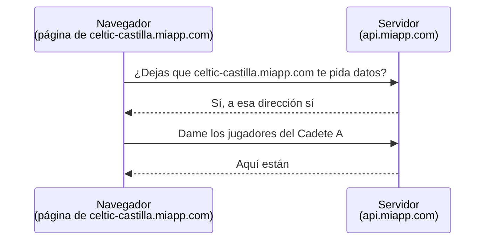
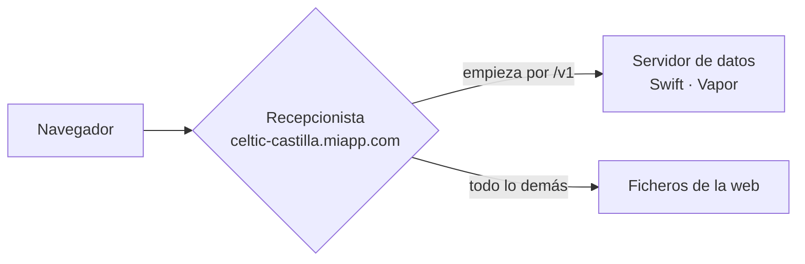

# CORS explicado sencillo: la web y la API en la misma dirección

> Explica en lenguaje llano la idea central del punto 2 de
> [[Dominios, subdominios, API y CORS]]: qué norma del navegador entra en juego cuando una web
> pide datos a un servidor, por qué molesta y cómo la evitamos sin tener que configurarla. Para la parte técnica (DNS,
> certificados, el ejemplo de configuración), ver esa nota.
>
> Escrita el 2026-10-12, al decidir el tipo de web del backoffice (ADR-Backoffice-001, decisión 1). Las
> secciones 5 y 6 —el recepcionista de cerca y dónde viven los ficheros de la web— se añadieron el mismo
> día. **Lo que dependa de dónde se publique se cierra en la decisión 5 de ese ADR**; aquí van las
> opciones y lo que hay que comprobar.

---

## 1. La norma del navegador

**Una página web solo puede pedir datos libremente a la misma dirección de la que vino.**

Es una norma de seguridad de todos los navegadores. Sin ella, cualquier web que visitaras podría, sin que
te enterases, ir a tu banco o a tu correo **usando tu sesión abierta** y leer lo que quisiera. El navegador
lo impide porque la web maliciosa y tu banco son direcciones distintas.

## 2. Qué cuenta como «la misma dirección»

Para el navegador, una dirección son tres cosas juntas, y **las tres tienen que coincidir exactamente**:

| Parte | Ejemplo |
|---|---|
| El tipo de conexión | `https` |
| El nombre | `celtic-castilla.miapp.com` |
| La puerta (puerto) | `443`, que es la de siempre y no se escribe |

Que dos nombres se parezcan no cuenta. Compartir el final (`…miapp.com`) tampoco:

| Web | Servidor de datos | ¿Misma dirección? |
|---|---|---|
| `https://celtic-castilla.miapp.com` | `https://celtic-castilla.miapp.com` | ✅ sí |
| `https://celtic-castilla.miapp.com` | `https://api.miapp.com` | ❌ no: otro nombre |
| `https://celtic-castilla.miapp.com` | `https://celtic-castilla.api.miapp.com` | ❌ no: otro nombre |
| `https://celtic-castilla.miapp.com` | `http://celtic-castilla.miapp.com` | ❌ no: otro tipo de conexión |
| `http://localhost:5173` | `http://localhost:8080` | ❌ no: otra puerta |

La última fila es la que aparece en cuanto empiezas a desarrollar: la web y el servidor, en tu propio
ordenador, escuchan en puertas distintas.

## 3. Qué pasa cuando no coinciden

La norma no prohíbe del todo hablar con otra dirección: **obliga a pedir permiso**. A eso se le llama
**CORS**, y funciona así:



Cada petición con usuario y contraseña lleva **una pregunta previa** delante. Y eso trae tres molestias:

1. **Más lento.** Cada petición son dos viajes en vez de uno. Se puede pedir al navegador que recuerde el
   permiso un rato, pero nunca se elimina del todo.
2. **Una lista que mantener.** El servidor tiene que saber a qué direcciones dice que sí. En este proyecto
   **cada club tiene la suya** y se dan de alta sin tocar nada más, así que la lista no se puede escribir
   una vez y olvidarse: habría que consultarla contra la tabla de clubes en cada petición.
3. **Código de seguridad propio.** Esa comprobación la escribiríamos nosotros. La salida fácil que traen
   las herramientas («di que sí a quien pregunte») equivale a desactivar la norma. Un error ahí deja la
   puerta abierta a quien no debe.

**Las apps del móvil no tienen nada de esto**: la norma es de los navegadores, no de internet. Una app de
iOS o Android habla con el servidor sin preguntas previas.

## 4. La solución: no configurar CORS, sino hacer que no haga falta

Se ponen la web y el servidor **bajo la misma dirección**, y se distinguen por cómo empieza el camino:

```
https://celtic-castilla.miapp.com/              → la web (pantallas, botones, formularios)
https://celtic-castilla.miapp.com/v1/...        → el servidor (los datos)
```

En la puerta hay un **recepcionista**: un programa pequeño cuya única tarea es repartir lo que llega. En
el oficio se llama *proxy inverso*.



Para el navegador todo es **la misma dirección**, así que la norma no se activa: no hay pregunta
previa, no hay lista y no hay código de seguridad nuestro.

Siguen siendo **dos programas independientes**, que se publican y se actualizan cada uno por su lado. Lo
único que comparten es el nombre que ve el usuario.

### Lo que no cambia

- **Cada club conserva su propia dirección.** El nombre del club sigue siendo la primera parte
  (`celtic-castilla.…`).
- **El servidor sigue sabiendo de qué club es cada petición igual que ahora**, leyendo ese nombre. Lo
  único que tiene que hacer el recepcionista es **no cambiarlo** al pasar la petición; es el fallo
  típico de este montaje y conviene comprobarlo en cuanto lo haya.
- **Las apps del móvil** pueden usar la misma dirección o una propia: a ellas les da igual.

### Lo que se gana de regalo

- **Lo que un club guarda en el navegador no lo ve otro.** El navegador guarda la sesión de cada
  dirección por separado, así que la página de un club no puede leer la sesión de otro aunque estén en el
  mismo ordenador.
- **Un solo certificado de seguridad** (el del candado) cubre todos los clubes: `*.miapp.com`. Con el
  servidor en `….api.miapp.com` harían falta dos.
- **Se evita una confusión al reconocer el club**: con `api.miapp.com` el servidor podría tomar `api` por
  el nombre de un club. Ver la tabla del punto 2 de [[Dominios, subdominios, API y CORS]].

### Lo que cuesta

- **Montar el recepcionista una vez**, al publicar. Qué es exactamente, dónde puede vivir y cómo se
  despliega: la sección 5.
- **Reservar nombres**: ningún club se puede llamar `www`, `api`, `admin`… porque su dirección chocaría
  con la de la infraestructura. **Ya está hecho**: el servidor tiene esa lista y nunca toma esos nombres
  por un club (`backend/Sources/Tenancy/TenantResolver.swift`, `reserved`).

## 5. El recepcionista, de cerca

### Qué hace exactamente

Cuatro trabajos, y ninguno más:

1. **Pone el candado.** Es el que habla con el navegador en `https`, así que es quien guarda el
   certificado de seguridad. Por dentro, hacia el servidor, la conversación puede ir sin cifrar si es en la
   misma máquina o en una red privada.
2. **Reparte por el principio del camino.** Lo que empieza por `/v1` va al servidor de datos y todo lo
   demás, a los ficheros de la web.
3. **Pasa el nombre de la dirección sin tocarlo.** Este es **el trabajo que no se puede hacer mal**. El
   servidor averigua el club leyendo el nombre con el que llegó la petición: la cabecera `Host`, en
   `TenantResolver.swift` (`slug(fromHost:)`). Muchos recepcionistas, al reenviar, ponen en su lugar el
   nombre interno del destino. Si pasa eso, **todas las peticiones llegan como "ningún club"**, o todas
   como el mismo. Y nuestro servidor **no lee** la cabecera alternativa con la que algunos recepcionistas
   avisan del nombre original (`X-Forwarded-Host`), así que hoy la única manera de que funcione es que el
   nombre llegue intacto.
4. **Entrega los ficheros de la web**, si se decide que sea él quien lo haga (sección 6).

**Sobre el prefijo:** el servidor ya contesta en `/v1/…`, sin `/api` delante. Lo más sencillo es que el
recepcionista reparta por `/v1` y no tenga que reescribir nada; ninguna pantalla de la web empezará por
`/v1`. Si se prefiere `/api/v1` por claridad, el recepcionista quita el `/api` al pasarla. Se decide en el
LLD del backoffice.

### Dónde puede vivir

Hay tres sitios posibles. **El servidor se publicará en Fly.io** (ADR-API_y_BBDD-001, decisión 6), así que
las tres se piensan alrededor de eso.

| | Dónde vive | Cómo se despliega | A favor | En contra |
|---|---|---|---|---|
| **a. Un recepcionista propio junto al servidor** | Un programa pequeño (p. ej. **Caddy**) dentro del mismo paquete que se sube a Fly.io, o en un segundo paquete al lado, hablando por la red privada de Fly.io | Su configuración es un fichero de texto en el repositorio (el `Caddyfile`, ejemplo en [[Dominios, subdominios, API y CORS]]). Se mete en la imagen de Docker y se sube con `fly deploy`, como el servidor | Todo bajo control y versionado. Pasa el nombre intacto por defecto. Puede entregar también los ficheros de la web | Un programa más que vigilar. Si va en el mismo paquete que el servidor, hay que arrancar dos programas dentro de un solo contenedor |
| **b. El servicio que aloja la web hace de recepcionista** | Netlify, Vercel o Cloudflare alojan los ficheros y, con una regla de "reenvío", mandan `/v1/*` al servidor en Fly.io | Una regla en un fichero de configuración del propio servicio | Nada que montar: viene con el alojamiento. Los ficheros se sirven desde copias repartidas por el mundo | **El riesgo del trabajo 3**: al reenviar a otra dirección, estos servicios suelen poner el nombre del destino. Habría que comprobarlo en cada uno y, si lo cambian, enseñar al servidor a leer `X-Forwarded-Host` **solo cuando venga del recepcionista**, que es código de seguridad nuevo |
| **c. Sin recepcionista: el servidor entrega también la web** | El propio servidor Swift sirve los ficheros de la web (Vapor trae una pieza para eso) además de los datos | Los ficheros de la web se copian dentro de la imagen del servidor antes de `fly deploy` | Un solo programa y nada que configurar. El nombre llega intacto porque no hay intermediario | Cada cambio en la web obliga a volver a publicar el servidor. Mezcla dos trabajos en el mismo programa |

En las tres, **el candado lo puede poner la propia entrada de Fly.io**, que se encarga de los certificados.

**Elegida el 2026-10-12: la a., con Caddy en una máquina propia** («web») y el servidor en otra («api»), sin
dirección pública. Lo comprobado en la documentación y las razones están en la decisión 5 del
[ADR-Backoffice-001](../ADR-Backoffice-001.md). En resumen: Fly.io emite el certificado comodín (1 $/mes);
su función para servir ficheros (`[[statics]]`) **no cumple las dos reglas de la sección 6**; y Caddy pasa
el nombre intacto mientras reenvíe por `http`, que es lo que ocurre dentro de la red privada de Fly.io. Queda
por medir al publicar si la entrada de Fly.io se lo entrega intacto a Caddy: lo dice la prueba de humo de
abajo.

### Cómo se comprueba que funciona

Cuatro llamadas desde la terminal, con la web ya publicada. Son la prueba de humo del montaje:

| Llamada | Lo que tiene que pasar |
|---|---|
| `curl https://celtic-castilla.miapp.com/v1/club` | Devuelve los datos de **ese** club. Si sale otro club o un error de "club desconocido", el recepcionista ha cambiado el nombre (trabajo 3) |
| `curl https://otro-club.miapp.com/v1/club` | Devuelve el **otro** club, no el mismo que antes |
| `curl https://celtic-castilla.miapp.com/` | Devuelve la página de la web (`index.html`) |
| `curl https://celtic-castilla.miapp.com/equipos/123` | **También** devuelve `index.html`, no un "no encontrado" (sección 6, regla 1) |

### Y en el propio ordenador, mientras desarrollamos

Aquí la web y el servidor están en puertas distintas (`:5173` y `:8080`), que según la tabla de la sección
2 son direcciones distintas. La solución es la misma: **Vite**, la herramienta que arranca la web en
desarrollo, trae **su propio recepcionista**. Se configura en su fichero, `vite.config.ts`:

```ts
server: {
  proxy: {
    // Lo que empiece por /v1, al servidor de datos.
    // changeOrigin: false → el nombre de la dirección pasa intacto (trabajo 3).
    '/v1': { target: 'http://localhost:8080', changeOrigin: false },
  },
},
```

Abres `http://celtic-castilla.localhost:5173` y, para el navegador, web y datos vienen del mismo sitio. El
servidor recibe el nombre `celtic-castilla.localhost:5173` y saca el club igual que siempre, porque **no
mira la puerta**: la quita antes de leer el nombre (`TenantResolver.swift`, primera línea de
`slug(fromHost:)`).

Este recepcionista **solo existe mientras desarrollas**: cuando la web se prepara para publicarse, Vite
desaparece y quedan los ficheros de la sección 6. Por eso hace falta otro en producción.

Así, **en desarrollo y en producción la web funciona igual**, y no hay un permiso de CORS «solo para
desarrollo» que pueda acabar llegando a producción por despiste.

## 6. Dónde viven los ficheros de la web y quién los entrega

### Qué ficheros son

La web, ya preparada para publicar, **no es un programa que se quede en marcha**: es una carpeta de
ficheros. Se fabrica con una orden (`npm run build`) a partir del código de `backoffice/`, y sale algo así:

```
dist/
├── index.html                  ← la página de entrada; casi vacía
├── assets/
│   ├── index-4f9a2c1e.js       ← toda la aplicación: pantallas, botones, lógica
│   ├── index-b7d03e55.css      ← el aspecto
│   └── escudo-91ac04f2.png
└── favicon.ico
```

Los números raros de los nombres los pone la fabricación: **cambian cada vez que cambia el contenido**. Su
utilidad está en la regla 2, abajo.

Tres cosas que conviene tener claras:

- **Son los mismos ficheros para todos los clubes y todos los usuarios.** No hay una copia por club: la web,
  ya en el navegador, mira en qué dirección está abierta y pide los datos de ese club.
- **No llevan datos dentro.** Ni un jugador ni un partido. Los datos llegan después, pidiéndolos a `/v1`.
- **Son públicos.** Cualquiera puede descargarlos sin iniciar sesión, igual que puede ver el código de
  cualquier web. Por eso **no puede ir nada secreto** en ellos. La clave pública de Supabase sí puede ir,
  porque está pensada para eso; la clave de servicio de Supabase y las contraseñas de la base, **jamás**.
  Los datos de los menores solo viajan tras iniciar sesión, por `/v1`, y eso lo controla el servidor.

### Dónde se fabrican

En el ordenador del desarrollador o, cuando lo haya, en el CI. **No en el servidor de producción.** La
carpeta `dist/` no se guarda en el repositorio: se fabrica de nuevo en cada publicación a partir del
código, igual que el binario del servidor sale de un commit.

### Quién los entrega

Depende de dónde viva el recepcionista (sección 5), y van emparejados:

| Recepcionista | Dónde viven los ficheros | Quién los entrega |
|---|---|---|
| **a.** Propio (Caddy) junto al servidor | Copiados dentro de la imagen de Docker, junto al Caddy | El propio Caddy (`file_server`) |
| **b.** El servicio de alojamiento | En el servicio (Netlify, Vercel, Cloudflare), con copias repartidas por el mundo | El servicio |
| **c.** Ninguno | Copiados dentro de la imagen del servidor Swift (su carpeta `Public/`) | El servidor Swift |

### Dos reglas que tiene que cumplir quien los entregue

**Regla 1 · Cualquier camino que no sea un fichero devuelve `index.html`.**

Las pantallas de la web (`/equipos`, `/equipos/123/plantilla`) **no existen como ficheros**: existen dentro
de la aplicación, que ya está en el navegador. Moviéndote por la web no pasa nada, porque no se pide nada
al servidor. Pero si **recargas la página** o **abres un enlace guardado**, el navegador pide
`/equipos/123/plantilla` a quien entrega los ficheros. Si este busca un fichero con ese nombre, no lo
encuentra y responde "no encontrado". La regla dice que, cuando no sea un fichero, devuelva `index.html`:
la aplicación arranca, mira el camino y pinta la pantalla correcta. En Caddy es la línea
`try_files {path} /index.html`; en Netlify y compañía, una regla de su fichero de configuración.

La regla vale para **todo menos `/v1`**: una petición de datos mal escrita tiene que dar el error del
servidor, no la página de la web.

**Regla 2 · `index.html` nunca se guarda en caché; lo demás, para siempre.**

El navegador guarda copias para no descargar dos veces lo mismo. Si guardase `index.html`, al publicar una
versión nueva seguiría arrancando la vieja. Así que:

- **`index.html`**: que el navegador lo pida siempre de nuevo. Pesa muy poco.
- **Todo lo de `assets/`**: que lo guarde para siempre. Como su nombre cambia cuando cambia el contenido, la
  versión nueva tiene nombres nuevos, el `index.html` nuevo apunta a ellos y el navegador los descarga.
  Lo que no ha cambiado conserva su nombre y no se vuelve a descargar.

Las dos reglas se comprueban con las dos últimas filas de la prueba de humo de la sección 5.

## 7. En una frase

> El navegador desconfía de las páginas que piden datos a otra dirección. En vez de enseñarle a confiar,
> le enseñamos una sola dirección por club y dejamos que un recepcionista reparta por dentro, sin tocar
> el nombre con el que llegó cada petición.
