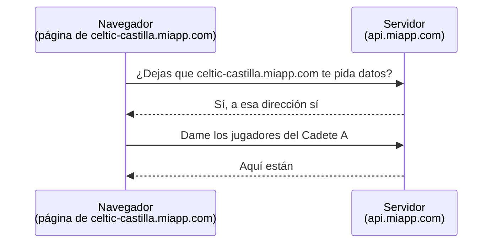
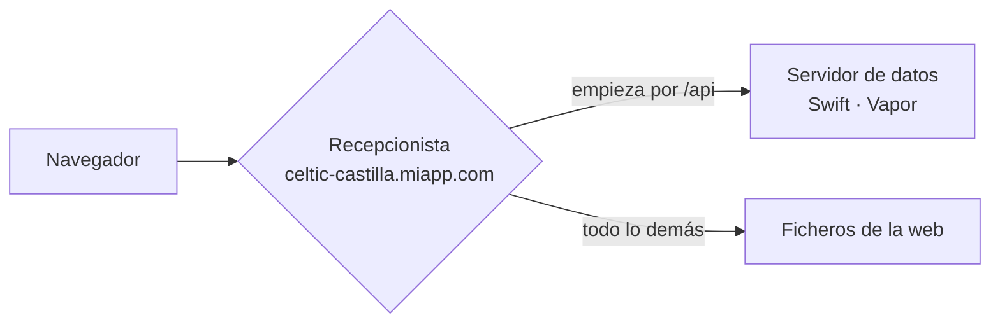

# CORS explicado sencillo: la web y la API en la misma dirección

> Explica en lenguaje llano la idea central del punto 2 de
> [[Dominios, subdominios, API y CORS]]: qué norma del navegador entra en juego cuando una web
> pide datos a un servidor, por qué molesta y cómo la evitamos sin tener que configurarla. Para la parte técnica (DNS,
> certificados, el ejemplo de configuración), ver esa nota.
>
> Escrita el 2026-10-12, al decidir el tipo de web del backoffice (ADR-Backoffice-001, decisión 1).

---

## 1. La norma del navegador

**Una página web solo puede pedir datos libremente a la misma dirección de la que vino.**

Es una norma de seguridad de todos los navegadores. Sin ella, cualquier web que visitaras podría, sin que
te enterases, ir a tu banco o a tu correo **usando tu sesión abierta** y leer lo que quisiera. El navegador
lo impide porque la web maliciosa y tu banco son direcciones distintas.

## 2. Qué cuenta como «la misma dirección»

Para el navegador, una dirección son tres cosas juntas, y **las tres tienen que coincidir exactamente**:

| Parte | Ejemplo |
|---|---|
| El tipo de conexión | `https` |
| El nombre | `celtic-castilla.miapp.com` |
| La puerta (puerto) | `443`, que es la de siempre y no se escribe |

Que dos nombres se parezcan no cuenta. Compartir el final (`…miapp.com`) tampoco:

| Web | Servidor de datos | ¿Misma dirección? |
|---|---|---|
| `https://celtic-castilla.miapp.com` | `https://celtic-castilla.miapp.com` | ✅ sí |
| `https://celtic-castilla.miapp.com` | `https://api.miapp.com` | ❌ no: otro nombre |
| `https://celtic-castilla.miapp.com` | `https://celtic-castilla.api.miapp.com` | ❌ no: otro nombre |
| `https://celtic-castilla.miapp.com` | `http://celtic-castilla.miapp.com` | ❌ no: otro tipo de conexión |
| `http://localhost:5173` | `http://localhost:8080` | ❌ no: otra puerta |

La última fila es la que aparece en cuanto empiezas a desarrollar: la web y el servidor, en tu propio
ordenador, escuchan en puertas distintas.

## 3. Qué pasa cuando no coinciden

La norma no prohíbe del todo hablar con otra dirección: **obliga a pedir permiso**. A eso se le llama
**CORS**, y funciona así:



Cada petición con usuario y contraseña lleva **una pregunta previa** delante. Y eso trae tres molestias:

1. **Más lento.** Cada petición son dos viajes en vez de uno. Se puede pedir al navegador que recuerde el
   permiso un rato, pero nunca se elimina del todo.
2. **Una lista que mantener.** El servidor tiene que saber a qué direcciones dice que sí. En este proyecto
   **cada club tiene la suya** y se dan de alta sin tocar nada más, así que la lista no se puede escribir
   una vez y olvidarse: habría que consultarla contra la tabla de clubes en cada petición.
3. **Código de seguridad propio.** Esa comprobación la escribiríamos nosotros. La salida fácil que traen
   las herramientas («di que sí a quien pregunte») equivale a desactivar la norma. Un error ahí deja la
   puerta abierta a quien no debe.

**Las apps del móvil no tienen nada de esto**: la norma es de los navegadores, no de internet. Una app de
iOS o Android habla con el servidor sin preguntas previas.

## 4. La solución: no configurar CORS, sino hacer que no haga falta

Se ponen la web y el servidor **bajo la misma dirección**, y se distinguen por cómo empieza el camino:

```
https://celtic-castilla.miapp.com/              → la web (pantallas, botones, formularios)
https://celtic-castilla.miapp.com/api/v1/...    → el servidor (los datos)
```

En la puerta hay un **recepcionista**: un programa pequeño cuya única tarea es repartir lo que llega. En
el oficio se llama *proxy inverso*.



Para el navegador todo es **la misma dirección**, así que la norma no se activa: no hay pregunta
previa, no hay lista y no hay código de seguridad nuestro.

Siguen siendo **dos programas independientes**, que se publican y se actualizan cada uno por su lado. Lo
único que comparten es el nombre que ve el usuario.

### Lo que no cambia

- **Cada club conserva su propia dirección.** El nombre del club sigue siendo la primera parte
  (`celtic-castilla.…`).
- **El servidor sigue sabiendo de qué club es cada petición igual que ahora**, leyendo ese nombre. Lo
  único que tiene que hacer el recepcionista es **no cambiarlo** al pasar la petición; es el fallo
  típico de este montaje y conviene comprobarlo en cuanto lo haya.
- **Las apps del móvil** pueden usar la misma dirección con `/api` o una propia: a ellas les da igual.

### Lo que se gana de regalo

- **Lo que un club guarda en el navegador no lo ve otro.** El navegador guarda la sesión de cada
  dirección por separado, así que la página de un club no puede leer la sesión de otro aunque estén en el
  mismo ordenador.
- **Un solo certificado de seguridad** (el del candado) cubre todos los clubes: `*.miapp.com`. Con el
  servidor en `….api.miapp.com` harían falta dos.
- **Se evita una confusión al reconocer el club**: con `api.miapp.com` el servidor podría tomar `api` por
  el nombre de un club. Ver la tabla del punto 2 de [[Dominios, subdominios, API y CORS]].

### Lo que cuesta

- **Configurar el recepcionista una vez**, al publicar. Son unas pocas líneas; hay un ejemplo con Caddy
  en [[Dominios, subdominios, API y CORS]]. Muchos servicios de alojamiento traen uno incorporado.
- **Reservar nombres**: ningún club se puede llamar `www`, `api`, `admin`… porque su dirección chocaría
  con la de la infraestructura.

## 5. Y mientras desarrollamos, en el propio ordenador

Aquí la web y el servidor están en puertas distintas (`:5173` y `:8080`), que según la tabla del punto 2
son direcciones distintas. La solución es la misma: la herramienta con la que se construye la web trae
**su propio recepcionista**, que reenvía al servidor todo lo que empieza por `/v1`. Abres
`http://celtic-castilla.localhost:5173` y, para el navegador, web y datos vienen del mismo sitio.

Así, **en desarrollo y en producción la web funciona igual**, y no hay un permiso de CORS «solo para
desarrollo» que pueda acabar llegando a producción por despiste.

## 6. En una frase

> El navegador desconfía de las páginas que piden datos a otra dirección. En vez de enseñarle a confiar,
> le enseñamos una sola dirección por club y dejamos que un recepcionista reparta por dentro.
