# La web del backoffice por dentro: el andamiaje de la rebanada 0, explicado para estudiar

> Un documento de estudio, no de referencia: explica **qué se montó en la rebanada 0 de la web y por qué**,
> de lo general a lo concreto, para quien no viene del desarrollo web. Las reglas en sí están en el
> [LLD del backoffice](../Backoffice%20LLD-001.md) y lo que se hizo paso a paso, en el
> [plan](../../backoffice/Plan%20backoffice-001.md) (`R0.1`–`R0.13`).
>
> Escrito el 2026-10-17, al cerrar la rebanada 0. Cada sección empieza con un resumen de dos líneas: se puede
> leer solo eso y volver luego.

---

## Parte I · La vista desde arriba

### 1. Qué es la rebanada 0, y por qué va antes que ninguna pantalla

> **En dos líneas:** una web vacía que ya sabe arrancar, hablar con el servidor y probarse. Es el andamio de
> la obra: no se ve en el edificio terminado, pero sin él no se puede construir.

La web del club se construye **una pantalla cada vez** (cada una es una *rebanada*). Pero antes de la
primera pantalla hay trabajo que no es de ninguna en concreto y que todas necesitan: elegir las herramientas,
conectar la web con el servidor, preparar las pruebas… Eso es la rebanada 0.

Al terminarla, en el navegador **no se ve nada**: una página en blanco. Lo que hay está por detrás.

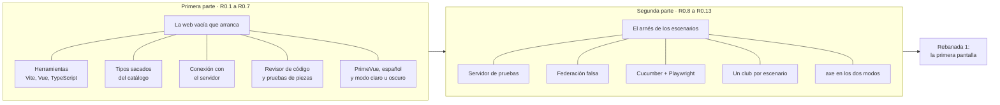

**El «arnés»** es todo lo que rodea a una prueba para que pueda ejecutarse: lo que arranca, prepara datos y
limpia después. En un banco de pruebas de electrónica sería el cableado, no el circuito que se prueba.

### 2. El mapa de las piezas cuando trabajas

> **En dos líneas:** cuando usas la web en tu Mac hay cuatro piezas en marcha, cada una en su puerto. La web
> nunca habla directamente con la base de datos: siempre a través del servidor.

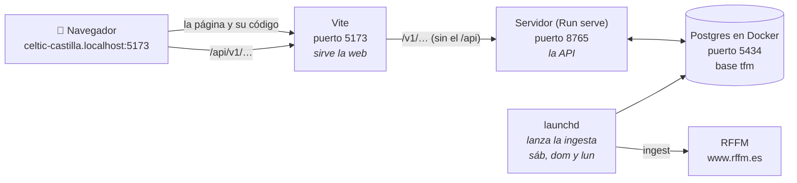

| Pieza | Qué es, en lenguaje llano | Quién la arranca |
|---|---|---|
| **Navegador** | Donde ves la web | Tú |
| **Vite** | Un servidor pequeño que entrega la web al navegador mientras se desarrolla, y le pasa al servidor de verdad las peticiones de datos | `npm run dev` |
| **Servidor** (`Run serve`) | La API del backend: recibe peticiones, aplica las reglas y lee o escribe en la base | `swift run Run serve`, desde `backend/` |
| **Postgres** | La base de datos, dentro de un contenedor de Docker | Docker, siempre encendido |
| **RFFM** | La federación: de ahí salen partidos, clasificaciones y goleadores | Nadie: es de fuera |

**El puerto del servidor se elige en un solo sitio**, el fichero `backend/.env.development` (`API_PORT=8765` en
este Mac). Lo leen los dos: el servidor al arrancar y Vite para saber adónde mandar las peticiones. Sin el
fichero, los dos usan el 8080. Es de cada Mac y git no lo guarda. Se eligió así, y no con una variable en el
perfil del shell, porque `API_PORT` es un nombre tan genérico que otra aplicación podría leerlo.

**El club va en la dirección.** `celtic-castilla.localhost` es el club `celtic-castilla`. El servidor lee ese
primer trozo del nombre y con eso sabe con qué club está hablando. Por eso la web no tiene un desplegable para
elegir club.

### 3. El mapa de las piezas cuando se prueba

> **En dos líneas:** los escenarios montan **su propia copia** de todo, en otros puertos y otra base, para no
> tocar lo tuyo. Y en el sitio de la RFFM ponen una federación falsa.

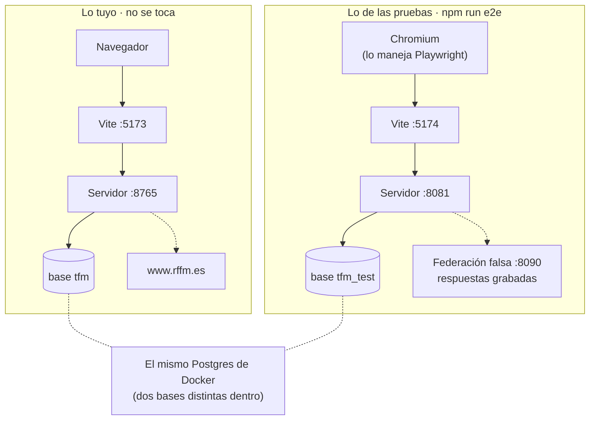

| | Cuando trabajas | Cuando se prueba |
|---|---|---|
| Web | 5173 | **5174** |
| Servidor | 8765 (el de `backend/.env.development`) | **8081** |
| Base | `tfm` | **`tfm_test`** |
| Federación | la RFFM real | **la falsa, en el 8090** |
| Club | `celtic-castilla` | **uno nuevo por escenario**, `bo-…` |

Lo único compartido es el **Postgres**: es un solo programa con dos bases dentro, como un armario con dos
cajones. Por eso los escenarios nunca lo paran: solo paran **sus** copias.

---

## Parte II · La web que arranca (R0.1 a R0.7)

### 4. Las herramientas, y para qué sirve cada una

> **En dos líneas:** Node ejecuta las herramientas, Vite sirve la web, Vue la dibuja y TypeScript comprueba
> que los datos encajan antes de ejecutar nada.

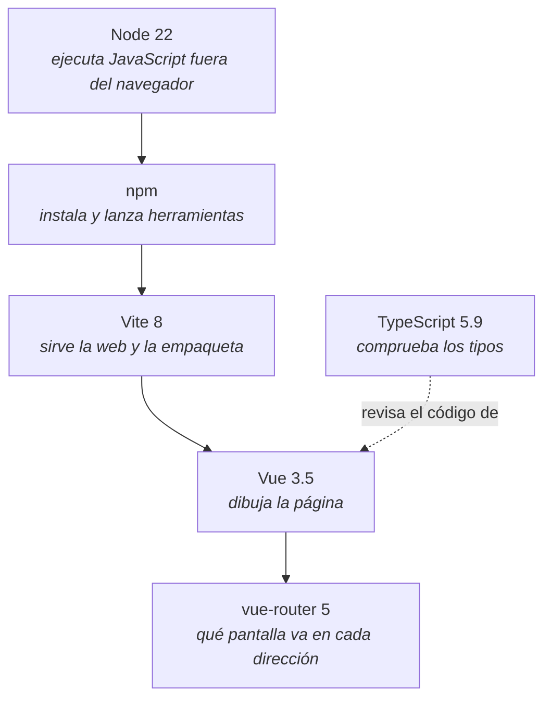

| Herramienta | Comparación | Dónde se nota |
|---|---|---|
| **Node** | El motor. Sin él no corre ninguna de las demás | La versión está fijada en `.nvmrc` (22) |
| **npm** | El gestor de paquetes: como una tienda de aplicaciones para herramientas | `npm install`, `npm run …` |
| **Vite** | El camarero: te sirve la web mientras trabajas y, al terminar, la empaqueta para publicarla | `npm run dev`, `npm run build` |
| **Vue** | El dibujante: convierte las piezas (`.vue`) en lo que ves | `src/App.vue`, `src/screens/` |
| **TypeScript** | El corrector: avisa si pasas un dato que no encaja antes de ejecutar nada | `npm run typecheck` |
| **vue-router** | El mapa: qué pantalla va en cada dirección (`/`, `/equipos/…`) | `src/router.ts` |

> **Una lección de versiones:** la plantilla de Vite traía TypeScript 6, y la herramienta que fabrica los tipos
> del catálogo (sección 6) solo acepta la 5. Se fijó la 5.9.3 ([DW-16](../Backoffice%20LLD-Anexo-Decisiones-Disenho-001.md)).
> **Lo más nuevo no siempre encaja con lo demás.**

### 5. Las carpetas, y la frontera entre piezas y conexión

> **En dos líneas:** cada carpeta tiene un trabajo. La regla que importa: las piezas (`components/`) solo
> pintan lo que les dan; **nunca** hablan con el servidor.

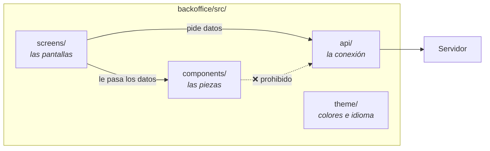

Piensa en un restaurante:

- La **pantalla** (`screens/`) es el camarero: va a la cocina (el servidor) a por el plato.
- La **pieza** (`components/`) es el plato: se sirve con lo que le pongan encima. No va a la cocina.
- La **conexión** (`api/`) es la ventanilla de la cocina: todo pedido pasa por ahí.

**¿Por qué tanto empeño?** Porque una pieza que no habla con el servidor **se puede probar sola**, dándole datos
como se le dan argumentos a una función, sin servidor ni base. Es lo que hace barata la prueba de piezas
(sección 9). La regla está escrita en el revisor de código: si una pieza importa algo de `api/`, da error
([DW-01](../Backoffice%20LLD-Anexo-Decisiones-Disenho-001.md)).

### 6. El catálogo convertido en tipos

> **En dos líneas:** el catálogo de la API (`openapi.yaml`) describe cada petición y cada dato. De él se
> fabrica solo un fichero de tipos, y así una dirección mal escrita falla antes de ejecutar nada.

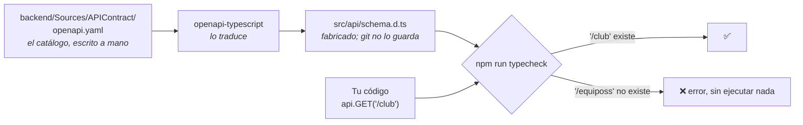

**El catálogo** es el contrato entre el servidor y la web: qué direcciones hay, qué se manda y qué se recibe.
Lo escribe el backend, y la web **no copia nada a mano**: antes de `dev`, `typecheck` y `build` se vuelve a
fabricar `schema.d.ts`.

Para ti, como QA, esto es una prueba gratis: **si el catálogo cambia y la web no se ha adaptado, no compila.**
El error sale en tu Mac antes de que nadie abra la página. Comprobado en `R0.3`: `client.GET('/equiposs')` hace
fallar `typecheck` diciendo que `'/equiposs'` no es una dirección válida.

### 7. La conexión con el servidor

> **En dos líneas:** toda petición sale por `src/api/client.ts`, que le pone `/api/v1` delante, la corta a los
> 30 segundos y permite cancelarla. Vite le quita el `/api` y se la pasa al servidor.

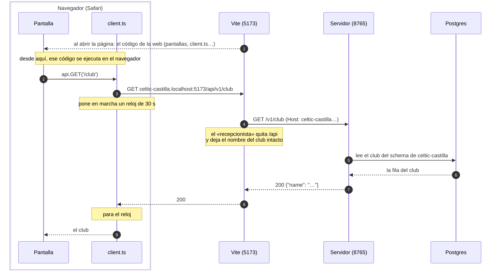

**Vite hace dos trabajos, en dos momentos.** Al abrir la página, entrega al navegador el código de la web,
`client.ts` incluido (el paso 1). A partir de ahí ese código corre **en el navegador**, así que cada petición
nace allí: la pantalla llama a `client.ts`, que la prepara y la manda por la red, y solo entonces llega a Vite,
que hace de recepcionista. Es como una tienda que primero te vende el teléfono y luego hace de centralita:
marcas en tu teléfono (`client.ts`) y la llamada pasa por la centralita (Vite) hasta el otro lado (el servidor).

Tres reglas, cada una con su prueba de piezas en `src/api/client.test.ts`:

| Regla | Qué pasa | Por qué |
|---|---|---|
| **Todo va bajo `/api/v1`** | `api.GET('/club')` sale a `/api/v1/club` | `/api` es la señal para el recepcionista; `v1`, la versión del catálogo |
| **30 s como mucho** | Si no hay respuesta, llega el error «el servidor no responde» | Más que los 20 s que el servidor espera a la federación, para no cortarle mientras trabaja |
| **Se puede cancelar** | Una petición cancelada no entrega nada | Si sales de la pantalla, su respuesta ya no le interesa a nadie |

**El recepcionista** (el *proxy* de Vite) existe para que la web y la API **parezcan estar en la misma
dirección**. Así el navegador no aplica sus reglas contra pedir datos a otro sitio (CORS). Está explicado
despacio en [CORS explicado sencillo](./CORS%20explicado%20sencillo%20-%20la%20web%20y%20la%20API%20en%20la%20misma%20direcci%C3%B3n.md).

**A tu servidor se le llama sin `/api`.** Sus direcciones empiezan directamente por `/v1/…`. El `/api` lo pone
la web solo para que Vite sepa qué peticiones son de datos y debe pasar al servidor, y Vite se lo quita antes de
pasarlas. Para probarlo con tus ojos, con `swift run Run serve` en marcha:

| Llamada | Por dónde pasa | Qué sale |
|---|---|---|
| `curl -s http://celtic-castilla.localhost:5173/api/v1/club` | Por Vite, que quita `/api` y pasa `/v1/club` al 8765 | ✅ el club |
| `curl -s http://celtic-castilla.localhost:8765/v1/club` | **Directo a tu servidor**, sin Vite | ✅ el club, lo mismo |
| `curl -s http://celtic-castilla.localhost:8765/api/v1/club` | Directo a tu servidor, pero con `/api` | ❌ «no encontrado»: el servidor no tiene ninguna dirección que empiece por `/api` |

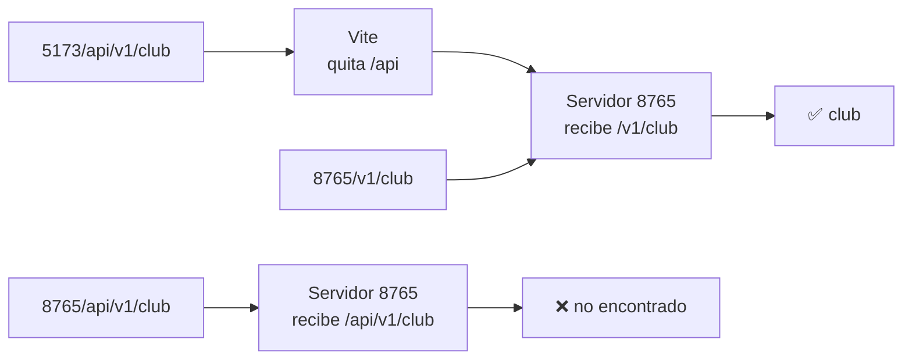

La segunda es la del día a día, para preguntar a tu servidor directamente: es la que usan todos los `curl` del
README del backend. La tercera no se usa nunca; está solo para ver que el `/api` lo quita Vite, no el servidor.

**Dónde está el recepcionista.** No tiene un fichero propio: es un trozo de la configuración de Vite, en
**`backoffice/vite.config.ts`** (*proxy* es su nombre técnico). Tiene dos partes:

```ts
// Adónde manda las peticiones
function apiTarget(mode: string): string {
  if (process.env.BACKOFFICE_API_URL) return process.env.BACKOFFICE_API_URL   // 1. las pruebas (8081)
  const port = loadEnv(mode, '../backend', 'API_PORT').API_PORT ?? '8080'     // 2. backend/.env.development (tu 8765)
  return `http://127.0.0.1:${port}`                                          // 3. si no, el 8080
}
```

```ts
// Qué hace con cada petición
proxy: {
  '/api': {                                            // lo que empiece por /api…
    target: apiTarget(mode),                           // …se manda a ese servidor…
    changeOrigin: false,                               // …sin tocar el nombre (así el club llega intacto)…
    rewrite: (path) => path.replace(/^\/api/, ''),     // …y quitándole el /api
  },
},
```

> **Si la primera devuelve la página HTML en vez del club**, la web que tienes en marcha no tiene el recepcionista
> activo: se arrancó antes de que existiera, o con otra configuración. Párala con `Ctrl+C` y vuelve a lanzar
> `npm run dev`. Pasó de verdad el 2026-10-17, con una web arrancada desde antes de `R0.4`.

**¿Cómo se prueban los 30 s sin esperar 30 s?** Con un **reloj de mentira**: Vitest adelanta el tiempo de
golpe. La prueba comprueba que a los 29,999 s sigue esperando y que a los 30 s falla.

### 8. PrimeVue, el idioma y el modo claro u oscuro

> **En dos líneas:** PrimeVue da las piezas ya hechas (calendarios, tablas, botones) en español. Y el modo
> claro u oscuro se decide **antes** de pintar, para que no haya un destello blanco.

**PrimeVue** es una caja de piezas de interfaz: en vez de dibujar un calendario desde cero, se usa el suyo.
Se configura en `src/theme/primevue.ts`, con tres cosas:

- **El tema Aura**, sus colores por defecto. Los del club se miden de los bocetos en la rebanada 1.
- **Los textos en español** (con `primelocale`): meses, días, botones de «Hoy» o «Borrar».
- **La semana empieza en lunes.**

La prueba de `src/theme/primevue.test.ts` monta un calendario y comprueba que los días salen
`L M X J V S D` y el mes, «Octubre». Su rojo, sin el idioma, decía `Su Mo Tu…`.

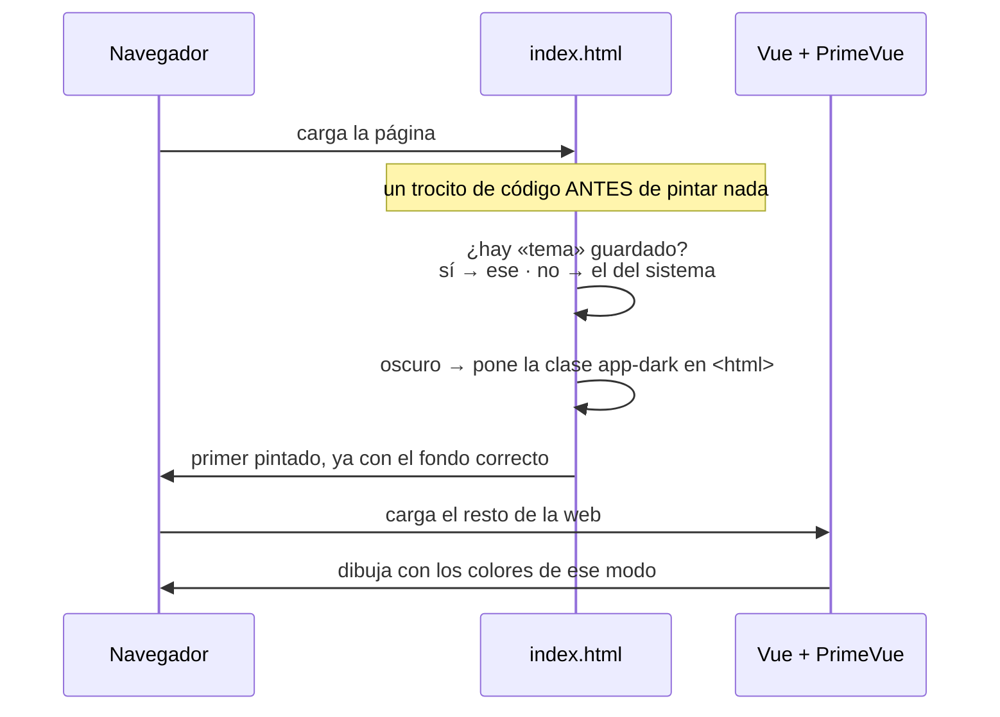

**¿Por qué antes de pintar?** Si el modo se eligiera después de cargar Vue, durante una fracción de segundo
verías la página en blanco y luego en oscuro: un destello molesto. El trocito de `index.html` va **antes de
todo**. Lo único que la web guarda en el navegador es esa elección (`tema`).

> **Una lección de licencias:** PrimeVue 5 dejó de ser libre (licencia comercial, con clave anual). Se fijó la
> 4.5.5, que sigue siendo MIT (nota en el ADR, decisión 4). **Una versión nueva puede cambiar las condiciones,
> no solo el código.**

### 9. El revisor de código y las pruebas de piezas

> **En dos líneas:** ESLint lee el código sin ejecutarlo y avisa de errores típicos, incluidos los de
> accesibilidad. Vitest monta piezas sueltas, sin navegador ni servidor, y comprueba lo que pintan.

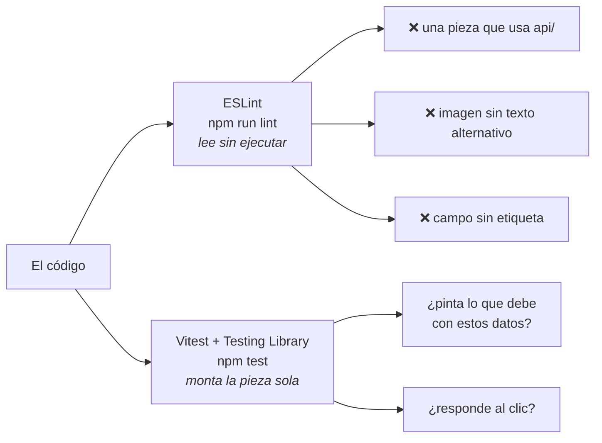

**ESLint, el revisor.** Como un corrector ortográfico que además conoce las reglas del proyecto. Las dos que
importan: la frontera de la sección 5 y las de accesibilidad de Vue. **Lo que no caza:** un botón sin nombre (el
paquete no tiene esa regla). Lo caza axe en los escenarios (sección 13).

**Vitest, las pruebas de piezas.** Es el nivel 1 de la pirámide de la web: rápido y sin nada encendido.

- **jsdom** hace de navegador de mentira: tiene página, pero no pantalla.
- **Testing Library** busca las cosas **como lo haría una persona**: «el botón que dice *Dar de alta*», no «el
  elemento con la clase `btn-primary`». Si una prueba no encuentra el botón por su papel y su nombre, un lector
  de pantalla tampoco lo encontraría: la prueba comprueba de paso la accesibilidad.
- **`test-setup.ts`** prepara cada prueba: vacía la página al terminar y añade un `matchMedia` mínimo, porque
  jsdom no lo trae y PrimeVue lo usa.

Hoy hay **4 pruebas**: las tres reglas de la conexión y el calendario en español.

> **«Una prueba que falla porque no encuentra el fichero no es un rojo».** El plan lo exige así (§2.3): primero
> un **esqueleto que existe pero hace mal a propósito**, para ver fallar la prueba **por lo que comprueba**. Si
> no, solo has demostrado que el fichero no estaba.

---

## Parte III · El arnés de los escenarios (R0.8 a R0.13)

### 10. Por qué hubo que tocar el servidor (R0.8)

> **En dos líneas:** la dirección de la RFFM estaba escrita fija en el servidor. Ahora se lee de la variable
> `RFFM_BASE_URL`; sin ella, sigue siendo la de verdad.

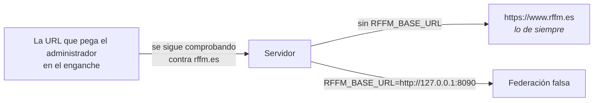

Sin este cambio, los escenarios dependerían de internet y de los datos del día de la RFFM: una prueba que hoy
pasa y mañana no, sin que nadie haya tocado nada. **Solo cambia adónde se piden los datos.** La URL que pega el
administrador sigue siendo de la RFFM real, y se sigue rechazando la que no lo es.

Se hizo con el método del backend: cuatro ciclos con su rojo y **10 de 10 mutaciones cazadas** (la herramienta
rompe cada línea nueva a propósito y exige que alguna prueba lo note).

> **El hueco que apareció después:** `seed-competition` se montaba su propio acceso a la RFFM y no se enteraba
> de la variable. En `R0.8` se buscó quién **usaba** las direcciones, no quién **creaba** el acceso. Se arregló
> en `R0.10`, con su prueba. **Buscar lo que se usa no es lo mismo que buscar lo que se crea.**

### 11. La federación falsa (R0.10)

> **En dos líneas:** un servidor pequeño que contesta lo mismo que contestó la RFFM el día que se grabó.
> Va **detrás** de nuestro servidor, así que no es un simulacro de nada nuestro.

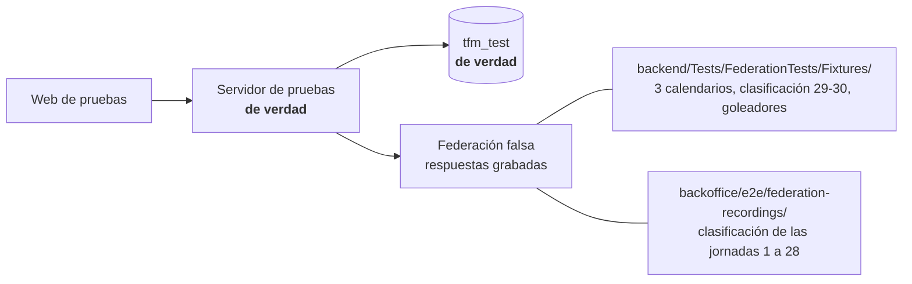

**Respuesta grabada** (*fixture*): una copia exacta de lo que respondió la RFFM a una pregunta concreta. En la
mayoría, la primera línea es la dirección que se pidió y debajo va la respuesta tal cual.

**¿Simulacro o no?** El ADR prohíbe simular **el servidor** en los escenarios. La federación falsa no lo
hace:

| | Simulacro del servidor (prohibido) | Federación falsa (permitida) |
|---|---|---|
| ¿Qué sustituye? | Nuestro servidor | Un sistema de **fuera**, la RFFM |
| ¿Dónde se pone? | Delante del servidor: la web nunca le habla | **Detrás**: el servidor funciona entero |
| ¿Qué se queda sin probar? | El servidor y la base | Solo la RFFM, que no es nuestra |

Las pruebas del backend hacen lo mismo: nunca llaman a la federación de verdad. Por qué es así, en
[DW-14](../Backoffice%20LLD-Anexo-Decisiones-Disenho-001.md).

**Lo que no tiene grabado, lo contesta como la RFFM cuando algo no existe:** con un `200` y `null` (la
clasificación y los goleadores), o con el calendario vacío. Así la ingesta ve lo mismo que vería en
producción. **La RFFM nunca contesta 404**, ni siquiera para algo que no existe: es una de esas costumbres de
terceros que hay que medir, no suponer.

> **Comprobado sin internet:** con la federación falsa, la ingesta trae 240 partidos, 480 filas de
> clasificación (16 equipos × 30 jornadas) y 218 goleadores, con sus 32 pasadas en verde.

### 12. Lo que hace `npm run e2e`, en orden (R0.9 y R0.11)

> **En dos líneas:** compila el servidor, prepara la base, barre restos, arranca tres piezas y abre el
> navegador. Si algo no arranca, falla enseguida diciendo qué, y para lo que ya estaba en marcha.

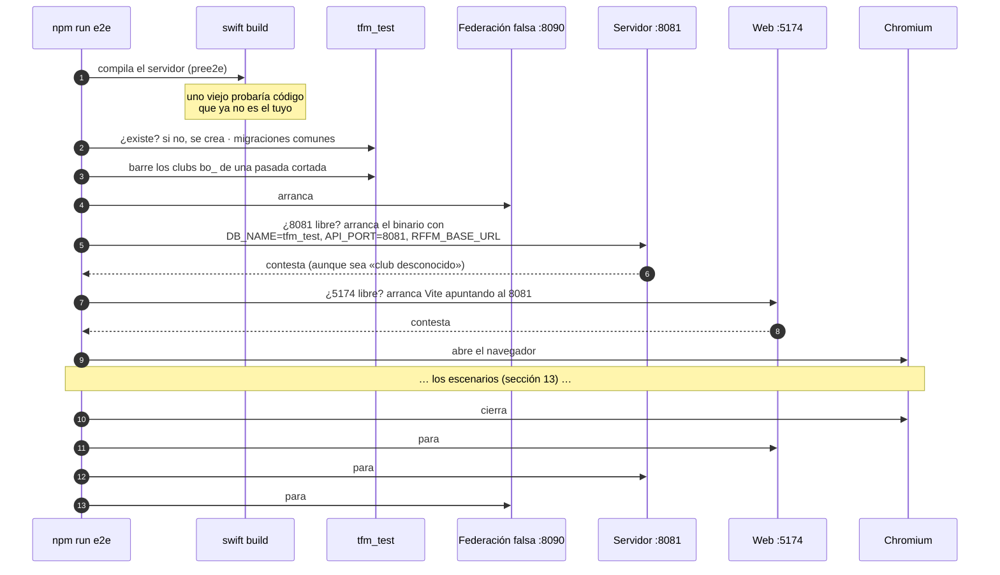

**De `npm run e2e` al guion.** En `package.json` no hay un script que diga «primero arranca esto, luego esto
otro». `npm run e2e` solo enciende la mecha: Cucumber carga los ficheros que le dice su configuración, apunta
qué hacer en cada momento y luego lo ejecuta en su orden.

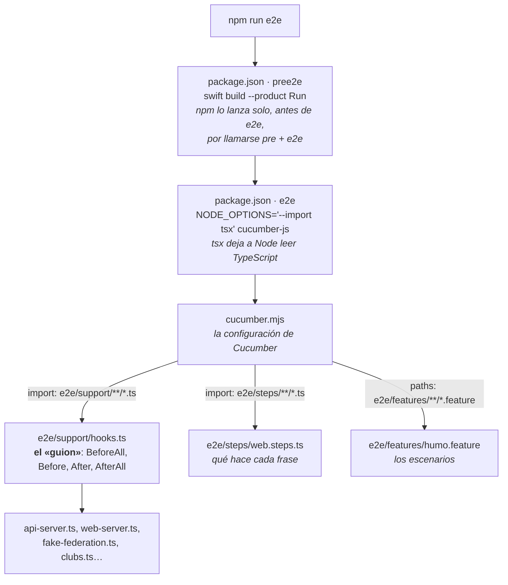

Dónde está cada cosa, dentro de `backoffice/`:

| Fichero | Qué hace |
|---|---|
| `package.json` · `pree2e` | Compila el servidor. npm la lanza sola antes de `e2e`: cualquier orden que se llame `pre` + el nombre de otra va delante de ella |
| `package.json` · `e2e` | Lanza Cucumber, con `tsx` para que Node entienda TypeScript |
| `cucumber.mjs` | La configuración de Cucumber: qué escenarios leer (`paths`) y qué código cargar (`import`) |
| `e2e/support/hooks.ts` | **El guion**: qué pasa antes de todos (`BeforeAll`), antes y después de cada escenario (`Before`, `After`) y al final (`AfterAll`) |
| `e2e/support/config.ts` | Los puertos, la base y dónde están el servidor compilado y las respuestas grabadas |
| `e2e/support/processes.ts` | Lo común: ¿está libre el puerto?, arrancar dejando lo que escribe en un fichero, esperar a que conteste |
| `e2e/support/test-database.ts` | Crea `tfm_test` si no existe y le pasa las migraciones |
| `e2e/support/sweep.ts` | El barrido: borra los clubs `bo_` |
| `e2e/support/fake-federation.ts` | La federación falsa |
| `e2e/support/api-server.ts` / `web-server.ts` | El servidor y la web de pruebas |
| `e2e/support/clubs.ts` | Crea y borra el club de cada escenario (sección 13) |
| `e2e/support/world.ts` | Lo que tiene cada escenario: su pestaña y su club |
| `e2e/support/accessibility.ts` | axe en los dos modos (sección 13) |
| `e2e/steps/web.steps.ts` | Qué hace cada frase de los escenarios en el navegador |
| `e2e/features/humo.feature` | Los escenarios, escritos como los contaría un usuario |

**«Falla enseguida diciendo cuál».** Con el 8081 ocupado, la pasada termina en 2 segundos con:

```
El servidor de pruebas (8081): el puerto 8081 está ocupado. ¿Quedó en marcha de una pasada anterior?
Para ver quién lo usa: lsof -i :8081
```

Es la lección H-07 del backend: **una prueba que no pudo arrancar tiene que fallar, nunca saltarse.** Un verde
que significa «no se probó nada» es peor que un rojo.

### 13. La vida de un escenario (R0.12 y R0.13)

> **En dos líneas:** cada escenario tiene su club recién creado, su pestaña limpia y sus pasos. Al final, axe
> revisa la accesibilidad en los dos modos, y el club se borra.

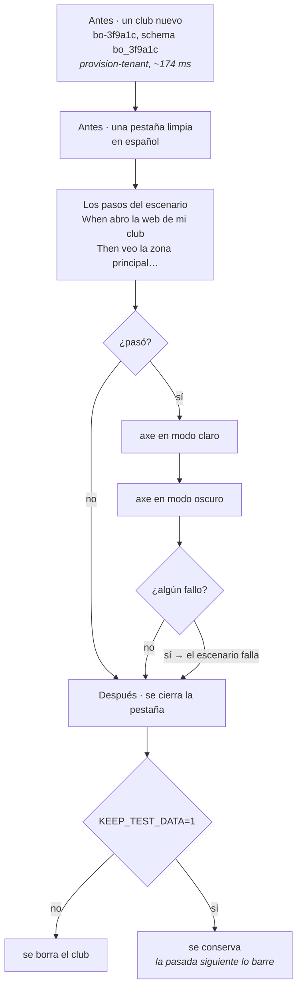

**Un club por escenario** ([DW-13](../Backoffice%20LLD-Anexo-Decisiones-Disenho-001.md)): así ninguno ve lo que
dejó otro. Comprobado con un escenario que renombró su club y cinco siguientes que no vieron el cambio. **El
prefijo `bo_`** no es casual: las pruebas del backend barren `e2e_` y `test_`, y cada barrido solo toca lo suyo.

**Cómo se escriben los pasos** (LLD-B §11.4):

- **Como hablaría el usuario**: «doy de alta el equipo "Cadete B"», no «relleno el campo `name`».
- **Se buscan las cosas por lo que son**: un botón, un título, un campo con su etiqueta.
- **Un `Given` solo prepara y un `Then` solo comprueba.**

```gherkin
Feature: La web arranca

  Scenario: La portada se abre en español
    When abro la web de mi club
    Then veo la zona principal de la página
    And la página está en español
```

**axe en los dos modos** (LLD-B §9.4). axe es un analizador de accesibilidad: recorre la página y la compara con
las reglas de WCAG 2.2, nivel AA. Se pasa **dos veces**, cambiando el modo con la clase `app-dark` sin
recargar, porque **un color que se lee bien sobre blanco puede no leerse sobre negro**. Comprobado así:

| Lo que se metió en la página | Modo claro | Modo oscuro |
|---|---|---|
| Imagen sin texto alternativo | ❌ `image-alt` | ❌ `image-alt` |
| Botón sin nombre | ❌ `button-name` | ❌ `button-name` |
| Texto gris oscuro `#444` | ✅ se lee | ❌ `color-contrast` |

**Lo que axe no cubre**, para no confiarse: moverse con el teclado, el orden en que lo lee un lector de pantalla
y si los textos tienen sentido. Eso va en la revisión a mano de cada rebanada.

### 14. Cómo leer un fallo

> **En dos líneas:** hay tres tipos de fallo, y cada uno se ve distinto. Lo que escribe cada pieza queda en
> `backoffice/e2e-results/`.

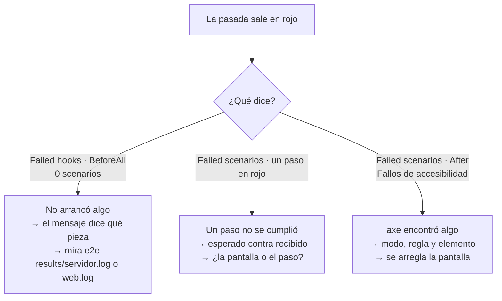

| Tipo | Cómo se ve | Dónde mirar |
|---|---|---|
| **No arrancó** | `Failed hooks: BeforeAll`, con el nombre de la pieza y el motivo. Cucumber cuenta **0 scenarios**, pero la pasada sale en **rojo** | `e2e-results/servidor.log`, `e2e-results/web.log` |
| **Un paso falló** | `Failed scenarios`, el paso en rojo, lo esperado y lo recibido | El escenario, y si hace falta `KEEP_TEST_DATA=1` para mirar los datos en TablePlus |
| **Accesibilidad** | `Failed scenarios`, el `After` en rojo y `Fallos de accesibilidad (axe, WCAG 2.2 AA)`, con `[modo claro]` u `[modo oscuro]`, la regla y el elemento | La pantalla, en el modo que diga |

> Ojo con **0 scenarios**: suena a «no había nada que probar», pero aquí significa «no se pudo probar nada». Lo
> que manda es el código de salida, que es de fallo.

---

## Parte IV · Para no perderse

### 15. Lo que aprendimos montándolo

> **En dos líneas:** casi ningún problema vino de nuestro código: vino de lo que se suponía y no se había
> medido. Cada uno, con su porqué.

| Qué pasó | Por qué | La lección |
|---|---|---|
| Una comprobación salió bien… con el servidor viejo | Los escenarios usan el servidor **ya compilado**, y estaba compilado sin el último arreglo. Se notó porque la federación falsa contó una petición en vez de dos | Por eso `npm run e2e` compila antes de empezar. **Una prueba vale lo que vale el código que ejecuta** |
| La web de pruebas «no contestaba» | Vite, con `localhost`, escuchaba en la dirección nueva (IPv6, `::1`) y la espera preguntaba en la de siempre (IPv4, `127.0.0.1`) | Se escribe `127.0.0.1` y no `localhost` en todo el arnés. **`localhost` no es una sola dirección** |
| Las pruebas del backend fallaban a veces con *«too many clients»* | Las suites corren a la vez y cada una abre sus conexiones: unas 90, más las tuyas, contra un límite de 100 | Se limitaron a 4 a la vez: pico de 36. **Un rojo que se arregla repitiendo enseña a no fiarse de los rojos** |
| La RFFM contestó `null` a unos goleadores durante unos minutos | Es así: a veces responde vacío y luego no (H-61). Pasó también al grabar 5 de las 28 jornadas | Se comprobó con la web de la RFFM y se volvió a pedir. **De un sistema de terceros se desconfía y se mide** |
| `seed-competition` iba a la RFFM real con la variable puesta | Se montaba su propio acceso en vez de pedirlo al sitio común | **Buscar lo que se usa no es buscar lo que se crea** |
| TypeScript 6 y PrimeVue 5 no entraron | La primera no encajaba con otra herramienta; la segunda cambió de licencia | Versiones **fijadas** y con su porqué escrito |
| La web del 5173 iba al 8080 y el servidor estaba en el 8765 | El 8080 era el valor por defecto, y el puerto real no estaba escrito en ningún sitio que la web leyera | El puerto va en `backend/.env.development`, que leen los dos. **Dos piezas que tienen que estar de acuerdo leen el mismo dato, no cada una el suyo** |
| Testing Library no reconocía algunos papeles | Traía una versión vieja de su parte común | Se le obligó a usar la 10.4 ([DW-15](../Backoffice%20LLD-Anexo-Decisiones-Disenho-001.md)) |

### 16. Glosario

En el orden en que aparecen:

| Palabra | Qué significa aquí |
|---|---|
| **Rebanada** | Una pantalla con todo lo que necesita, terminada de punta a punta |
| **Arnés** | Lo que rodea a una prueba para poder ejecutarla: arrancar, preparar, limpiar |
| **Puerto** | La «puerta» de un programa dentro de tu Mac: 5173, 8765… |
| **API** | Las direcciones que ofrece el servidor para pedir o cambiar datos (`/v1/club`) |
| **Catálogo** (OpenAPI) | La descripción escrita de toda la API: el contrato entre servidor y web |
| **Tipos** | La forma que tiene que tener cada dato; TypeScript los comprueba |
| **Recepcionista** (*proxy*) | Vite pasando al servidor lo que empieza por `/api`, sin el `/api` |
| **CORS** | La norma del navegador contra pedir datos a otra dirección |
| **Pieza** (componente) | Un trozo de pantalla que pinta lo que le dan |
| **Revisor de código** (*linter*) | ESLint: lee el código y avisa, sin ejecutarlo |
| **Prueba de piezas** | Vitest: una pieza montada sola, sin servidor |
| **jsdom** | Un navegador de mentira, sin pantalla, para las pruebas de piezas |
| ***Schema*** | Un «cajón» dentro de la base: uno por club |
| **Migración** | Un paso que crea o cambia tablas, y que se aplica una sola vez |
| **Ingesta** | La pasada que trae los datos de la federación |
| **Respuesta grabada** (*fixture*) | Copia exacta de lo que contestó la RFFM un día concreto |
| **Doble** | Algo que hace de otra cosa en una prueba: un `fetch` de mentira, un reloj de mentira |
| **Escenario** | Una prueba escrita como la contaría un usuario: `Given` / `When` / `Then` |
| **Cucumber** | Quien lee los escenarios y ejecuta sus pasos |
| **Playwright** | Quien maneja el navegador de los escenarios |
| **axe** | El analizador de accesibilidad |
| **WCAG 2.2 AA** | El nivel de accesibilidad que se exige |
| **Mutación** | Romper una línea a propósito para ver si alguna prueba lo caza |
| **Rojo de aserción** | Una prueba que falla **por lo que comprueba**, no porque falte algo |

### 17. Chuleta de órdenes

Todas dentro de `backoffice/`, salvo que se diga otra cosa.

| Para ver… | Orden |
|---|---|
| La web, con tus datos | `npm run dev` (y en otra terminal, en `backend/`: `swift run Run serve`) |
| En qué puerto está tu servidor | `cat ../backend/.env.development` |
| Que la web habla con el servidor | `curl -s http://celtic-castilla.localhost:5173/api/v1/club` |
| Las pruebas de piezas | `npm test` |
| Que los tipos encajan con el catálogo | `npm run typecheck` |
| El revisor de código | `npm run lint` |
| Los escenarios | `npm run e2e` (la primera vez, antes: `npx playwright install chromium`) |
| Los clubs de los escenarios, en TablePlus | `KEEP_TEST_DATA=1 npm run e2e` y abrir la base `tfm_test` |
| Qué escribió cada pieza de las pruebas | `e2e-results/servidor.log`, `e2e-results/web.log` |
| Quién ocupa un puerto | `lsof -i :8081` |
| Las pruebas del backend (en `backend/`) | `REQUIRE_DB=1 swift test` |
